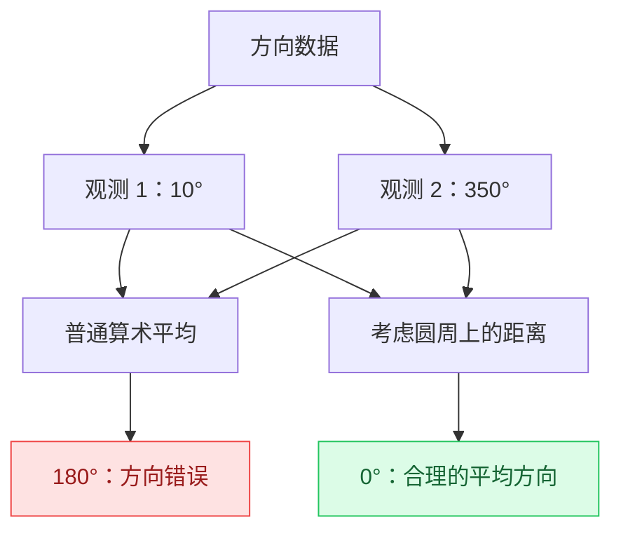
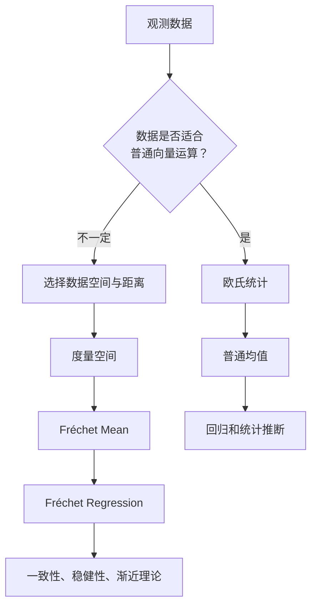
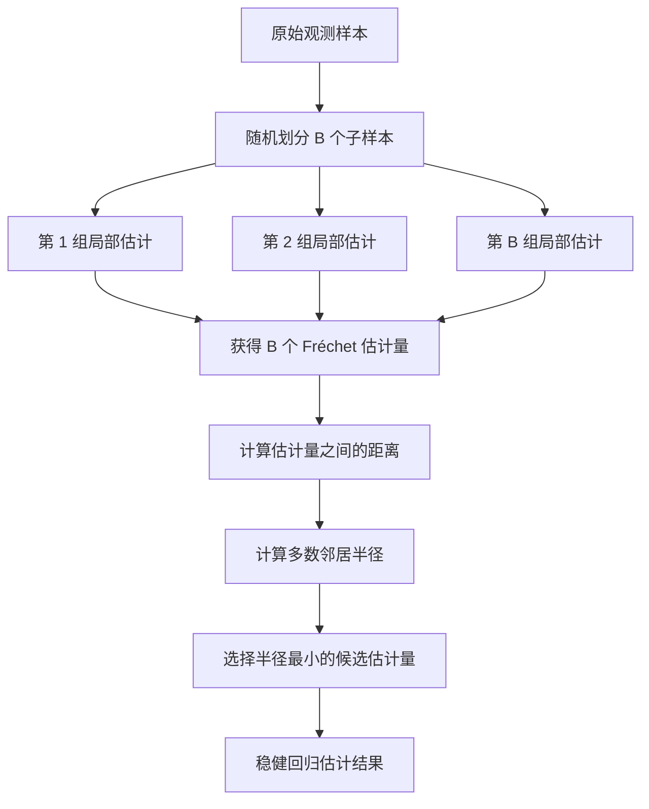

# 第 001 期｜从度量空间到稳健 Fréchet 回归

> Non-Euclidean Statistics · Learning & Research Notes

**日期：** 2026-11-16  
**主题：** Metric Spaces & Robust Fréchet Regression  
**关键词：** 度量空间、Fréchet Mean、稳健统计、非参数回归、Minimax Theory

---

## 本期导读

本期包括四个部分：

1. 基础知识：什么是非欧统计？为什么需要度量空间？
2. 前沿研究：六篇值得关注的研究论文
3. 核心精读：Robust Local Fréchet Regression
4. 总结：知识联系与后续研究问题

---

# A. 基础知识：非欧统计学从哪里开始？

## A.1 为什么普通统计方法不总是适用？

考虑两个方向观测：

- 第一个方向：10°
- 第二个方向：350°

如果直接使用算术平均：

```math
\bar{\theta}
=
\frac{10^\circ+350^\circ}{2}
=
180^\circ
```

但实际上，两个方向都靠近正北方，平均方向应该是 0°。

原因是方向数据位于圆周上，而不是普通实数轴上。

### 图 1：为什么圆周数据不能直接求算术平均？



**核心原因：** 0° 和 360° 在圆周上表示同一个方向，但在普通实数轴上是不同数值。

对于圆周数据，可以定义角度之间的最短弧距离：

```math
d_{S^1}(\theta,\phi)
=
\min_{k\in\mathbb Z}
\left|
\theta-\phi+360^\circ k
\right|
```

这里使用角度制。

该距离考虑了圆周的周期性结构。

因此：

```math
d_{S^1}(10^\circ,350^\circ)=20^\circ
```

而普通实数距离会给出 340°。

这说明：**距离的选择决定了我们如何理解数据之间的差异。**

---

## A.2 欧氏空间与非欧空间

传统统计学中，数据通常被表示为：

```math
X\in\mathbb R^p
```

常见欧氏距离为：

```math
d_E(x,y)
=
\sqrt{\sum_{j=1}^{p}(x_j-y_j)^2}
```

但许多现代数据并不适合直接使用这种结构。

| 数据对象 | 自然空间 | 典型统计问题 |
|---|---|---|
| 方向和角度 | 圆周 $S^1$ | 方向均值 |
| 地球表面位置 | 球面 $S^2$ | 测地回归 |
| 协方差矩阵 | SPD 矩阵空间 | 矩阵均值与回归 |
| 概率分布 | Wasserstein 空间 | 分布回归与重心 |
| 图和网络 | 图空间 | 网络比较与推断 |
| 系统发育树 | 树空间 | 树均值与变异分析 |

这些对象通常具有特殊的几何结构。

需要注意：并非所有非欧数据都必须属于光滑流形。一般度量空间可以包含离散对象、树、图等。

---

## A.3 度量空间（Metric Space）

一个度量空间定义为：

```math
(\Omega,d)
```

其中：

- $\Omega$ 是数据对象的集合；
- $d:\Omega\times\Omega\to[0,\infty)$ 是距离函数。

度量需要满足：

**非负性与同一性**

```math
d(x,y)\geq 0,
\qquad
d(x,y)=0\iff x=y
```

**对称性**

```math
d(x,y)=d(y,x)
```

**三角不等式**

```math
d(x,z)\leq d(x,y)+d(y,z)
```

度量空间提供了一种分析复杂数据的通用语言。

它不要求对象能够进行向量加法，但允许我们讨论距离、收敛以及许多统计估计问题。

---

## A.4 Fréchet Mean：如何推广均值？

普通欧氏样本均值可以表示为：

```math
\bar X
=
\operatorname*{arg\,min}_{\mu\in\mathbb R^p}
\sum_{i=1}^{n}\|X_i-\mu\|^2
```

这个表达启发了 Fréchet mean。

对于度量空间 $(\Omega,d)$，定义：

```math
\boxed{
\hat{\mu}_F
\in
\operatorname*{arg\,min}_{\omega\in\Omega}
\frac{1}{n}
\sum_{i=1}^{n}d^2(Y_i,\omega)
}
```

直观理解：

> 寻找一个对象，使它到所有样本对象的平方距离总和最小。

当 $\Omega=\mathbb R^p$，距离为欧氏距离时，Fréchet mean 与普通样本均值一致。

但在一般度量空间中：

- Fréchet mean 不一定存在；
- Fréchet mean 不一定唯一；
- 最优化问题可能不是凸的；
- 估计量的收敛性质取决于空间几何。

这也是非欧统计学理论研究的重要内容。

### 图 2：从普通统计到非欧统计



---

# B. 今日前沿研究雷达

本期收录六项 2026 年研究成果。

以下成果以 arXiv 预印本为主，正式发表状态与同行评审情况应以最新版本为准。

## B.1 Local Fréchet Regression with Polyspherical Predictors

**作者：** Chang Jun Im  
**首次提交：** 2026-11-09  
**链接：** https://arxiv.org/abs/2611.13240

### 研究问题

当解释变量位于多个球面构成的乘积空间中，如何构造有效的非参数回归估计器？

### 核心方法

论文研究：

- Local constant Fréchet regression
- Local linear Fréchet regression
- Factor-specific bandwidth selection
- 基于交叉拟合预测风险的变量选择

### 核心贡献

建立统一收敛速率与变量选择一致性结果。

**值得关注：** 将几何结构下的局部回归与高维变量选择联系起来。

---

## B.2 Principal Manifold Estimation with Riemannian Templates

**作者：** Kun Meng, Christopher Perez  
**首次提交：** 2026-04-05  
**更新：** 2026-11-08  
**链接：** https://arxiv.org/abs/2604.04272

### 研究问题

高维数据可能集中在潜在低维流形附近，如何估计这个流形？

### 核心贡献

建立允许非欧拓扑结构的主流形估计框架，并研究：

- 数学上的良定义性；
- 计算算法的收敛性；
- 有限样本估计的一致性；
- 与贝叶斯方法的联系。

**值得关注：** 将低维几何结构恢复与正式统计估计理论结合。

---

## B.3 Robust Local Fréchet Regression

**完整标题：**

Robust Local Fréchet Regression: Nonasymptotic Theory and Minimax Optimality

**作者：** Chang Jun Im, Daisuke Kurisu  
**日期：** 2026-10-16  
**链接：** https://arxiv.org/abs/2610.23757

### 核心问题

当响应变量位于一般度量空间，并且数据具有重尾性质时，如何进行稳健的非参数回归？

### 创新点

- 构造 distance-based median-of-means 估计器；
- 建立非渐近高概率误差界；
- 证明相应的逐点 minimax lower bounds；
- 在特定几何条件下避免对响应空间施加熵条件。

**本期重点精读。**

---

## B.4 Online Covariance Estimation on Riemannian Manifolds

**完整标题：**

Online Covariance Estimation for Averaged Stochastic Gradient Descent on Riemannian Manifolds

**作者：** Jingrong Guan, Liwei Jiang, Sen Na  
**日期：** 2026-10-24  
**链接：** https://arxiv.org/abs/2610.33419

### 研究问题

对于黎曼流形上的随机梯度下降，如何估计渐近协方差并进行统计推断？

### 核心贡献

通过向量传输，整合不同切空间中的梯度信息，构造在线协方差估计器。

**值得关注：** 将非欧优化与渐近正态性、协方差估计和统计推断连接起来。

---

## B.5 Wasserstein Barycenter Under Sparse Sampling

**完整标题：**

Estimating the Wasserstein Barycenter of One-Dimensional Distributions Under Sparse Sampling

**作者：** James Peng, Florian Stijven, Linbo Wang, Peter B. Gilbert  
**日期：** 2026-06-08  
**链接：** https://arxiv.org/abs/2606.10096

### 研究问题

当每个研究对象的概率分布只能通过极少数样本观测时，如何估计 Wasserstein barycenter？

### 核心贡献

提出 marginal-constructed barycenter 估计器，并研究其一致性和渐近正态性。

**值得关注：** 把稀疏采样问题与分布值数据、最优传输统计联系起来。

---

## B.6 Inference for Fréchet Regression

**作者：** Wookyeong Song, Paromita Dubey, Hans-Georg Müller, Alexander Petersen  
**日期：** 2026-05-19  
**链接：** https://arxiv.org/abs/2605.19519

### 研究问题

如何检验 Fréchet 回归中的解释变量是否具有统计显著性？

### 核心贡献

提出整体回归效应和部分解释变量效应的统计检验方法。

其中涉及随机乘子和 Cauchy combination 等工具。

**值得关注：** 将 Fréchet 回归从估计与预测推进到正式统计推断。

---

# C. 重点精读：Robust Local Fréchet Regression

**论文：** Im & Kurisu (2026)  
**原文：** https://arxiv.org/abs/2610.23757

## C.1 研究动机

假设：

```math
X\in\mathbb R^d,
\qquad
Y\in(\mathcal Y,d_{\mathcal Y})
```

研究目标是条件 Fréchet mean：

```math
\boxed{
m_\oplus(x)
\in
\operatorname*{arg\,min}_{\omega\in\mathcal Y}
\mathbb E[
d_{\mathcal Y}^2(Y,\omega)
\mid X=x
]
}
```

经典局部 Fréchet 回归估计器为：

```math
\hat m_h(x)
\in
\operatorname*{arg\,min}_{\omega\in\mathcal Y}
\sum_{i=1}^{n}
K_h(X_i,x)d_{\mathcal Y}^2(Y_i,\omega)
```

其中 $K_h$ 是核权重。

问题在于，平方距离对远离中心的观测比较敏感。

当条件响应分布具有重尾性质时，普通局部估计可能出现较大的随机误差。

作者希望在有限二阶矩条件下构造具有高概率误差保证的稳健估计器。

---

## C.2 核心方法：Median-of-Means

方法包含三个步骤。

### Step 1：样本分组

将样本划分成 $B$ 个互不重叠的分组：

```math
I_1,\ldots,I_B
```

### Step 2：计算每组的 Fréchet 回归估计量

```math
\hat m_{h,b}(x)
\in
\operatorname*{arg\,min}_{\omega\in\mathcal Y}
\sum_{i\in I_b}
K_h(X_i,x)d_{\mathcal Y}^2(Y_i,\omega)
```

### Step 3：基于距离进行稳健聚合

对每个候选估计量 $\hat m_{h,b}$，计算包含严格超过一半候选估计量的最小半径：

```math
r_b=
\inf\left\{
r\geq0:
\sum_{\ell=1}^{B}
\mathbf 1\left[
d_{\mathcal Y}(\hat m_{h,b},\hat m_{h,\ell})
\leq r
\right]>\frac B2
\right\}
```

选择：

```math
\hat b\in\operatorname*{arg\,min}_{b}r_b
```

最终估计器为：

```math
\boxed{
\hat m_{h,B}^{RLFR}(x)=\hat m_{h,\hat b}(x)
}
```

算法不要求对所有候选估计量进行向量求和。

### 图 3：稳健局部 Fréchet 回归算法



### 方法直觉

只要超过一半的分组估计结果足够接近真实目标，那么最终选出的候选估计量也会保持在真实目标附近。

这种多数聚合机制有助于减少极端分组估计结果的影响。

---

## C.3 主要理论结果

论文在相应几何条件、光滑性条件和有限二阶矩条件下，证明局部稳健估计的非渐近高概率误差界。

对于局部二阶光滑情形，主要误差结构为：

```math
\boxed{
d_{\mathcal Y}
\left(
\hat m_{h,B}^{RLFR}(x_0),
m_\oplus(x_0)
\right)
\lesssim
h^2+
\sigma
\sqrt{
\frac{\log(1/\delta)}
{nh^d f_X(x_0)}
}
}
```

该界在论文规定条件下，以至少 $1-\delta$ 的概率成立。

其中：

- $h^2$ 表示平滑偏差的主要量级；
- $nh^d f_X(x_0)$ 对应局部有效样本量的尺度；
- $\sigma$ 控制局部二阶矩；
- $\delta$ 表示容许的失败概率。

通过平衡偏差与随机误差，固定置信水平下可得到：

```math
\boxed{
n^{-2/(d+4)}
}
```

的逐点收敛速率。

对于满足 Wasserstein Hölder 连续性条件的模型，若：

```math
W_1(P_x,P_{x_0})
\leq
L_W\|x-x_0\|^\beta
```

则相应逐点速率为：

```math
\boxed{
n^{-\beta/(2\beta+d)}
}
```

其中 $P_x$ 是 $Y\mid X=x$ 的条件分布。

作者还在相关模型类中建立 matching minimax lower bounds。

### 统计学意义

这些结果说明，在一定几何及正则条件下，即使响应变量属于非欧度量空间，而且仅具有局部有限二阶矩，仍然可以获得与经典非参数回归相匹配的逐点收敛速率。

---

## C.4 方法的贡献与局限

### 主要贡献

1. 将距离型 Median-of-Means 方法用于局部 Fréchet 回归。
2. 在重尾条件下建立非渐近高概率保证。
3. 通过不等权 Fréchet 估计稳定性分析，减少对传统熵条件的依赖。
4. 证明相应逐点估计速率的 minimax 最优性。

### 主要局限

1. 仍要求一定的几何条件，例如二次增长和四点不等式。
2. 主要研究逐点误差，不直接提供统一置信带。
3. 分组数量与估计效率之间存在权衡。
4. 理论带宽和实际数据驱动选择之间仍存在进一步研究空间。

---

## C.5 值得进一步探索的问题

### 方向一：统一收敛

能否证明：

```math
\sup_{x\in\mathcal X}
d_{\mathcal Y}
\left(
\hat m^{RLFR}(x),
m_\oplus(x)
\right)
```

的高概率收敛界？

### 方向二：自适应稳健回归

能否在未知局部光滑性、噪声规模和尾部性质的条件下，同时自适应选择带宽 $h$ 与分组数 $B$？

### 方向三：更一般的几何结构

当 Fréchet mean 不唯一或风险函数不满足二次增长条件时，是否还能建立稳健估计与 minimax 理论？

以上为基于论文提出的延伸研究问题，并非论文已证明的结果。

---

# D. 今日总结

## D.1 三个重要收获

**第一：** 非欧统计研究的核心之一是尊重数据空间的几何结构。

**第二：** Fréchet mean 为一般度量空间中的均值和回归提供了自然的推广方式。

**第三：** 稳健局部 Fréchet 回归展示了几何结构、估计稳定性和高概率统计理论之间的联系。

## D.2 自测题

给定三个实数观测：

```math
1,\quad3,\quad5
```

求它们在普通欧氏距离下的 Fréchet mean。

**答案：**

```math
\hat\mu_F
=
\operatorname*{arg\,min}_{\mu\in\mathbb R}
\left[
(1-\mu)^2+(3-\mu)^2+(5-\mu)^2
\right]
=3
```

## D.3 下一期预告

**第 002 期：距离、测地线与统计均值**

预计学习：

- 欧氏距离与测地距离
- 圆周和球面上的最短路径
- 度量选择如何影响 Fréchet mean
- 新的非欧统计前沿研究

---

# 参考文献

## 核心基础文献

Petersen, A., & Müller, H.-G. (2019).

*Fréchet Regression for Random Objects with Euclidean Predictors.*

The Annals of Statistics, 47(2), 691–719.

DOI: https://doi.org/10.1214/17-AOS1624

## 本期精读文献

Im, C. J., & Kurisu, D. (2026).

*Robust Local Fréchet Regression: Nonasymptotic Theory and Minimax Optimality.*

arXiv:2610.23757

https://arxiv.org/abs/2610.23757

## 其他前沿文献

1. Im, C. J. (2026). *Local Fréchet Regression with Polyspherical Predictors: Uniform Convergence Rates and Factor Selection.*  
   https://arxiv.org/abs/2611.13240

2. Meng, K., & Perez, C. (2026). *Principal Manifold Estimation with Riemannian Templates.*  
   https://arxiv.org/abs/2604.04272

3. Guan, J., Jiang, L., & Na, S. (2026). *Online Covariance Estimation for Averaged Stochastic Gradient Descent on Riemannian Manifolds.*  
   https://arxiv.org/abs/2610.33419

4. Peng, J., Stijven, F., Wang, L., & Gilbert, P. B. (2026). *Estimating the Wasserstein Barycenter of One-Dimensional Distributions Under Sparse Sampling.*  
   https://arxiv.org/abs/2606.10096

5. Song, W., Dubey, P., Müller, H.-G., & Petersen, A. (2026). *Inference for Fréchet Regression.*  
   https://arxiv.org/abs/2605.19519

---

**Non-Euclidean Statistics Learning Notes · Issue 001**

*学习笔记仅用于研究与教学交流。论文结论以原始文献及其适用条件为准。*
