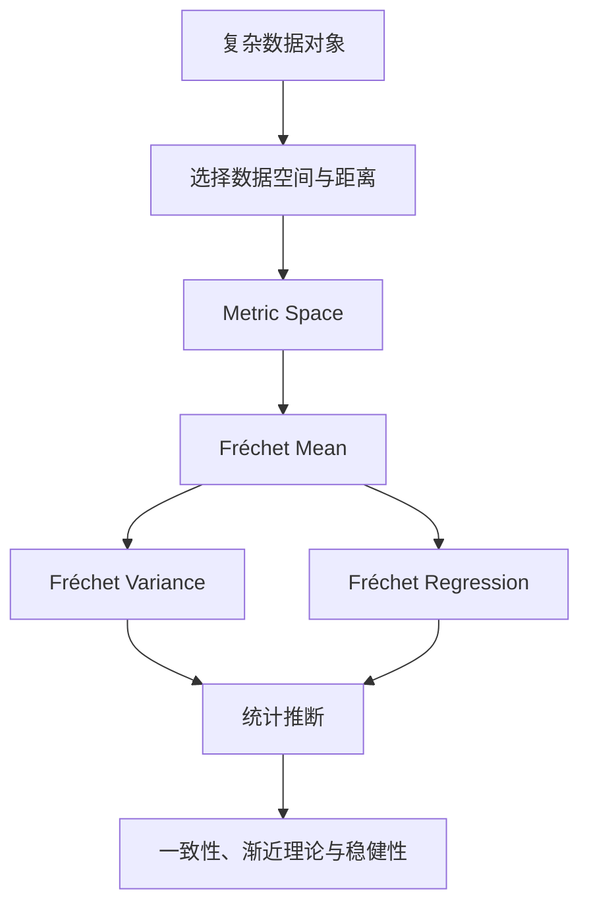
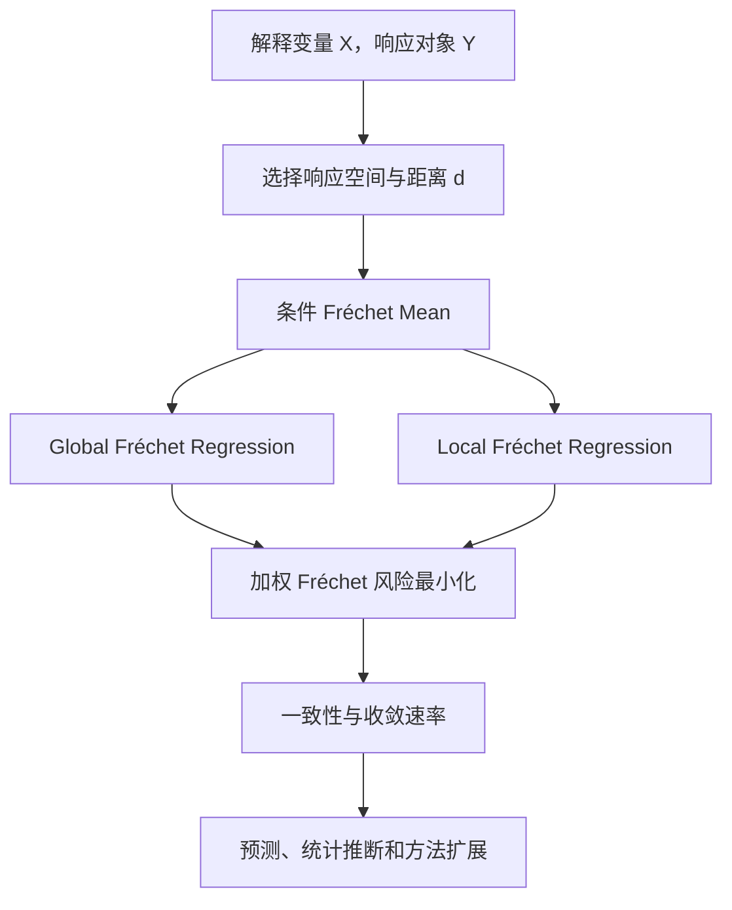

# 第 001 期｜从度量空间到 Fréchet 均值与回归

> Non-Euclidean Statistics · Learning & Research Notes

**日期：** 2026-11-16  
**主题：** Metric Spaces, Fréchet Means & Regression

**关键词：** Metric Space、Fréchet Mean、Object Data Analysis、Global Fréchet Regression、Robust Estimation

---

## 本期导读

非欧统计学研究的对象并不一定是普通实数或欧氏向量。现代统计数据还可能包括方向、概率分布、协方差矩阵、图、树和形状。

本期从一个简单的平均数问题出发，介绍度量空间与 Fréchet mean，并通过高质量研究论文理解这些基本概念如何扩展为现代统计方法。

本期包括：

- **A. 基础知识：** 欧氏与非欧数据、度量空间、Fréchet mean。
- **B. 研究前沿：** 四项正式发表或经过作者背景核验的研究。
- **C. 核心精读：** Fréchet Regression for Random Objects with Euclidean Predictors。
- **D. 总结：** 核心收获、练习和下一期预告。

---

# A. 基础知识：非欧统计学从哪里开始？

## A.1 一个普通平均数无法解决的问题

假设我们观察到两个方向：

- 10°
- 350°

如果将其当作普通数值，算术平均为：

```math
\bar{\theta}
=
\frac{10^\circ+350^\circ}{2}
=
180^\circ
```

但两个方向实际上都接近 0°。

因此，180° 不是合理的平均方向。

问题在于：方向数据属于圆周，而不是普通实数轴。

在圆周上，0° 与 360° 表示同一个方向。

可以定义圆周上的最短弧距离：

```math
d_{S^1}(\theta,\phi)
=
\min_{k\in\mathbb Z}
|\theta-\phi+360^\circ k|
```

因此：

```math
d_{S^1}(10^\circ,350^\circ)=20^\circ
```

而普通实数距离给出 340°。

**关键结论：**

同一组数据，如果使用不同的距离结构，就可能得到不同的统计解释。

---

## A.2 欧氏空间与非欧数据

经典多元统计通常考虑：

```math
X\in\mathbb R^p
```

欧氏距离为：

```math
d_E(x,y)
=
\sqrt{
\sum_{j=1}^{p}(x_j-y_j)^2
}
```

在欧氏空间中，可以自然定义：

- 向量加法；
- 标量乘法；
- 线性组合；
- 内积；
- 欧氏均值。

但复杂数据可能具有不同的数学结构。

| 数据对象 | 自然空间或结构 | 统计问题 |
|---|---|---|
| 方向、角度 | 圆周 $S^1$ | 方向均值 |
| 地球表面位置 | 球面 $S^2$ | 测地均值 |
| 协方差矩阵 | SPD 矩阵空间 | 矩阵均值与回归 |
| 概率分布 | Wasserstein 空间 | 分布重心 |
| 系统发育树 | 树空间 | 树均值与变异 |
| 图、网络 | 图空间 | 网络比较与推断 |

这里需要强调：

**非欧数据不一定属于光滑流形。**

一般度量空间可以包含离散对象、树、图以及其他没有线性结构的复杂对象。

---

## A.3 度量空间（Metric Space）

一个度量空间表示为：

```math
(\Omega,d)
```

其中：

- $\Omega$ 是所有可能数据对象构成的集合；
- $d$ 是对象之间的距离函数。

距离函数必须满足三个条件。

### 非负性与同一性

```math
d(x,y)\geq0,
\qquad
d(x,y)=0\iff x=y
```

### 对称性

```math
d(x,y)=d(y,x)
```

### 三角不等式

```math
d(x,z)\leq d(x,y)+d(y,z)
```

度量空间不要求对象能够相加，但允许我们讨论：

- 距离；
- 收敛；
- 连续性；
- 最优化；
- 基于距离定义的统计泛函。

因此，它为非欧统计提供了一种非常通用的数学语言。

---

## A.4 从样本均值到 Fréchet Mean

考虑欧氏样本：

```math
X_1,\ldots,X_n\in\mathbb R^p
```

普通样本均值为：

```math
\bar X=\frac1n\sum_{i=1}^{n}X_i
```

它具有一个重要性质：

```math
\sum_{i=1}^{n}\|X_i-\bar X\|^2
=
\min_{\mu\in\mathbb R^p}
\sum_{i=1}^{n}\|X_i-\mu\|^2
```

也就是说，样本均值是使平方距离之和最小的点。

这个性质不依赖均值必须通过加法来定义。

因此，可以将它推广到度量空间。

### 样本 Fréchet Mean

设样本对象属于度量空间：

```math
Y_1,\ldots,Y_n\in\Omega
```

如果存在 $\hat\mu_F\in\Omega$，满足：

```math
\frac1n\sum_{i=1}^{n}d^2(Y_i,\hat\mu_F)
=
\min_{\omega\in\Omega}
\frac1n\sum_{i=1}^{n}d^2(Y_i,\omega)
```

则称 $\hat\mu_F$ 为一个样本 Fréchet mean。

### 总体 Fréchet Mean

对于随机对象 $Y$，定义 Fréchet 风险：

```math
F(\omega)=\mathbb E[d^2(Y,\omega)]
```

若存在 $\mu_F$，使：

```math
F(\mu_F)=\min_{\omega\in\Omega}F(\omega)
```

那么 $\mu_F$ 为总体 Fréchet mean。

注意：

- 最小值不一定存在；
- 最小化对象可能不唯一；
- 空间的几何结构会影响优化与估计性质。

---

## A.5 Fréchet Variance

如果总体 Fréchet mean 存在，可以定义 Fréchet variance：

```math
V_F=\mathbb E[d^2(Y,\mu_F)]
```

它是数据围绕 Fréchet mean 的平均平方距离。

在欧氏空间中，它与传统总方差相对应。

但在一般度量空间中，我们需要额外研究：

- Fréchet mean 的唯一性；
- 样本估计的一致性；
- Fréchet variance 的渐近分布；
- 不同群体之间的变异比较。

这些问题也是现代非欧统计推断的重要组成部分。

---

## A.6 从 Fréchet Mean 到统计方法

Fréchet mean 并不是研究的终点。

它还可以推广为：

- Fréchet regression；
- Fréchet analysis of variance；
- Fréchet change-point detection；
- Fréchet hypothesis testing；
- Robust Fréchet estimation。

### 图 1：非欧统计的基本研究路线



这条路线说明：

**从最基本的距离结构出发，可以建立完整的统计估计和推断理论。**

---

# B. 高质量研究精选

本期选择四项研究。

其中三项为正式发表的重要论文，一项为经过作者发表记录核验的近期预印本。

## B.1 Large Sample Theory of Intrinsic and Extrinsic Sample Means on Manifolds—II

**作者：** Rabi Bhattacharya, Vic Patrangenaru  
**年份：** 2005  
**期刊：** The Annals of Statistics, 33(3), 1225–1259  
**类型：** 经典奠基性研究

**原文：**

https://doi.org/10.1214/009053605000000093

### 研究问题

流形上的样本均值是否满足类似欧氏样本均值的中心极限定理？

### 核心贡献

- 研究流形上 intrinsic mean 的渐近分布；
- 建立 Fréchet sample mean 的中心极限定理；
- 研究由嵌入定义的 extrinsic mean；
- 为流形均值的置信区域和统计推断提供理论基础。

### 统计学意义

把非欧统计从均值定义推进到大样本理论。

### 局限

渐近正态性依赖相应的几何、唯一性与局部正则条件，不能无条件推广到任意度量空间。

**推荐度：极高。**

---

## B.2 Fréchet Regression for Random Objects with Euclidean Predictors

**作者：** Alexander Petersen, Hans-Georg Müller  
**年份：** 2019  
**期刊：** The Annals of Statistics, 47(2), 691–719  
**类型：** 经典方法与理论论文

**正式原文：**

https://doi.org/10.1214/17-AOS1624

**开放预印本：**

https://arxiv.org/abs/1608.03012

### 研究问题

当响应变量属于一般度量空间，但解释变量属于欧氏空间时，如何进行回归分析？

### 核心贡献

- Global Fréchet Regression；
- Local Fréchet Regression；
- 加权 Fréchet 风险；
- 一致性及收敛速率理论；
- 概率分布、相关矩阵和球面数据应用。

### 统计学意义

将回归从普通数值响应扩展到复杂随机对象。

### 局限

加权最小化需要存在性及唯一性条件；全局回归并不一定等于真正的条件 Fréchet mean。

**推荐度：极高。本期重点精读。**

---

## B.3 Fréchet Analysis of Variance for Random Objects

**作者：** Paromita Dubey, Hans-Georg Müller  
**年份：** 2019  
**期刊：** Biometrika, 106(4), 803–821  
**类型：** 正式发表的统计推断研究

**原文：**

https://doi.org/10.1093/biomet/asz052

### 研究问题

当观测对象不能相加时，如何比较不同群体的中心位置和变异程度？

### 核心贡献

- 推广方差分析的思想；
- 基于 Fréchet mean 和 variance 构造统计检验；
- 研究 Fréchet variance 的渐近分布；
- 建立相应的统计推断方法。

### 统计学意义

说明 Fréchet mean 和 variance 不仅可以描述数据，还可以用于群体比较与假设检验。

### 局限

相关极限定理和检验的有效性依赖独立性、矩条件及相应正则条件。

**推荐度：极高。**

---

## B.4 Robust Local Fréchet Regression: Nonasymptotic Theory and Minimax Optimality

**作者：** Chang Jun Im, Daisuke Kurisu  
**日期：** 2026-10  
**状态：** arXiv 预印本，未标记为正式发表

**原文：**

https://arxiv.org/abs/2610.23757

### 作者背景核验

Chang Jun Im 已有相关正式发表成果：

- *Local Fréchet Regression with Spherical Predictors*，Electronic Journal of Statistics，2025。

  https://doi.org/10.1214/25-EJS2462

Daisuke Kurisu 已有相关正式发表成果：

- *Empirical Likelihood for Manifolds*，JRSSB，2026，与 Taisuke Otsu 合作。

  https://doi.org/10.1093/jrsssb/qkaf043

因此，这篇预印本具有可核实的相关研究基础，但作者既有发表记录并不等于当前预印本已完成同行评审。

### 研究问题

当非欧响应变量具有重尾性质时，如何构造稳健的局部 Fréchet 回归？

### 核心贡献

- 距离型 Median-of-Means 估计器；
- 有限二阶矩下的非渐近高概率误差界；
- Minimax lower bounds；
- 不等权 Fréchet 均值的稳定性分析。

### 统计学价值

将稳健估计、非欧回归与有限样本理论结合。

### 局限

理论仍需要相应的几何与局部光滑性条件；当前为预印本，后续可能修订。

**推荐度：高，作为近期研究观察。**

---

# C. 核心论文精读

## Fréchet Regression for Random Objects with Euclidean Predictors

Alexander Petersen & Hans-Georg Müller (2019)

The Annals of Statistics

https://doi.org/10.1214/17-AOS1624

---

## C.1 研究动机

经典线性回归模型为：

```math
Y=\beta_0+X^\top\beta+\varepsilon
```

这里 $Y$ 是普通实数响应。

如果 $Y$ 是：

- 一个概率分布；
- 一个协方差矩阵；
- 一张网络；
- 一个球面方向；

那么普通线性组合通常不再具有自然意义。

这篇论文的主要问题是：

**是否能够在不要求响应空间具有向量结构的情况下，构造类似经典线性回归的统计方法？**

作者的思路是：

先把欧氏线性回归重新写成一个加权平方距离最小化问题，再把欧氏距离替换成一般度量距离。

---

## C.2 条件 Fréchet Mean

假设：

```math
X\in\mathbb R^p,
\qquad
Y\in(\Omega,d)
```

自然的条件均值推广是：

```math
M_x(\omega)
=
\mathbb E[d^2(Y,\omega)\mid X=x]
```

条件 Fréchet mean $m_F(x)$ 满足：

```math
M_x(m_F(x))
=
\min_{\omega\in\Omega}M_x(\omega)
```

这是非欧版本的条件平均。

但直接估计条件 Fréchet mean 可能需要复杂的非参数平滑方法。

因此，作者考虑两种回归策略：

- Global Fréchet Regression；
- Local Fréchet Regression。

---

## C.3 Global Fréchet Regression

首先回忆普通线性回归。

令：

```math
\mu_X=\mathbb E[X]
```

```math
\Sigma=\mathbb E[(X-\mu_X)(X-\mu_X)^\top]
```

假设 $\Sigma$ 可逆。

定义：

```math
s(z,x)
=
1+(z-\mu_X)^\top
\Sigma^{-1}(x-\mu_X)
```

这个函数是一个依赖解释变量的权重。

它满足：

```math
\mathbb E[s(X,x)]=1
```

对于普通欧氏响应，经典最佳线性预测可以写成：

```math
m_L(x)
=
\mathbb E[s(X,x)Y]
```

也可以写成加权平方误差的最小化点。

由此定义 Global Fréchet Regression。

令：

```math
G_x(\omega)
=
\mathbb E[s(X,x)d^2(Y,\omega)]
```

Global Fréchet regression function $m_G(x)$ 满足：

```math
G_x(m_G(x))
=
\min_{\omega\in\Omega}G_x(\omega)
```

### 重要说明

Global Fréchet Regression 与真正的条件 Fréchet mean 不一定相同。

它更类似于普通线性回归中的最佳线性预测。

另外，权重 $s(X,x)$ 可能为负。

因此，这不是普通非负概率权重下的 Fréchet mean；需要额外检查目标函数的良定义性、最小值存在性和唯一性。

---

## C.4 样本估计器

给定样本：

```math
(X_1,Y_1),\ldots,(X_n,Y_n)
```

先估计解释变量的均值：

```math
\bar X=\frac1n\sum_{i=1}^{n}X_i
```

以及协方差：

```math
\hat\Sigma
=
\frac1n\sum_{i=1}^{n}
(X_i-\bar X)(X_i-\bar X)^\top
```

在 $\hat\Sigma$ 可逆时，定义样本权重：

```math
\hat s_i(x)
=
1+(X_i-\bar X)^\top
\hat\Sigma^{-1}(x-\bar X)
```

然后构造样本目标函数：

```math
G_{n,x}(\omega)
=
\frac1n\sum_{i=1}^{n}
\hat s_i(x)d^2(Y_i,\omega)
```

选择满足以下关系的对象作为估计量：

```math
G_{n,x}(\hat m_G(x))
=
\min_{\omega\in\Omega}G_{n,x}(\omega)
```

这是原论文 Global Fréchet Regression 的核心结构。

---

## C.5 Local Fréchet Regression

全局模型适合描述整体回归关系，但对于复杂非线性变化可能不够灵活。

因此，论文还提出 Local Fréchet Regression。

其核心思想是：

在目标点 $x$ 附近，使用局部线性平滑权重构造 Fréchet 风险。

对于一维解释变量，定义：

```math
\mu_j(x,h)
=
\mathbb E[
K_h(X-x)(X-x)^j
]
```

其中 $j=0,1,2$。

再令：

```math
D(x,h)=\mu_0\mu_2-\mu_1^2
```

当 $D(x,h)>0$ 时，局部线性权重具有：

```math
w_h(z,x)
=
K_h(z-x)
\frac{\mu_2-\mu_1(z-x)}
{D(x,h)}
```

的形式。

接下来最小化加权 Fréchet 风险。

这种方法在思想上类似于欧氏统计中的 Local Linear Regression。

### 与普通核回归的区别

普通 Nadaraya–Watson 平滑通常使用非负核权重。

局部线性权重则可能为负。

但其优势在于，适当条件下可以改善边界偏差。

需要注意：

Local Fréchet Regression 的目标可以看成条件 Fréchet mean 的局部平滑近似，其性质依赖带宽、光滑性和响应空间条件。

---

## C.6 核心理论贡献

论文在适当的存在性、唯一性、局部增长和经验过程条件下研究：

1. Global Fréchet Regression 的一致性；
2. Global Fréchet Regression 的收敛速率；
3. Local Fréchet Regression 的平滑偏差；
4. Local Fréchet Regression 的估计误差；
5. 某些 Hilbert 空间情形下的极限分布。

理论证明需要研究加权 Fréchet 风险在最小点附近的行为。

关键难点在于：

一般度量空间中无法直接使用欧氏参数空间的梯度和 Hessian。

因此，作者使用经验过程、局部目标函数增长和 M-estimation 理论建立统计性质。

---

## C.7 统计学价值

这篇论文的重要性在于：

它并不要求响应变量一定属于光滑流形。

只要存在适当的度量结构，就有机会建立回归方法。

例如：

- 概率分布值响应；
- 相关矩阵；
- 球面方向；
- 其他满足适当条件的度量空间值对象。

论文还展示了在死亡率分布、脑成像相关矩阵和球面数据中的应用。

### 图 2：Fréchet 回归的方法结构



---

## C.8 局限与进一步研究

### 局限

- Global 模型可能无法刻画高度非线性的关系。
- 一般度量空间中的最小化问题可能不唯一。
- 理论依赖响应空间的复杂度和局部正则条件。
- 局部方法存在带宽选择与偏差、方差权衡。
- 统计推断比欧氏线性回归更加复杂。

### 值得研究的方向

**方向一：稳健 Fréchet Regression**

如何在重尾数据下建立有限样本高概率保证？

**方向二：非欧变量选择**

当解释变量具有高维或流形结构时，如何选择重要变量？

**方向三：Fréchet Regression Inference**

如何构造适用于非欧响应的显著性检验和置信区域？

这些问题在后续研究中已经得到部分推进，但仍存在值得研究的扩展方向。

---

# D. 今日总结

## D.1 三个核心收获

**第一：** 非欧统计的出发点是数据所在空间，而不仅是统计公式本身。

**第二：** Fréchet mean 通过平方距离最小化推广了普通均值。

**第三：** Fréchet Regression 进一步将条件平均和回归推广到一般度量空间值数据。

---

## D.2 今日练习

考虑三个实数样本：

```math
1,\quad3,\quad5
```

求其 Fréchet mean。

### 答案

因为采用普通欧氏距离：

```math
\hat\mu_F=\frac{1+3+5}{3}=3
```

也可以通过最小化平方距离验证：

```math
(1-3)^2+(3-3)^2+(5-3)^2
=
\min_{\mu\in\mathbb R}
\left[
(1-\mu)^2+(3-\mu)^2+(5-\mu)^2
\right]
```

---

## D.3 下一期预告

### 第 002 期｜距离、测地线与非欧重心估计

重点学习：

- Euclidean Distance；
- Geodesic Distance；
- Geodesic Space；
- CAT(0) 空间；
- 曲率与 Fréchet mean 的唯一性；
- 经验重心的有限样本误差界。

---

# 参考文献

1. Bhattacharya, R., & Patrangenaru, V. (2005). Large Sample Theory of Intrinsic and Extrinsic Sample Means on Manifolds—II. The Annals of Statistics, 33(3), 1225–1259.

   https://doi.org/10.1214/009053605000000093

2. Petersen, A., & Müller, H.-G. (2019). Fréchet Regression for Random Objects with Euclidean Predictors. The Annals of Statistics, 47(2), 691–719.

   https://doi.org/10.1214/17-AOS1624

3. Dubey, P., & Müller, H.-G. (2019). Fréchet Analysis of Variance for Random Objects. Biometrika, 106(4), 803–821.

   https://doi.org/10.1093/biomet/asz052

4. Im, C. J., & Kurisu, D. (2026). Robust Local Fréchet Regression: Nonasymptotic Theory and Minimax Optimality. arXiv preprint.

   https://arxiv.org/abs/2610.23757

---

**Non-Euclidean Statistics Learning Notes · Issue 001**

*修订版：优先选择正式发表的高质量研究；预印本单独标注，相关结论以原文及其假设为准。*
