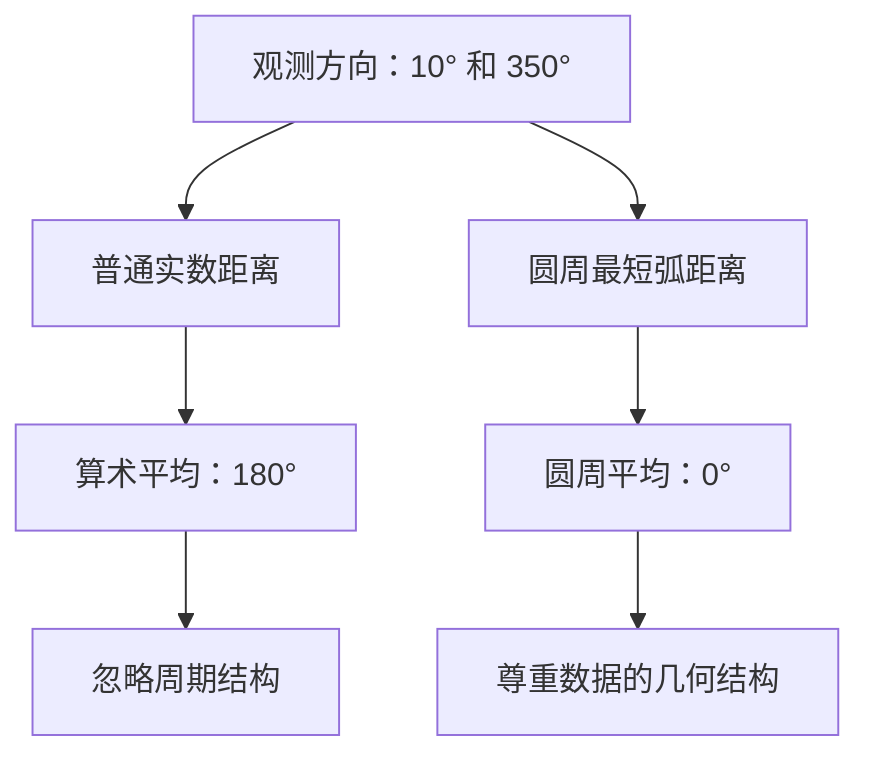
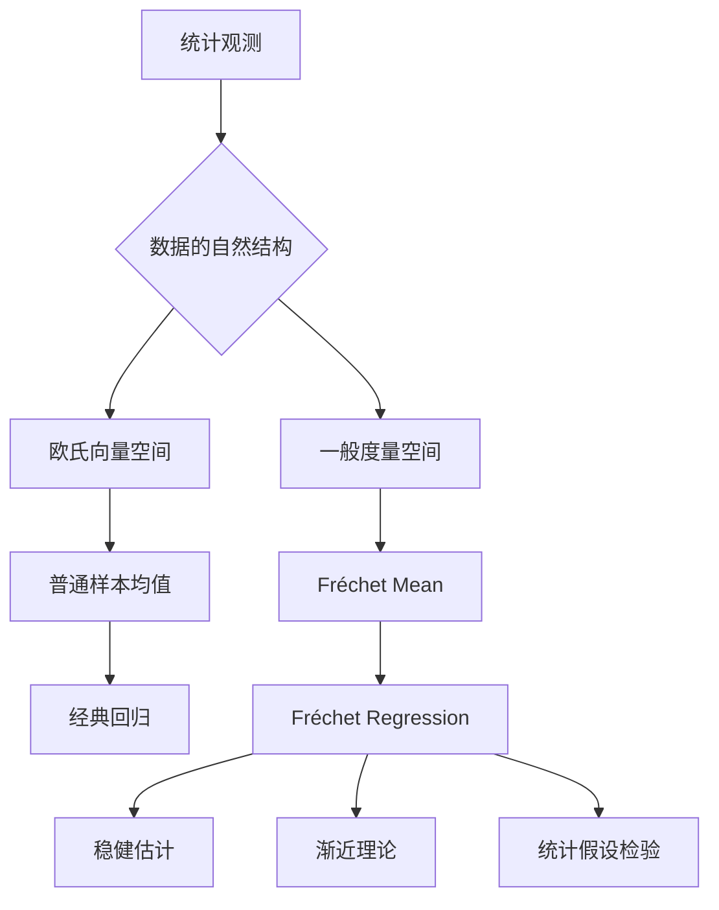
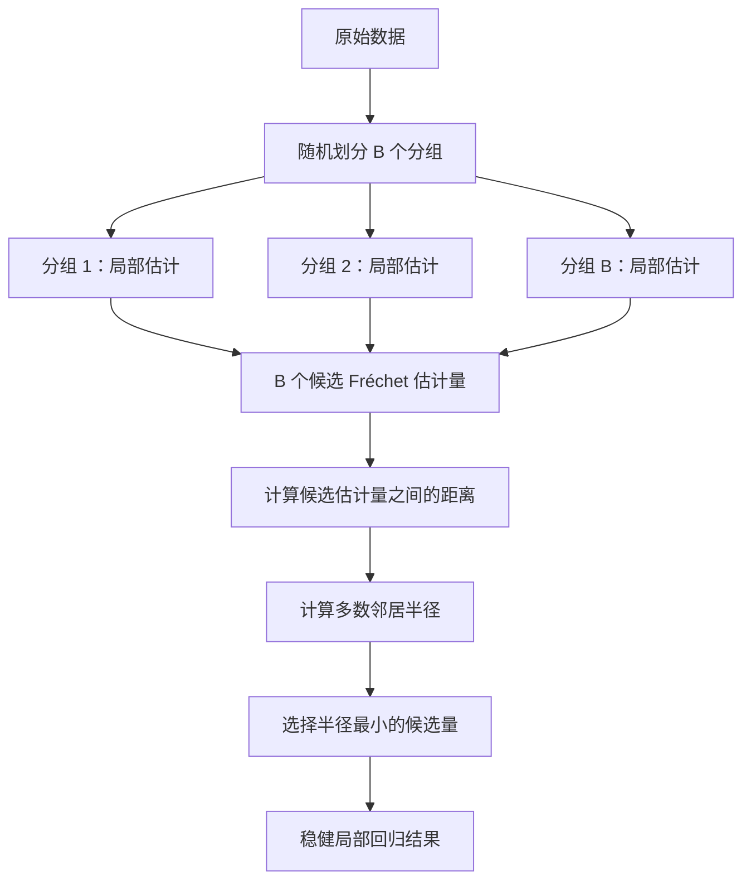
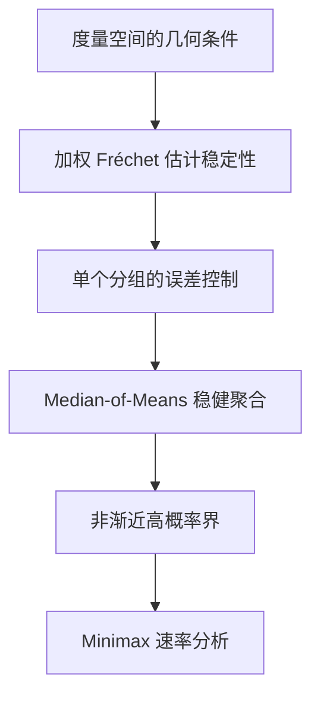

# 第 001 期｜从度量空间到稳健 Fréchet 回归

> Non-Euclidean Statistics · Learning & Research Notes

**日期：** 2026-11-16  
**主题：** Metric Spaces & Robust Fréchet Regression  
**关键词：** 度量空间、Fréchet Mean、非参数回归、稳健估计、Minimax Theory

---

## 本期导读

本系列采用两条并列的学习主线：

- **基础知识：** 系统理解非欧统计学涉及的数学与统计概念。
- **研究前沿：** 持续关注新理论、新统计方法和值得研究的问题。

本期从度量空间与 Fréchet mean 出发，介绍六项非欧统计学研究，并重点分析稳健局部 Fréchet 回归。

---

# A. 今日基础知识：什么是非欧统计学？

## A.1 一个普通平均数无法解决的问题

考虑两个方向观测：

- 第一个方向为 10°
- 第二个方向为 350°

直接使用算术平均：

```math
\bar{\theta}
=
\frac{10^\circ+350^\circ}{2}
=
180^\circ
```

但是两个方向实际上都接近正北方。

按照圆周上的最短弧距离，0° 才是这两个方向合理的平均方向。

为什么普通平均数会出现问题？

因为方向数据并不天然属于普通实数轴，而是属于圆周。

在圆周上：

```math
0^\circ=360^\circ
```

但在普通实数轴上，0 和 360 是两个不同的数。

因此，普通的算术平均没有正确反映方向数据的周期性结构。

### 图 1：普通平均与圆周平均的区别



对于圆周数据，可以定义最短弧距离：

```math
d_{S^1}(\theta,\phi)
=
\min_{k\in\mathbb Z}
|\theta-\phi+360^\circ k|
```

因此：

```math
d_{S^1}(10^\circ,350^\circ)
=
20^\circ
```

而不是 340°。

**核心思想：** 统计方法不仅取决于数据的数值，还取决于数据所在空间的几何结构。

---

## A.2 欧氏空间与非欧空间

在经典多元统计中，通常考虑向量数据：

```math
X\in\mathbb R^p
```

例如，一个人可以由身高、体重和年龄构成的向量表示。

欧氏距离定义为：

```math
d_E(x,y)
=
\sqrt{
\sum_{j=1}^{p}(x_j-y_j)^2
}
```

但对于现代统计中的复杂数据，我们可能需要不同的空间。

| 数据对象 | 典型空间 | 研究问题 |
|---|---|---|
| 方向和角度 | 圆周 | 方向均值 |
| 地理位置 | 球面 | 测地距离与回归 |
| 协方差矩阵 | SPD 矩阵空间 | 矩阵均值和统计推断 |
| 概率分布 | Wasserstein 空间 | 分布回归与重心 |
| 树结构 | 树空间 | 树均值和形状分析 |
| 网络数据 | 图空间 | 网络统计推断 |

需要注意，非欧空间不一定是流形。

一般度量空间可以包括离散对象、树、网络以及不具有光滑结构的空间。

---

## A.3 度量空间（Metric Space）

一个度量空间由两个部分组成：

```math
(\Omega,d)
```

其中：

- $\Omega$ 是所有可能数据对象的集合；
- $d$ 是对象之间的距离函数。

距离函数必须满足三个基本性质。

**1. 非负性与同一性**

```math
d(x,y)\geq0,
\qquad
d(x,y)=0\iff x=y
```

**2. 对称性**

```math
d(x,y)=d(y,x)
```

**3. 三角不等式**

```math
d(x,z)\leq d(x,y)+d(y,z)
```

度量空间的价值在于：

即使两个对象不能直接相加，我们仍然可以研究它们之间的距离、收敛性，以及基于距离构造的统计方法。

---

## A.4 从普通样本均值到 Fréchet Mean

假设我们观察到：

```math
X_1,\ldots,X_n\in\mathbb R^p
```

普通样本均值定义为：

```math
\bar X
=
\frac1n\sum_{i=1}^{n}X_i
```

它具有一个重要的最优化性质：

```math
\sum_{i=1}^{n}\|X_i-\bar X\|^2
=
\min_{\mu\in\mathbb R^p}
\sum_{i=1}^{n}\|X_i-\mu\|^2
```

也就是说，样本均值是使平方距离之和最小的点。

这个形式可以推广到一般度量空间。

### 样本 Fréchet Mean

对于度量空间：

```math
(\Omega,d)
```

样本 Fréchet mean 是满足以下等式的对象：

```math
\frac1n\sum_{i=1}^{n}
d^2(Y_i,\hat\mu_F)
=
\min_{\omega\in\Omega}
\frac1n\sum_{i=1}^{n}
d^2(Y_i,\omega)
```

其中 $\hat\mu_F$ 表示一个样本 Fréchet mean。

注意，最小值可能无法取得，或者可能存在多个最小化对象。

因此在一般空间中，需要另外研究均值的存在性、唯一性与估计性质。

### 图 2：从欧氏统计到 Fréchet 统计



### 本节总结

Fréchet mean 提供了一种通过最小化平方距离来定义中心位置的通用方法。

它也是现代非欧回归、分布值数据统计和流形统计的重要基础。

---

# B. 今日前沿研究雷达

本期关注六项 2026 年的研究成果。

以下论文主要为 arXiv 预印本，相关研究结果仍应结合原文假设与后续同行评审情况理解。

## B.1 Adaptive Local Fréchet Regression with Polyspherical Predictors

**作者：** Chang Jun Im  
**日期：** 2026-11-09  
**原文：** https://arxiv.org/abs/2611.13240

**研究问题：**

如果解释变量来自多个不同维数的球面，如何构造局部 Fréchet 回归估计器？

**核心贡献：**

- 构造局部常数和局部线性 Fréchet 回归。
- 对不同球面因子采用不同的带宽。
- 利用交叉拟合预测风险进行变量选择。
- 研究统一收敛速率和变量选择一致性。

**统计学价值：**

将非参数回归、几何结构和变量选择结合起来。

**局限：**

理论保证依赖相应的光滑性、带宽和数据分布条件。

---

## B.2 Principal Manifold Estimation with Riemannian Templates

**作者：** Kun Meng, Christopher Perez  
**首次提交：** 2026-04-05  
**更新：** 2026-11-08  
**原文：** https://arxiv.org/abs/2604.04272

**研究问题：**

如果高维数据集中在某个潜在低维流形附近，如何估计这一非线性几何结构？

**核心贡献：**

- 允许具有一般非欧拓扑结构的主流形。
- 研究估计对象的数学良定义性。
- 证明计算算法的收敛性。
- 建立有限样本估计的一致性。
- 提供相关的贝叶斯解释。

**统计学价值：**

将流形学习与正式的统计估计理论联系起来。

**局限：**

其数学框架涉及黎曼几何和 Sobolev 空间，理论条件较为复杂。

---

## B.3 Robust Local Fréchet Regression

**完整标题：**

Robust Local Fréchet Regression: Nonasymptotic Theory and Minimax Optimality

**作者：** Chang Jun Im, Daisuke Kurisu  
**日期：** 2026-10-16  
**原文：** https://arxiv.org/abs/2610.23757

**研究问题：**

当非欧响应变量具有重尾分布时，如何实现稳健的非参数回归？

**核心贡献：**

- 距离型 Median-of-Means 估计器；
- 非渐近高概率误差界；
- Minimax lower bounds；
- 在相应条件下避免对响应空间施加熵条件。

**统计学价值：**

在适当几何和概率条件下，实现与经典非参数回归匹配的逐点收敛速率。

**本期重点精读。**

---

## B.4 Online Covariance Estimation on Riemannian Manifolds

**完整标题：**

Online Covariance Estimation for Averaged Stochastic Gradient Descent on Riemannian Manifolds

**作者：** Jingrong Guan, Liwei Jiang, Sen Na  
**日期：** 2026-10-24  
**原文：** https://arxiv.org/abs/2610.33419

**研究问题：**

如何对黎曼流形上的随机梯度下降算法进行在线协方差估计？

**核心贡献：**

利用向量传输整合不同切空间中的信息，构造在线协方差估计器。

**统计学价值：**

将黎曼优化与统计推断相联系，为流形参数的不确定性量化提供方法。

**局限：**

需要满足相应的流形、算法与渐近理论条件。

---

## B.5 Wasserstein Barycenter Under Sparse Sampling

**完整标题：**

Estimating the Wasserstein Barycenter of One-Dimensional Distributions Under Sparse Sampling

**作者：** James Peng, Florian Stijven, Linbo Wang, Peter B. Gilbert  
**日期：** 2026-06-08  
**原文：** https://arxiv.org/abs/2606.10096

**研究问题：**

如果每个个体对应一个概率分布，但每个分布只能观测到少量样本，如何估计总体 Wasserstein barycenter？

**核心贡献：**

提出 marginal-constructed barycenter 估计器，并研究其逐点一致性与渐近正态性。

**统计学价值：**

连接稀疏采样、分布值数据和最优传输统计。

**局限：**

主要针对一维概率分布的相关估计问题。

---

## B.6 Inference for Fréchet Regression

**作者：** Wookyeong Song, Paromita Dubey, Hans-Georg Müller, Alexander Petersen  
**日期：** 2026-05-19  
**原文：** https://arxiv.org/abs/2605.19519

**研究问题：**

如何检验 Fréchet 回归模型中的解释变量是否具有显著作用？

**核心贡献：**

- 整体回归效应检验；
- 部分解释变量效应检验；
- 使用随机乘子和 Cauchy combination 等技术。

**统计学价值：**

把 Fréchet 回归从估计和预测推进到统计推断。

---

# C. 核心论文精读

## Robust Local Fréchet Regression: Nonasymptotic Theory and Minimax Optimality

**作者：** Im & Kurisu（2026）

原文：https://arxiv.org/abs/2610.23757

## C.1 研究动机

假设解释变量属于欧氏空间，响应变量属于一般度量空间：

```math
X\in\mathbb R^d,
\qquad
Y\in(\mathcal Y,d_{\mathcal Y})
```

我们希望估计条件 Fréchet mean。

定义：

```math
M_x(\omega)
=
\mathbb E[
d_{\mathcal Y}^2(Y,\omega)\mid X=x
]
```

条件 Fréchet mean 满足：

```math
M_x(m_\oplus(x))
=
\min_{\omega\in\mathcal Y}M_x(\omega)
```

传统局部 Fréchet 回归通过核加权平方距离构造估计器。

但在重尾分布下，局部估计可能受到极端观测的显著影响。

作者希望构造一种稳健估计器，同时获得有限样本高概率保证和最优收敛速率。

---

## C.2 方法：Distance-Based Median-of-Means

基本思想是：

将数据分组，在每组独立估计局部 Fréchet mean，再使用距离关系进行稳健聚合。

### 第一步：样本分组

将样本分为：

```math
I_1,I_2,\ldots,I_B
```

每组大致包含：

```math
\frac nB
```

个观测。

### 第二步：计算分组 Fréchet 估计量

对于第 $b$ 组，寻找满足以下条件的对象：

```math
\sum_{i\in I_b}
K_h(X_i,x)d_{\mathcal Y}^2(Y_i,\hat m_{h,b}(x))
=
\min_{\omega\in\mathcal Y}
\sum_{i\in I_b}
K_h(X_i,x)d_{\mathcal Y}^2(Y_i,\omega)
```

这里：

- $K_h$ 是核权重；
- $h$ 是带宽；
- $\hat m_{h,b}(x)$ 是第 $b$ 组的局部估计结果。

### 第三步：多数邻居聚合

定义候选估计量的多数邻居半径：

```math
r_b=
\inf\left\{
r\geq0:
\sum_{\ell=1}^{B}
\mathbf 1\left[
d_{\mathcal Y}(\hat m_{h,b},\hat m_{h,\ell})
\leq r
\right]>\frac B2
\right\}
```

选择半径最小的候选估计量：

```math
\hat b\in\{b:r_b=\min_{1\leq j\leq B}r_j\}
```

最终得到：

```math
\hat m_{h,B}^{RLFR}(x)
=
\hat m_{h,\hat b}(x)
```

这种方法只依赖候选估计量之间的距离，不要求响应空间具备普通向量加法。

### 图 3：Robust Local Fréchet Regression



---

## C.3 主要理论结果

论文研究两种局部光滑性框架。

### 情形一：局部二阶光滑

在相应的核函数、设计分布、几何条件和局部二阶矩条件下，可以获得：

```math
d_{\mathcal Y}
\left(
\hat m_{h,B}^{RLFR}(x_0),
m_\oplus(x_0)
\right)
\leq
C\left[
h^2+
\sigma
\sqrt{
\frac{\log(1/\delta)}
{nh^df_X(x_0)}
}
\right]
```

该界在论文规定的样本量和带宽条件下，以至少 $1-\delta$ 的概率成立。

这里：

- 第一项是平滑偏差；
- 第二项是随机误差；
- $f_X(x_0)$ 是解释变量在目标点处的密度；
- $C$ 表示依赖相关模型条件的常数。

平衡两项误差后，固定置信水平下可得到逐点速率：

```math
n^{-2/(d+4)}
```

### 情形二：Wasserstein Hölder 连续性

设条件响应分布为：

```math
P_x=\mathcal L(Y\mid X=x)
```

假设：

```math
W_1(P_x,P_{x_0})
\leq
L_W\|x-x_0\|^\beta
```

其中：

```math
0<\beta\leq1
```

此时主要误差结构为：

```math
h^\beta+
\sqrt{
\frac{\log(1/\delta)}
{nh^d}
}
```

上式省略了固定的噪声、密度及几何常数。

相应的逐点收敛速率为：

```math
n^{-\beta/(2\beta+d)}
```

论文还建立了相应的 minimax lower bounds，说明这些速率在所研究的模型类中具有最优性。

---

## C.4 理论为什么重要？

这篇论文最值得关注的，不仅是 Median-of-Means 算法本身。

它还展示了一条重要的证明路线：

**第一步：** 利用空间几何条件控制加权 Fréchet 估计器的稳定性。

**第二步：** 建立单个分组的有限样本估计误差界。

**第三步：** 利用独立分组和多数聚合获得高概率保证。

**第四步：** 通过 minimax lower bound 证明收敛阶的最优性。

因此：



这条思路可能对其他非欧估计问题也具有启发性。

---

## C.5 方法的贡献与局限

### 主要贡献

1. 构造适用于一般度量空间的稳健局部回归方法。
2. 建立有限二阶矩条件下的高概率误差保证。
3. 提出不等权 Fréchet 估计的稳定性分析工具。
4. 证明相应的逐点 minimax 最优速率。
5. 在特定几何条件下避免使用响应空间熵条件。

### 局限

1. 仍依赖一定的几何性质，例如二次增长条件。
2. 理论主要针对逐点估计。
3. 分组数量与估计效率之间存在权衡。
4. 数据驱动的带宽和分组数选择仍值得研究。

---

## C.6 值得进一步研究的方向

### 方向一：Uniform Convergence

能否进一步控制整个解释变量区域上的估计误差？

例如：

```math
\sup_{x\in\mathcal X}
d_{\mathcal Y}
\left(
\hat m^{RLFR}(x),m_\oplus(x)
\right)
```

### 方向二：Adaptive Robust Regression

能否在未知噪声分布和光滑性的条件下，同时选择带宽与分组数？

### 方向三：更弱的几何条件

如果 Fréchet mean 不唯一，或者二次增长条件不成立，是否仍可以建立稳定的统计估计理论？

这些问题是基于论文结果提出的研究延伸，并非原论文已经证明的结论。

---

# D. 今日学习总结

## D.1 三个核心收获

**第一：** 数据所在空间的几何结构会直接影响统计方法的定义。

**第二：** Fréchet mean 通过距离最小化推广了普通样本均值。

**第三：** 稳健局部 Fréchet 回归将几何结构、稳健估计与非渐近统计理论联系起来。

## D.2 今日练习

给定三个观测：

```math
1,\quad3,\quad5
```

求它们在欧氏距离下的 Fréchet mean。

**答案：**

```math
\hat\mu_F
=
\frac{1+3+5}{3}
=
3
```

也可以通过最小化平方距离验证：

```math
(1-3)^2+(3-3)^2+(5-3)^2
=
\min_{\mu\in\mathbb R}
\left[
(1-\mu)^2+(3-\mu)^2+(5-\mu)^2
\right]
```

---

## D.3 下一期预告

**第 002 期：距离、测地线与统计均值**

基础学习重点：

- 欧氏距离；
- 球面测地距离；
- 不同距离对统计均值的影响；
- 测地线与流形统计的联系。

前沿研究部分继续独立跟踪新方法和理论发展。

---

# 参考文献

## 基础文献

Petersen, A., & Müller, H.-G. (2019).

*Fréchet Regression for Random Objects with Euclidean Predictors.*

The Annals of Statistics, 47(2), 691–719.

https://doi.org/10.1214/17-AOS1624

## 本期重点精读

Im, C. J., & Kurisu, D. (2026).

*Robust Local Fréchet Regression: Nonasymptotic Theory and Minimax Optimality.*

https://arxiv.org/abs/2610.23757

## 其他前沿文献

1. Im, C. J. (2026). *Adaptive local Fréchet regression with polyspherical predictors.*  
   https://arxiv.org/abs/2611.13240

2. Meng, K., & Perez, C. (2026). *Principal Manifold Estimation with Riemannian Templates.*  
   https://arxiv.org/abs/2604.04272

3. Guan, J., Jiang, L., & Na, S. (2026). *Online Covariance Estimation for Averaged Stochastic Gradient Descent on Riemannian Manifolds.*  
   https://arxiv.org/abs/2610.33419

4. Peng, J., Stijven, F., Wang, L., & Gilbert, P. B. (2026). *Estimating the Wasserstein Barycenter of One-Dimensional Distributions Under Sparse Sampling.*  
   https://arxiv.org/abs/2606.10096

5. Song, W., Dubey, P., Müller, H.-G., & Petersen, A. (2026). *Inference for Fréchet Regression.*  
   https://arxiv.org/abs/2605.19519

---

**Non-Euclidean Statistics Learning Notes · Issue 001**

*本系列用于非欧统计学知识学习与科研文献追踪。预印本结论以原始论文、适用假设及后续研究为准。*
