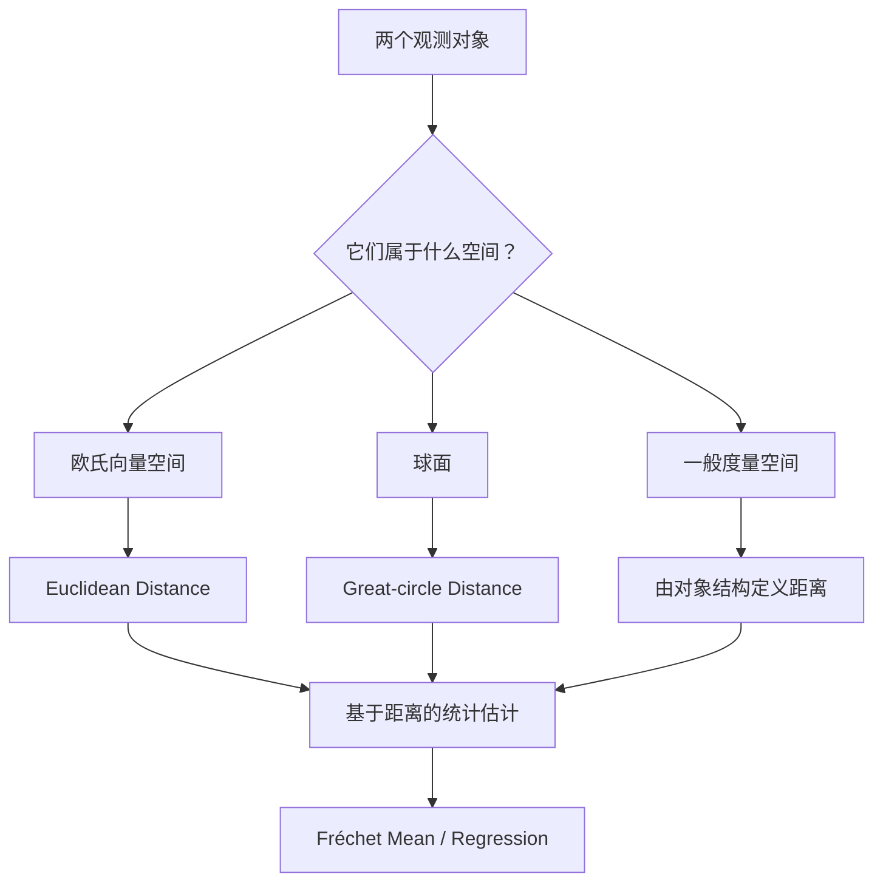
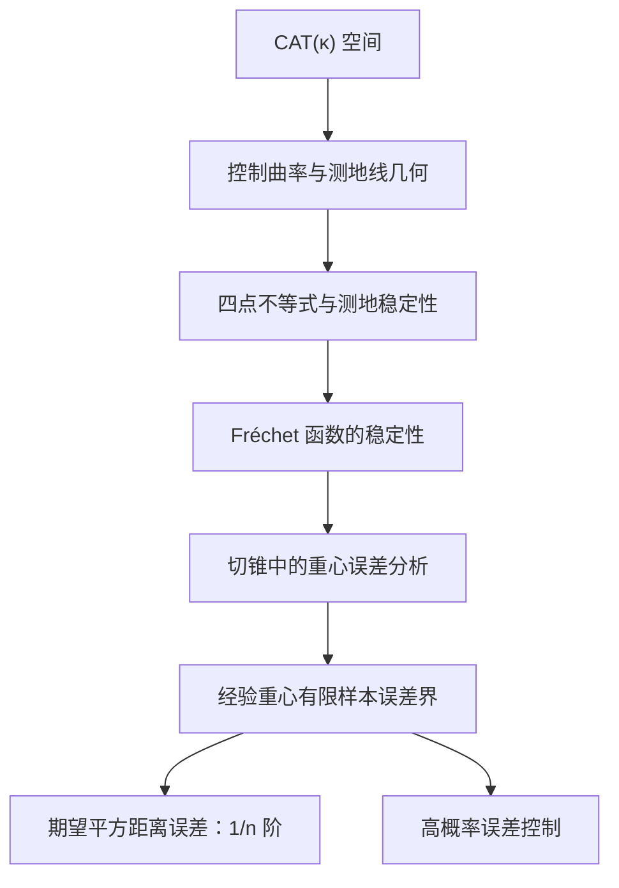

# 第 002 期｜距离、测地线与 Fréchet 均值的统计理论

> Non-Euclidean Statistics · Learning & Research Notes

**日期：** 2026-11-17  
**主题：** Metric Geometry, Geodesics & Barycenter Estimation  
**关键词：** Geodesic Distance、CAT Spaces、Fréchet Mean、Statistical Barycenters

---

## 本期导读

本期继续采用基础知识与研究前沿并行的方式。

- **A. 基础课：** 欧氏距离、测地距离与测地空间。
- **B. 前沿雷达：** 五项近期非欧统计研究。
- **C. 核心精读：** 正曲率上界空间中的重心估计理论。
- **D. 今日总结：** 理论联系、自测与后续学习。

本期最重要的问题是：

**当数据空间具有曲率时，统计均值的存在性、唯一性以及估计误差会发生什么变化？**

---

# A. 基础知识：距离、测地线与统计均值

## A.1 距离不一定是直线长度

在第 001 期中，我们介绍了度量空间：

```math
(\Omega,d)
```

其中距离函数满足非负性、对称性和三角不等式。

但是满足这些条件的距离不一定是普通欧氏距离。

考虑两个位于球面上的点。

如果只考虑它们在三维欧氏空间中的坐标，我们可以计算穿过球体内部的直线距离。

但如果一个对象必须沿球面运动，例如沿地球表面移动，那么更自然的距离是球面上的最短路径长度。

这就引出了两种不同的距离。

### Euclidean Distance

对于三维空间中的两点：

```math
x,y\in\mathbb R^3
```

欧氏距离为：

```math
d_E(x,y)
=
\sqrt{
\sum_{j=1}^{3}(x_j-y_j)^2
}
```

### Geodesic Distance

对于单位球面：

```math
S^2=\{x\in\mathbb R^3:\|x\|=1\}
```

球面测地距离为：

```math
d_G(x,y)
=
\arccos(x^\top y)
```

其中 $x^\top y$ 是两个单位向量的内积。

对于半径为 $R$ 的球面：

```math
d_G(x,y)
=
R\arccos\left(\frac{x^\top y}{R^2}\right)
```

这里的 $x,y$ 是模长为 $R$ 的三维向量。

**直观理解：**

- 欧氏距离：连接两点的空间直线长度。
- 球面测地距离：沿球面最短大圆弧的长度。

### 一个简单例子

在单位球面上，假设两个点对应的中心夹角是 90°。

欧氏距离（弦长）为：

```math
d_E=\sqrt{2}
```

测地距离（弧长）为：

```math
d_G=\frac{\pi}{2}
```

两者不相等。

### 图 1：不同的数据结构对应不同距离



这张图展示的是距离选择的逻辑，而不是几何形状的精确绘图。

---

## A.2 什么是测地线（Geodesic）？

在欧氏空间中，连接两点的最短路径是直线段。

在弯曲空间中，对应的概念是测地线。

为了避免术语混淆，这里首先考虑**最短测地线段**。

设：

```math
\gamma:[0,1]\rightarrow\Omega
```

是从 $x$ 到 $y$ 的一条曲线。

如果满足：

```math
\gamma(0)=x,\qquad\gamma(1)=y
```

并且：

```math
d(\gamma(s),\gamma(t))
=
|s-t|d(x,y)
```

对于所有 $s,t\in[0,1]$ 成立，那么 $\gamma$ 是一条常速最短测地线段。

例如：

- 欧氏空间：直线段；
- 球面：较短的大圆弧；
- 双曲空间：相应双曲模型中的测地曲线。

需要注意：一般黎曼几何中的测地线可以只在局部最短，不一定始终是全局最短路径。

如果任意两点之间都存在这样的最短测地线段，我们称这个空间为测地空间（Geodesic Space）。

### 为什么测地线对统计学重要？

因为非欧空间中的许多统计方法都需要在两个数据对象之间进行插值。

普通线性插值为：

```math
z(t)=(1-t)x+ty
```

但在一般度量空间中，对象可能无法相加。

于是可以使用：

```math
z(t)=\gamma(t)
```

其中 $\gamma$ 是连接 $x,y$ 的测地线。

这提供了非欧空间中的一种自然插值方式。

---

## A.3 测地距离与 Fréchet Mean

第 001 期中，我们学习了 Fréchet mean。

对于随机对象 $X$，定义 Fréchet 风险：

```math
F_{\mu}(z)
=
\mathbb E[d^2(X,z)]
```

总体 Fréchet mean 是使 $F_\mu$ 取得最小值的点。

即：

```math
F_{\mu}(b)
=
\min_{z\in\Omega}F_{\mu}(z)
```

样本 Fréchet mean 为：

```math
\frac1n
\sum_{i=1}^{n}d^2(X_i,\hat b_n)
=
\min_{z\in\Omega}
\frac1n\sum_{i=1}^{n}d^2(X_i,z)
```

### 关键问题

如果我们改变距离函数，那么最小化的目标函数也会变化。

因此，Fréchet mean 可能随距离的选择而改变。

例如，对于球面数据，可以考虑：

- 使用三维欧氏弦距离，并约束均值仍在球面上；
- 使用球面测地距离。

这分别对应不同的外在（Extrinsic）与内在（Intrinsic）统计思想。

它们的均值一般不一定相同。

---

## A.4 一个重要现象：均值可能不唯一

考虑球面上的两个对跖点，即位于球面正相反方向的两个点。

如果使用球面测地距离，并且两个点具有相同权重，那么位于它们之间任意最短半圆路径中点的位置，都可以成为平方距离的最小化点。

因此可能有多个 Fréchet mean。

这个例子说明：

**空间的几何结构会影响统计均值的唯一性。**

这也直接引出了本期重点论文的研究问题。

---

# B. 今日前沿研究雷达

本期精选五项研究，涉及度量几何、方向统计、球面推断、黎曼回归和最优传输。

这些论文不是全部在今天发表，而是截至本期检索时可以核验的近期研究成果。

## B.1 Geometry and barycenters in large CAT(κ) spaces

**作者：** Yassine Boukhateb, Victor-Emmanuel Brunel, Austin J. Stromme  
**日期：** 2026-10-13  
**类别：** arXiv 预印本  
**原文：** https://arxiv.org/abs/2610.17909

### 研究问题

在具有正曲率上界的度量空间中，当 Fréchet 风险函数可能不再具有强测地凸性时，是否还能稳定地估计统计重心？

### 核心贡献

论文研究曲率上界为 $\kappa$ 的 CAT 空间。

主要结果包括：

- 建立新的几何稳定性不等式；
- 研究 Fréchet mean 的存在性与唯一性；
- 扩大能够建立统计估计误差界的空间区域；
- 给出经验重心与迭代重心的有限样本误差保证；
- 研究重心的稀疏表示和近似问题。

### 统计学价值

表明即使 Fréchet 风险函数不再具有传统的全局强测地凸性，在一定几何条件下仍可能获得良好的重心估计理论。

**推荐度：高。**

---

## B.2 Directional Statistics in Signal Processing: A Geometry Driven Overview of Models, Learning, and Applications

**作者：** Anders S. Olsen, Kanti V. Mardia, Dimitri Van De Ville, Morten Mørup  
**日期：** 2026-11-03  
**类别：** arXiv 综述预印本  
**原文：** https://arxiv.org/abs/2611.04595

### 研究问题

信号处理中存在许多具有方向性、周期性、符号等价性或者子空间约束的数据。

如何根据数据的几何性质，选择合适的统计模型？

### 核心内容

论文讨论了：

- Circular Statistics；
- Spherical Statistics；
- Projective Spaces；
- Stiefel 和 Grassmann Manifolds；
- Covariance-valued Data；
- Geometry-aware Clustering。

并通过神经影像和信号分离等例子，说明几何表示会影响统计建模的效果。

### 统计学价值

这篇综述特别适合建立非欧统计的数据类型知识体系。

**推荐度：高。**

---

## B.3 Intrinsic predictive density estimation on the sphere under additional information

**作者：** Abdolnasser Sadeghkhani  
**发表日期：** 2026-10-02  
**期刊：** Journal of the Korean Statistical Society  
**原文：** https://doi.org/10.1007/s42952-026-00393-z

### 研究问题

当未来观测值位于球面上，并且已知两个未知方向参数之间存在几何约束时，如何构造预测概率密度？

### 核心贡献

论文研究球面上的 geodesic normal model。

它通过测地距离及对数映射表达参数约束，并建立相应的贝叶斯预测密度。

研究还讨论：

- Kullback–Leibler 损失；
- 受约束的贝叶斯预测；
- 正交变换下的等变性；
- 高集中度条件下的局部渐近近似。

### 统计学价值

它表明球面几何不仅影响均值和回归，还会影响完整的概率密度预测与决策理论。

**推荐度：高。**

---

## B.4 Retraction based regression methods on Riemannian manifolds

**作者：** Estefanía Loayza-Romero, Benedikt Sibum, Kathrin Welker  
**日期：** 2026-06-01  
**类别：** arXiv 预印本  
**原文：** https://arxiv.org/abs/2606.02116

### 研究问题

经典 geodesic regression 通常需要反复计算黎曼指数映射。

如果指数映射计算成本很高，能否构造更灵活的流形回归方法？

### 核心贡献

论文提出基于 retraction 的流形回归框架。

它使用局部回缩映射代替部分指数映射计算，并研究相应切丛上的优化结构。

作者将方法应用于 p-norm sphere，并通过黎曼最速下降算法求解。

### 统计学价值

为复杂流形上的回归建模提供了计算几何方面的新方法。

### 局限

这种回缩构造不应被直接视为与精确测地回归完全相同；其几何近似和计算效果取决于具体空间及 retraction 的选择。

**推荐度：中高。**

---

## B.5 Smoothed estimation of Wasserstein barycenters

**作者：** Pengtao Li, Changbo Zhu, Xiaohui Chen  
**日期：** 2026-05-05  
**类别：** arXiv 预印本  
**原文：** https://arxiv.org/abs/2605.03300

### 研究问题

Wasserstein barycenter 可以作为概率分布的统计均值，但高维分布的重心估计通常面临严重的维数灾难。

是否能够利用分布的光滑性改善统计估计速度？

### 核心贡献

作者结合：

- 密度估计；
- Sobolev 几何；
- Wasserstein barycenter 的 semi-dual 形式；

提出具有光滑性适应能力的估计方法，并建立重心目标函数及其最小化点的非参数收敛速率。

### 统计学价值

说明统计对象的光滑性以及空间的几何结构，可以共同决定估计难度。

**推荐度：高。**

---

# C. 今日核心论文精读

## Geometry and barycenters in large CAT(κ) spaces

**作者：** Boukhateb, Brunel & Stromme（2026）

**原文：** https://arxiv.org/abs/2610.17909

## C.1 研究动机

对于欧氏数据，样本均值具有很好的统计性质。

例如，在有限二阶矩条件下，普通样本均值的期望平方误差具有：

```math
\mathbb E[\|\bar X-\mu\|^2]
=
\frac{\sigma^2}{n}
```

这样的形式，其中 $\sigma^2$ 表示总方差。

对于一般度量空间，我们希望获得类似的结果：

```math
\mathbb E[d^2(\hat b_n,b)]
\leq
\frac{C\sigma^2}{n}
```

但几何结构会使问题复杂化。

在非正曲率的 CAT(0) 空间中，Fréchet 风险具有良好的强测地凸性。

而在正曲率上界空间中，风险函数可能出现非凸现象。

传统分析往往通过限制样本所在区域，保证足够强的凸性。

论文提出的问题是：

**如果允许更大的数据区域，使得 Fréchet 风险不再具有传统强测地凸性，是否仍能证明重心估计具有快速收敛速度？**

---

## C.2 什么是 CAT(κ) 空间？

CAT 空间是一类通过比较测地三角形来描述曲率的度量空间。

这里的 $\kappa$ 表示曲率上界。

可以从三个典型几何模型理解：

| 曲率类型 | 典型空间 |
|---|---|
| $\kappa<0$ | 双曲几何 |
| $\kappa=0$ | 欧氏几何 |
| $\kappa>0$ | 球面几何 |

严格地说，CAT(κ) 表示空间中的适当测地三角形不比曲率为 $\kappa$ 的模型三角形更厚，不能简单理解为“所有点的曲率都等于 $\kappa$”。

论文重点研究 $\kappa>0$ 的情形。

---

## C.3 数学问题设定

设：

```math
(\mathcal X,d)
```

是一个测地度量空间。

随机对象 $X$ 的分布为 $\mu$。

总体 Fréchet 风险为：

```math
F_{\mu}(z)
=
\frac12\int_{\mathcal X}d^2(x,z)\,d\mu(x)
```

总体重心 $b$ 满足：

```math
F_{\mu}(b)
=
\min_{z\in\mathcal X}F_{\mu}(z)
```

给定独立同分布样本：

```math
X_1,\ldots,X_n
```

对应的经验重心为：

```math
\frac1n\sum_{i=1}^{n}d^2(X_i,\hat b_n)
=
\min_{z\in\mathcal X}
\frac1n\sum_{i=1}^{n}d^2(X_i,z)
```

论文考虑的一个重要条件是：当 $\kappa>0$ 时，分布集中在半径为 $r$ 的适当球形区域内，其中：

```math
r<
\frac{\pi}{2\sqrt{\kappa}}
```

更准确地说，该区域属于论文定义的 $\kappa$-domain。

在这种区域中，重心可以保持唯一，即使 Fréchet 风险不满足传统的全局强测地凸性。

---

## C.4 主要理论结果

论文证明，在相应 CAT(κ) 几何条件和分布条件下，经验重心估计具有以下误差结构：

```math
\mathbb E[d^2(\hat b_n,b)]
\leq
\frac{C(r,\kappa)\sigma_{\mu}^2}{n}
```

其中：

```math
\sigma_{\mu}^2
=
\mathbb E[d^2(X,b)]
```

而 $C(r,\kappa)$ 是依赖区域半径和曲率上界的几何常数。

因此，经验重心的期望平方距离误差达到：

```math
O(n^{-1})
```

的阶数。

这对应于距离本身的典型误差尺度：

```math
O(n^{-1/2})
```

论文还研究了相应的高概率误差界以及迭代重心。

**最值得关注的是：**

作者不需要在整个研究区域上维持传统意义的强测地凸性，也能获得快速的统计估计误差界。

---

## C.5 核心证明思想

论文构造了新的几何工具，包括：

1. Quantitative Four-Point Inequality；
2. Geodesic Stability；
3. Fréchet Variance Inequality；
4. 基于 Tangent Cone 的重心误差分析。

其中一个重要思想是：

将原始弯曲空间中难以直接分析的重心估计问题，转化为在相应切锥中更容易控制的误差问题。

再利用切锥的 CAT(0) 结构和几何稳定性，将误差控制传递回原空间。

### 图 2：从几何结构到统计误差界



这不是论文每一条证明的逐步复现，而是主要理论工具之间的概念联系。

---

## C.6 研究价值与局限

### 主要贡献

**第一：扩大了统计估计理论适用的几何区域。**

作者不再局限于传统强测地凸性容易保证的小范围。

**第二：将几何稳定性与有限样本统计理论联系起来。**

空间曲率不仅影响距离定义，还直接影响统计估计的误差常数和证明工具。

**第三：为复杂空间上的重心估计提供新的理论工具。**

这可能启发流形统计、稳健统计和非欧优化等问题的研究。

### 局限

- 仍要求特定的曲率上界和数据区域条件；
- 随着数据接近允许区域的边界，几何常数可能恶化；
- 不能直接将结果推广到任意度量空间；
- 论文侧重重心估计理论，不代表所有复杂空间上的全局优化问题都容易求解。

---

## C.7 值得继续研究的问题

以下属于基于论文结果提出的研究思考。

### 方向一：更一般的曲率条件

能否在不满足全局 CAT 曲率上界的空间中，获得类似的有限样本误差界？

### 方向二：稳健重心估计

如果观测具有重尾分布或者受到异常值污染，能否把这些几何稳定性工具与稳健聚合方法结合？

### 方向三：从均值走向回归

对于条件 Fréchet mean：

```math
m(x)
```

是否能够在类似的几何条件下建立局部回归的统一收敛或高概率误差理论？

---

## C.8 与第 001 期的联系

第 001 期研究的是：

**如何在一般度量空间中定义均值？**

第 002 期进一步研究：

**空间几何如何影响均值的存在性、唯一性和估计误差？**

这也是从定义统计对象走向研究统计理论的关键一步。

---

# D. 今日总结

## 三个核心收获

**1. 距离选择具有统计意义。**

欧氏距离与测地距离可能对应不同的均值、回归模型和统计解释。

**2. 曲率会影响估计问题。**

在某些具有正曲率上界的空间中，Fréchet 风险可能不再具有全局强测地凸性，但仍可能拥有唯一重心及良好的估计性质。

**3. 几何工具可以产生统计理论结果。**

测地稳定性、四点不等式、切锥分析等工具，可以用于证明非欧统计估计的有限样本误差界。

---

## 今日自测

假设单位球面上有两个点，它们对应的中心夹角为 90°。

请分别求：

1. 三维欧氏距离；
2. 球面测地距离。

### 答案

欧氏距离：

```math
d_E=\sqrt2
```

球面测地距离：

```math
d_G=\frac{\pi}{2}
```

二者不同，因为一个测量三维直线距离，另一个测量球面上的最短路径长度。

---

## 下一期预告

**第 003 期：流形、切空间与指数映射**

预计学习：

- 什么是流形（Manifold）；
- 为什么局部可以使用欧氏坐标；
- 切空间（Tangent Space）；
- 指数映射（Exponential Map）；
- 从测地线到流形回归。

前沿研究雷达继续独立追踪新的统计理论和方法。

---

# 参考文献

1. Boukhateb, Y., Brunel, V.-E., & Stromme, A. J. (2026). *Geometry and barycenters in large CAT(κ) spaces*.  
   https://arxiv.org/abs/2610.17909

2. Olsen, A. S., Mardia, K. V., Van De Ville, D., & Mørup, M. (2026). *Directional Statistics in Signal Processing: A Geometry Driven Overview of Models, Learning, and Applications*.  
   https://arxiv.org/abs/2611.04595

3. Sadeghkhani, A. (2026). *Intrinsic predictive density estimation on the sphere under additional information*. Journal of the Korean Statistical Society.  
   https://doi.org/10.1007/s42952-026-00393-z

4. Loayza-Romero, E., Sibum, B., & Welker, K. (2026). *Retraction based regression methods on Riemannian manifolds*.  
   https://arxiv.org/abs/2606.02116

5. Li, P., Zhu, C., & Chen, X. (2026). *Smoothed estimation of Wasserstein barycenters*.  
   https://arxiv.org/abs/2605.03300

---

**Non-Euclidean Statistics Learning Notes · Issue 002**

*本笔记用于数学统计学习与科研文献追踪。所有论文的结论均应结合原始文献中的假设理解；研究延伸部分不代表原作者已证明的结果。*
