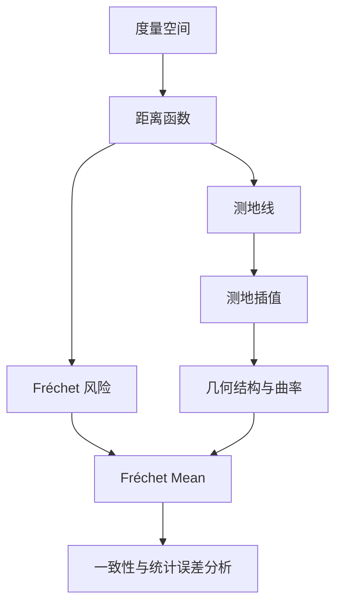
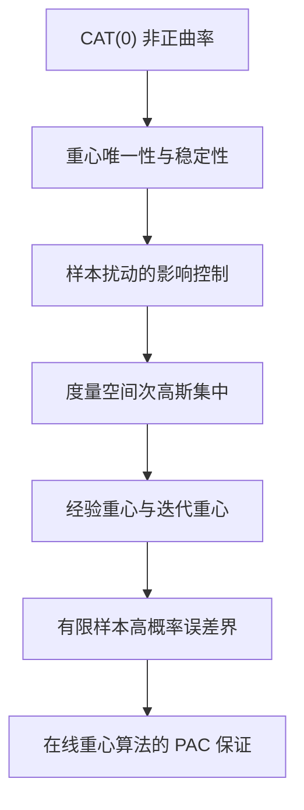

# 第 002 期｜距离、测地线与非欧重心估计

> Non-Euclidean Statistics · Learning & Research Notes

**日期：** 2026-11-17  
**主题：** Geodesic Distance, Curvature & Barycenter Concentration 
**关键词：** Geodesic Space、CAT(0)、Fréchet Mean、Barycenter、Concentration Inequality

---

## 本期导读

第 001 期介绍了度量空间和 Fréchet mean。

本期进一步研究：

**距离和曲率如何影响 Fréchet mean 的存在性、唯一性以及统计估计误差？**

本期包含：

- **A. 基础知识：** 欧氏距离、测地距离、测地空间与 CAT(0) 几何。
- **B. 研究前沿：** 五项高质量经典、正式发表及精选预印本研究。
- **C. 核心精读：** Concentration of empirical barycenters in metric spaces。
- **D. 总结：** 理论联系、自测和下一期预告。

---

# A. 基础知识：从距离走向测地几何

## A.1 欧氏距离与测地距离

考虑单位球面：

```math
S^2=\{x\in\mathbb R^3:\|x\|=1\}
```

假设两个球面点 $x,y$。

我们可以在三维空间中计算它们的普通欧氏距离：

```math
d_E(x,y)=\|x-y\|
```

但如果要求路径始终位于球面上，那么更自然的是测地距离。

球面测地距离为：

```math
d_G(x,y)=\arccos(x^\top y)
```

这里 $x,y$ 都是单位向量。

对于半径为 $R$ 的球面：

```math
d_G(x,y)
=
R\arccos\left(\frac{x^\top y}{R^2}\right)
```

### 例子

假设单位球面上两个点的中心夹角为 90°。

它们之间的欧氏弦长为：

```math
d_E=\sqrt{2}
```

但球面上最短大圆弧的长度为：

```math
d_G=\frac{\pi}{2}
```

因此：

```math
d_E\neq d_G
```

这说明，即使是同一组数据，也可以依据不同的几何结构定义不同距离。

---

## A.2 什么是测地线（Geodesic）？

在欧氏空间中，连接两点的最短路径是直线段。

在一般度量空间中，对应的概念是最短测地线段。

设：

```math
\gamma:[0,1]\rightarrow\Omega
```

是一条连接 $x$ 和 $y$ 的曲线，并满足：

```math
\gamma(0)=x,\qquad\gamma(1)=y
```

如果：

```math
d(\gamma(s),\gamma(t))
=
|s-t|d(x,y)
```

对于所有 $s,t\in[0,1]$ 成立，那么 $\gamma$ 是一条常速最短测地线段。

### 常见例子

| 空间 | 最短测地线 |
|---|---|
| 欧氏空间 | 直线段 |
| 球面 | 较短的大圆弧 |
| 双曲空间 | 双曲测地线 |
| 度量树 | 唯一路径 |

如果任意两点之间都存在最短测地线段，那么这个空间称为测地空间（Geodesic Space）。

注意：

- 最短测地线可能不唯一；
- 在黎曼几何中，一条测地线可以局部最短，但不一定全局最短。

---

## A.3 测地空间中的插值

欧氏空间中的线性插值为：

```math
z(t)=(1-t)x+ty
```

其中：

```math
0\leq t\leq1
```

但一般度量空间没有自然的向量加法。

如果存在连接 $x,y$ 的测地线 $\gamma$，可以使用：

```math
z(t)=\gamma(t)
```

实现几何插值。

这对于非欧统计非常重要。

例如：

- 流形上的回归曲线；
- 概率分布之间的 Wasserstein 插值；
- 正定矩阵之间的几何插值；
- 测地均值计算。

### 图 1：从度量空间到统计估计



---

## A.4 曲率为什么重要？

曲率描述空间偏离欧氏几何的方式。

可以从三个典型模型直观理解。

| 几何 | 典型空间 |
|---|---|
| 零曲率 | 欧氏空间 |
| 正曲率 | 球面 |
| 负曲率 | 双曲空间 |

但在一般度量空间中，我们不一定能够使用传统微分几何定义曲率。

一种重要的替代方法是 Alexandrov 曲率比较。

它通过比较测地三角形与常曲率模型三角形的几何性质来定义曲率上界或下界。

这引出了 CAT 空间。

---

## A.5 CAT(0) 空间

CAT(0) 空间是一类具有 Alexandrov 意义下非正曲率上界的测地空间。

它具有非常重要的性质：

**平方距离沿测地线满足一种强化的凸性不等式。**

设 $\gamma$ 是从 $x$ 到 $y$ 的最短测地线，那么对于任意点 $z$：

```math
d^2(z,\gamma(t))
\leq
(1-t)d^2(z,x)
+
td^2(z,y)
-
t(1-t)d^2(x,y)
```

其中：

```math
0\leq t\leq1
```

这个公式是理解 CAT(0) 统计理论的重要起点。

### 为什么它重要？

最后一项：

```math
-t(1-t)d^2(x,y)
```

提供了比普通凸性更强的控制。

在适当的完备性和矩条件下，这能够帮助证明：

- Fréchet mean 存在；
- Fréchet mean 唯一；
- 重心对数据扰动稳定；
- 样本重心具有良好的统计误差界。

常见 CAT(0) 空间包括：

- Hilbert 空间；
- Hadamard 流形；
- 某些树空间；
- 一些具有非正曲率的几何对象空间。

---

## A.6 正曲率空间中的困难

球面具有正曲率。

它在全局范围内并不具有 CAT(0) 空间那样的平方距离强凸性。

例如，单位球面上两个对跖点之间存在无穷多条最短半大圆路径。

如果数据只由两个等权重的对跖点组成，那么沿这些路径的中点构成一整条赤道。

这些中点都可以成为 Fréchet mean。

因此，Fréchet mean 可能不唯一。

这说明：

**曲率、数据分布和可行区域共同决定均值的统计性质。**

不过，在球面足够小的局部区域中，仍然可以建立良好的均值唯一性和统计估计理论。

---

# B. 高质量研究精选

本期选择五项研究：

- 一项奠基性经典；
- 三项正式发表的高质量研究；
- 一项经过作者背景核验的重要预印本。

---

## B.1 Probability Measures on Metric Spaces of Nonpositive Curvature

**作者：** Karl-Theodor Sturm  
**年份：** 2003  
**出版：** Contemporary Mathematics, Volume 338  
**类型：** 经典数学理论研究

**原文：**

https://doi.org/10.1090/conm/338/06080

### 研究问题

如何在具有非正曲率的度量空间中建立概率分布、期望与重心的数学理论？

### 核心贡献

- 非正曲率空间上的概率测度；
- Barycenter；
- Jensen 不等式；
- Law of Large Numbers；
- 重心映射的收缩性质。

### 为什么重要？

Sturm 的工作为后来许多 CAT(0) 统计理论奠定了数学基础。

它不是普通应用论文，而是理解度量几何与概率论联系的重要经典研究。

### 局限

数学抽象程度较高，重点是非正曲率结构，并不直接覆盖任意正曲率空间。

**推荐度：极高。**

---

## B.2 Concentration of Empirical Barycenters in Metric Spaces

**作者：** Victor-Emmanuel Brunel, Jordan Serres  
**年份：** 2024  
**会议：** 35th International Conference on Algorithmic Learning Theory（ALT 2024）  
**论文集：** Proceedings of Machine Learning Research, 237, 337–361  
**类型：** 正式发表的统计学习理论研究

**原文：**

https://proceedings.mlr.press/v237/brunel24a.html

**PDF：**

https://proceedings.mlr.press/v237/brunel24a/brunel24a.pdf

### 研究问题

对于非正曲率度量空间中的随机对象，能否建立类似经典均值的 Hoeffding 和 Bernstein 集中不等式？

### 核心贡献

- 研究经验重心的集中性质；
- 研究迭代重心；
- 推广非欧空间中的次高斯概念；
- 建立有限样本高概率误差界；
- 为随机在线重心算法提供 PAC 保证。

### 统计学意义

将非欧重心理论从渐近一致性推进到有限样本的概率控制。

### 局限

核心理论依赖非正曲率与相应的尾部条件，不能直接推广到任意度量空间。

**推荐度：极高。本期核心精读。**

---

## B.3 On the Concentration of the Minimizers of Empirical Risks

**作者：** Paul Escande  
**年份：** 2024  
**期刊：** Journal of Machine Learning Research, 25(251), 1–53  
**类型：** 正式发表的统计学习理论研究

**原文：**

https://jmlr.org/papers/v25/23-1149.html

### 研究问题

在一般统计估计问题中，如何控制经验风险最小化点偏离总体风险最小化点的概率？

### 核心贡献

提出经验风险最小化点的集中分析框架，并讨论多类统计问题，包括：

- 正曲率和负曲率空间中的重心；
- 协方差矩阵的子空间；
- 回归问题；
- Entropic-Wasserstein barycenters。

### 统计学意义

提供了比单一非欧均值问题更加一般的风险最小化分析视角。

### 局限

理论需要对应的风险函数稳定性与正则条件，不是无条件适用于所有复杂空间。

**推荐度：高。**

---

## B.4 Robust Estimation in Metric Spaces: Achieving Exponential Concentration with a Fréchet Median

**作者：** Jakwang Kim, Jiyoung Park, Anirban Bhattacharya  
**年份：** 2025  
**会议：** AISTATS 2025  
**论文集：** Proceedings of Machine Learning Research, 258, 4222–4230  
**类型：** 正式发表的统计学习方法研究

**原文：**

https://proceedings.mlr.press/v258/kim25e.html

### 研究问题

当随机对象具有重尾分布时，如何在非欧度量空间中构造具有指数型集中性质的稳健估计器？

### 核心贡献

研究基于 Fréchet median 的稳健聚合方法，并在适当的 CAT(κ) 几何和概率条件下建立指数集中保证。

### 统计学意义

将稳健估计与非欧重心理论结合，拓展了复杂对象数据下的不确定性控制方法。

### 局限

仍然依赖空间曲率及对应的误差控制条件；结论不能直接解释为对任意污染比例稳健。

**推荐度：高。**

---

## B.5 Geometry and Barycenters in Large CAT(κ) Spaces

**作者：** Yassine Boukhateb, Victor-Emmanuel Brunel, Austin J. Stromme  
**提交日期：** 2026-10  
**状态：** arXiv 预印本

**原文：**

https://arxiv.org/abs/2610.17909

### 作者背景核验

合作者 Victor-Emmanuel Brunel 已发表：

*Concentration of Empirical Barycenters in Metric Spaces*，ALT 2024。

https://proceedings.mlr.press/v237/brunel24a.html

因此，作者团队具有与本预印本直接相关的正式研究成果。

### 研究问题

当空间具有正的 Alexandrov 曲率上界，且研究区域大于传统强测地凸性容易保证的范围时，能否建立重心的统计估计理论？

### 核心贡献

论文研究：

- Quantitative Four-Point Inequality；
- Geodesic Stability；
- Fréchet 风险函数的几何性质；
- 经验重心与迭代重心的有限样本界；
- 重心的稀疏表示和近似。

### 统计学价值

将传统非正曲率空间中的部分重心估计思想推进到更广泛的正曲率上界空间。

### 局限

仍然需要明确的曲率、局部区域及概率条件；当前是预印本，其结论尚不能视为完成正式同行评审。

**推荐度：高，值得持续追踪。**

---

# C. 核心论文精读

## Concentration of Empirical Barycenters in Metric Spaces

Victor-Emmanuel Brunel & Jordan Serres（2024）

Algorithmic Learning Theory

https://proceedings.mlr.press/v237/brunel24a.html

---

## C.1 研究动机

在欧氏空间中，样本均值通常具有良好的集中性质。

假设：

```math
X_1,\ldots,X_n
```

为独立同分布的欧氏随机向量。

如果数据满足适当的次高斯或有界性条件，那么样本均值偏离总体均值的概率可以受到指数型不等式控制。

但当 $X_i$ 属于非欧空间时：

- 对象之间无法自然相加；
- 样本均值被替换为 Fréchet mean；
- 传统依赖向量加法的集中不等式无法直接使用。

因此，本文研究：

**能否在一般非正曲率度量空间中，建立与经典均值类似的有限样本集中不等式？**

---

## C.2 数学问题设定

设：

```math
(M,d)
```

是一个完备非正曲率度量空间。

考虑随机对象：

```math
X_1,\ldots,X_n
```

它们独立同分布于某个概率分布。

定义总体 Fréchet 风险：

```math
F(z)=\mathbb E[d^2(X,z)]
```

总体重心 $b^*$ 满足：

```math
F(b^*)=\min_{z\in M}F(z)
```

定义总体 Fréchet variance：

```math
\sigma^2=\mathbb E[d^2(X,b^*)]
```

经验重心 $\hat b_n$ 满足：

```math
\frac1n\sum_{i=1}^{n}d^2(X_i,\hat b_n)
=
\min_{z\in M}
\frac1n\sum_{i=1}^{n}d^2(X_i,z)
```

研究的目标是控制：

```math
d(\hat b_n,b^*)
```

的大小。

---

## C.3 经验重心与迭代重心

论文研究两种重要估计器。

### Empirical Barycenter

经验重心是一次性最小化样本平方距离目标函数得到的估计器。

### Inductive Barycenter

迭代重心通过递归方式更新。

设初始点：

```math
b_1=X_1
```

对于第 $k$ 步，沿着从 $b_{k-1}$ 到 $X_k$ 的唯一最短测地线，取比例为 $1/k$ 的位置作为新重心：

```math
b_k=\gamma_{b_{k-1},X_k}(1/k)
```

在 CAT(0) 空间中，连接两点的最短测地线唯一，因此该递归具有明确几何意义。

### 为什么考虑迭代重心？

因为经验重心需要求解一个全局最优化问题。

对于复杂数据对象，这个计算可能十分困难。

而迭代重心可以逐步更新，适用于在线数据与随机算法。

---

## C.4 核心理论：非欧空间中的集中不等式

作者首先建立适用于度量空间随机变量的次高斯分析工具。

在非正曲率条件下，经验重心和迭代重心都可以获得集中保证。

### Corollary 11

假设：

- 观测独立同分布；
- 空间满足论文要求的非正曲率条件；
- 随机对象满足论文定义的 $K^2$-sub-Gaussian 条件。

令 $B_n$ 表示经验重心或迭代重心。

那么对于：

```math
0<\delta<1
```

以至少 $1-\delta$ 的概率成立：

```math
d(B_n,b^*)
\leq
\frac{\sigma}{\sqrt n}
+
K\sqrt{
\frac{\log(1/\delta)}{n}
}
```

这是整篇论文最值得理解的结果之一。

---

## C.5 如何理解这个误差界？

误差被分成两部分：

```math
\frac{\sigma}{\sqrt n}
```

以及：

```math
K\sqrt{\frac{\log(1/\delta)}{n}}
```

第一部分与数据本身的总体波动规模有关。

第二部分与希望达到的置信水平有关。

如果希望失败概率 $\delta$ 更小，就需要允许相应的误差半径增大。

对于固定的 $\delta$ 和模型常数，距离误差具有：

```math
O(n^{-1/2})
```

的量级。

这说明在非正曲率空间中，可以获得与普通欧氏样本均值相似的有限样本集中速度。

但需要强调：

**这一结论依赖次高斯条件，并不是仅有有限二阶矩时自动成立的高概率保证。**

---

## C.6 Hoeffding 型不等式

论文还讨论有界随机对象的特殊情形。

假设存在点 $x_0$ 和常数 $C>0$，使：

```math
d(X_i,x_0)\leq C
```

几乎必然成立。

则可以获得：

```math
d(B_n,b^*)
\leq
\frac{\sigma}{\sqrt n}
+
C\sqrt{
\frac{\log(1/\delta)}{n}
}
```

的高概率误差界。

这与经典 Hoeffding 不等式的思想非常接近。

但这里估计的是度量空间中的重心，而不是普通向量均值。

---

## C.7 理论证明的主要思路

本文的证明结构可以从三个方面理解。

### 第一：利用非正曲率保证重心的稳定性

CAT(0) 几何的凸性性质使得重心对输入数据扰动具有良好的稳定性。

### 第二：研究重心作为样本函数的集中性质

将重心视为由多个随机对象构造的估计量。

通过分析输入数据的扰动如何影响最终重心，将度量空间中的次高斯性质传递到重心估计量。

### 第三：结合偏差控制与集中不等式

先控制重心到总体目标的平均距离，再利用集中不等式控制随机偏离。

由此得到有限样本误差界。

### 图 2：从几何性质到集中不等式



---

## C.8 研究价值

我认为这篇论文最重要的贡献有三点。

**第一：把经典集中不等式推广到非欧重心估计。**

这使得度量空间中的均值不仅具有渐近理论，也具有可量化的有限样本不确定性。

**第二：同时研究经验重心与迭代重心。**

这连接了统计估计与实际可执行的计算方法。

**第三：结果不依赖普通欧氏维数。**

理论框架可以适用于某些无限维或非线性度量空间，而不要求空间必须是有限维光滑流形。

---

## C.9 局限与研究机会

### 主要局限

- 核心结果依赖非正曲率或相关几何条件。
- 高概率集中界需要适当的尾部控制条件。
- 正曲率空间通常需要额外区域约束。
- 经验重心本身的计算在复杂空间中可能具有较高成本。

### 值得研究的问题

**方向一：正曲率重心估计**

是否能够在更大的正曲率区域中建立类似集中不等式？

这也是 2026 年 Boukhateb、Brunel 和 Stromme 新预印本关注的问题之一。

**方向二：重尾稳健重心**

如果只有有限二阶矩，能否借助 Median-of-Means 或 Fréchet median 构造稳健集中估计？

**方向三：非欧回归中的统一误差界**

能否把重心的集中理论推广到条件 Fréchet mean 及回归函数的统一收敛？

---

# D. 今日总结

## D.1 三个核心收获

**第一：** 同一个数据空间可能具有不同的距离结构，距离选择会影响统计方法。

**第二：** CAT(0) 空间中的几何凸性能够帮助建立 Fréchet mean 的唯一性与稳定性理论。

**第三：** 非欧统计可以获得与经典统计类似的有限样本集中不等式，但这些结论必须建立在明确的几何与概率假设之上。

---

## D.2 今日练习

假设单位球面上的两个点对应的中心夹角为 90°。

分别计算：

1. 三维欧氏距离；
2. 球面测地距离。

### 答案

欧氏弦长：

```math
d_E=\sqrt2
```

球面测地距离：

```math
d_G=\frac{\pi}{2}
```

两者不同，因为一个测量欧氏空间中的直线长度，另一个测量球面上的最短路径长度。

---

## D.3 下一期预告

### 第 003 期｜流形、切空间与统计推断

重点学习：

- Smooth Manifold；
- Tangent Space；
- Riemannian Metric；
- Exponential Map；
- Logarithm Map；
- 流形上的统计推断。

---

# 参考文献

1. Sturm, K.-T. (2003). Probability Measures on Metric Spaces of Nonpositive Curvature. Contemporary Mathematics, 338, 357–390.

   https://doi.org/10.1090/conm/338/06080

2. Brunel, V.-E., & Serres, J. (2024). Concentration of Empirical Barycenters in Metric Spaces. Proceedings of the 35th International Conference on Algorithmic Learning Theory, PMLR 237, 337–361.

   https://proceedings.mlr.press/v237/brunel24a.html

3. Escande, P. (2024). On the Concentration of the Minimizers of Empirical Risks. Journal of Machine Learning Research, 25(251), 1–53.

   https://jmlr.org/papers/v25/23-1149.html

4. Kim, J., Park, J., & Bhattacharya, A. (2025). Robust Estimation in Metric Spaces: Achieving Exponential Concentration with a Fréchet Median. Proceedings of AISTATS 2025, PMLR 258, 4222–4230.

   https://proceedings.mlr.press/v258/kim25e.html

5. Boukhateb, Y., Brunel, V.-E., & Stromme, A. J. (2026). Geometry and Barycenters in Large CAT(κ) Spaces. arXiv preprint.

   https://arxiv.org/abs/2610.17909

---

**Non-Euclidean Statistics Learning Notes · Issue 002**

*修订版：核心精读以正式发表的理论论文为主；预印本明确标注状态及作者相关发表记录。*
