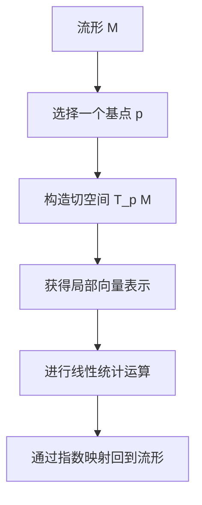
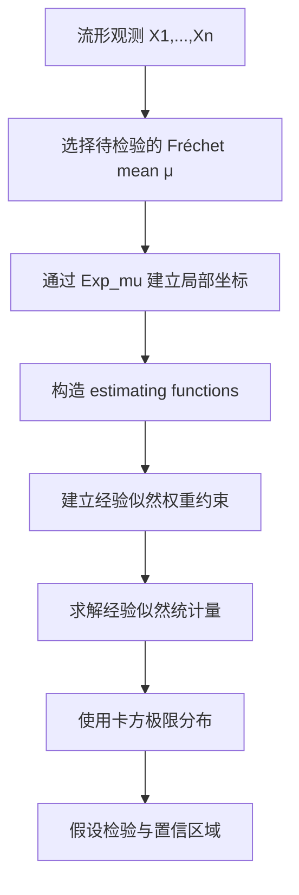

# 第 003 期｜流形、切空间与非欧统计推断

> Non-Euclidean Statistics · Learning & Research Notes

**日期：** 2026-11-18

**主题：** Manifolds, Tangent Spaces & Statistical Inference

**关键词：** Riemannian Manifold、Tangent Space、Exponential Map、Logarithm Map、Empirical Likelihood、Fréchet Mean

---

# 本期导读

本期继续采用基础知识与研究前沿并列的结构。

- **A. 基础知识：** 流形、切空间、黎曼度量、指数映射和对数映射。
- **B. 研究前沿：** 六项经典及近期高质量研究。
- **C. 核心精读：** Empirical likelihood for manifolds。
- **D. 总结：** 理论联系、自测与下一期预告。

本期的核心问题：

**如何将流形上的非线性统计问题转化为切空间中的统计推断问题？**

---

# A. 今日基础知识：流形与切空间

## A.1 什么是流形（Manifold）？

在欧氏空间中，我们通常处理：

```math
X\in\mathbb R^p
```

这里的数据可以进行加法、减法和数乘。

例如：

```math
\bar X=\frac1n\sum_{i=1}^nX_i
```

但如果数据是方向、旋转矩阵、协方差矩阵或者概率分布，这些操作未必具有合理的几何意义。

例如，单位球面：

```math
S^2=\{x\in\mathbb R^3:\|x\|=1\}
```

如果直接把两个球面点相加，结果通常不再属于球面。

因此，球面并不是一个向量空间。

但是，球面在每个足够小的局部区域内都可以通过二维坐标进行描述。

这就是流形的基本思想。

**定义直觉：**

一个 $d$ 维光滑流形，是一个局部可以用 $\mathbb R^d$ 中的坐标描述，并且坐标转换满足相应光滑性条件的空间。

这里需要区分：

- Ambient dimension：嵌入环境的维数。
- Intrinsic dimension：流形本身的维数。

例如，球面 $S^2$：

- Ambient dimension = 3；
- Intrinsic dimension = 2。

### 常见流形与统计对象

| 空间 | 内在维数 | 典型数据 |
|---|---:|---|
| $S^1$ | 1 | 方向角 |
| $S^2$ | 2 | 三维方向 |
| $SO(3)$ | 3 | 三维旋转 |
| $SPD(p)$ | $p(p+1)/2$ | 正定协方差矩阵 |
| $Gr(k,p)$ | $k(p-k)$ | $k$ 维子空间 |

---

## A.2 切空间（Tangent Space）

这是今天最重要的基础概念。

在流形上的某一点 $p$，我们可以构造一个局部线性空间，用来近似流形在该点附近的结构。

这个空间称为切空间：

```math
T_p\mathcal M
```

一种直观的定义方式是：

考虑所有满足 $\gamma(0)=p$ 的光滑曲线，那么它们在 $p$ 点的速度向量构成切空间：

```math
T_p\mathcal M
=
\{\dot\gamma(0):\gamma(0)=p\}
```

这里的向量表示曲线在该点的瞬时运动方向。

### 球面上的切空间

考虑单位球面：

```math
S^2=\{p\in\mathbb R^3:p^\top p=1\}
```

对球面上的点 $p$，其切空间为：

```math
T_pS^2
=
\{v\in\mathbb R^3:p^\top v=0\}
```

为什么？

因为曲线始终满足：

```math
\gamma(t)^\top\gamma(t)=1
```

对 $t$ 求导：

```math
2\gamma(t)^\top\dot\gamma(t)=0
```

在 $t=0$ 时：

```math
p^\top\dot\gamma(0)=0
```

所以切向量必须与球面的法向量正交。

### 图 1：流形与切空间



注意：

切空间是局部线性化工具，并不意味着整个流形变成了欧氏空间。

---

## A.3 黎曼度量（Riemannian Metric）

有了切空间，我们还需要定义向量之间的长度和夹角。

黎曼度量就是在每个切空间上定义一个内积：

```math
g_p:T_p\mathcal M\times T_p\mathcal M\rightarrow\mathbb R
```

对于两个切向量 $u,v$：

```math
g_p(u,v)
```

表示它们在点 $p$ 处的内积。

向量长度为：

```math
\|v\|_p=\sqrt{g_p(v,v)}
```

如果流形是嵌入在欧氏空间中的球面，并采用标准诱导度量，那么：

```math
g_p(u,v)=u^\top v
```

但是一般流形上的黎曼度量不一定等于环境空间中的普通内积。

### 曲线长度

给定一条曲线：

```math
\gamma:[0,1]\rightarrow\mathcal M
```

它的长度为：

```math
L(\gamma)
=
\int_0^1
\sqrt{
g_{\gamma(t)}
(\dot\gamma(t),\dot\gamma(t))
}\,dt
```

两个点之间的测地距离，就是所有连接它们的曲线长度的下确界。

---

## A.4 指数映射（Exponential Map）

假设：

```math
p\in\mathcal M,\qquad v\in T_p\mathcal M
```

我们从 $p$ 出发，沿着初速度为 $v$ 的测地线运动。

如果这条测地线记作 $\gamma_v(t)$，那么指数映射定义为：

```math
\exp_p(v)=\gamma_v(1)
```

它的作用是：

**把切空间中的向量转换为流形上的点。**

对于单位球面，指数映射具有显式表达式。

令：

```math
r=\|v\|
```

则：

```math
\exp_p(v)
=
\cos(r)p+\frac{\sin(r)}{r}v
```

其中 $v\ne0$。

当 $v=0$ 时：

```math
\exp_p(0)=p
```

这个公式说明，我们可以在切空间中确定一个运动方向和距离，再沿球面的测地线移动到对应位置。

---

## A.5 对数映射（Logarithm Map）

指数映射的局部逆映射称为对数映射：

```math
\log_p(q)\in T_p\mathcal M
```

它把流形上的点 $q$ 转换为基点 $p$ 处的切向量。

也就是说：

```math
\exp_p(\log_p(q))=q
```

但这只在指数映射具有适当局部可逆性的区域内成立。

对于单位球面，令：

```math
\theta=\arccos(p^\top q)
```

在 $q$ 不是 $p$ 的对跖点时：

```math
\log_p(q)
=
\frac{\theta}{\sin\theta}
(q-\cos\theta p)
```

### 一个重要限制：Cut Locus

在球面上，每个点都有一个对跖点。

从 $p$ 到它的对跖点存在多条长度相同的最短测地线。

因此，对数映射在对跖点处不再是单值的。

这引出两个概念：

- Cut Locus：割迹；
- Injectivity Radius：单射半径。

它们决定了我们能够在多大范围内使用一个稳定的指数坐标系统。

这一点对流形统计非常重要，因为很多统计方法需要对数映射来构造残差。

---

## A.6 从切空间到统计学

现在考虑随机对象：

```math
X\in\mathcal M
```

假设总体 Fréchet mean 为 $\mu$。

我们可以将每个观测转换到同一个切空间：

```math
Z=\log_\mu(X)\in T_\mu\mathcal M
```

于是，原本处于非线性空间的数据可以被表示为切向量。

在适当的可微性、唯一测地线和矩条件下，Fréchet mean 满足一阶条件：

```math
\mathbb E[\log_\mu(X)]=0
```

对应的样本一阶条件为：

```math
\sum_{i=1}^{n}\log_{\hat\mu_n}(X_i)=0
```

这里需要注意：

它是局部光滑条件下的 Fréchet 风险一阶条件，不是对所有一般度量空间都无条件成立的恒等式。

### 这有什么意义？

我们可以在切空间中构造：

- 均值和协方差；
- 回归模型；
- 统计检验；
- 渐近正态分布；
- 置信区域。

这就是流形统计的重要计算思路之一。

---

## A.7 今日练习

设单位球面北极点为：

```math
p=(0,0,1)
```

判断：

```math
v=(1,2,0)
```

是否属于 $T_pS^2$。

再令：

```math
r=\sqrt{a^2+b^2}
```

求：

```math
\exp_p(a,b,0)
```

### 答案

首先：

```math
p^\top v=0
```

所以 $v$ 属于切空间。

对于一般切向量 $(a,b,0)$：

```math
\exp_p(a,b,0)
=
\left(
\frac{a\sin r}{r},
\frac{b\sin r}{r},
\cos r
\right)
```

当 $r=0$ 时，结果就是北极点。

---

# B. 今日高质量研究雷达

本期不是简单按照 arXiv 最新时间排序，而是按照学术质量、研究价值和与非欧统计学的相关性筛选。

## B.1 Large Sample Theory of Intrinsic and Extrinsic Sample Means on Manifolds

**作者：** Rabi Bhattacharya, Vic Patrangenaru

**发表时间：** 2003、2005

**期刊：** The Annals of Statistics

**原文：**

- Part I: https://doi.org/10.1214/aos/1046294456
- Part II: https://doi.org/10.1214/009053605000000093

**性质：** 经典奠基性研究。

### 研究内容

这两篇论文系统研究了流形上 intrinsic mean 和 extrinsic mean 的统计性质。

主要贡献：

- 均值存在性与唯一性条件；
- 样本均值的一致性；
- 渐近分布；
- Bootstrap 置信区域；
- 球面、射影空间和形状空间的应用。

### 为什么重要？

它们建立了流形统计中从均值定义走向统计推断的重要理论框架。

特别是第二篇论文直接研究 Fréchet sample mean 的中心极限定理。

**推荐价值：极高。**

---

## B.2 Intrinsic Statistics on Riemannian Manifolds: Basic Tools for Geometric Measurements

**作者：** Xavier Pennec

**发表时间：** 2006

**期刊：** Journal of Mathematical Imaging and Vision, 25, 127–154

**原文：**

https://doi.org/10.1007/s10851-006-6228-4

**性质：** 经典理论与方法综述。

### 主要内容

- Riemannian metric；
- Geodesic distance；
- Exponential map；
- Fréchet mean；
- Covariance；
- Riemannian Gaussian；
- 流形上的梯度下降。

### 为什么推荐？

这篇文章将微分几何概念与统计计算联系起来，特别适合建立流形统计的数学工具箱。

它不是 Annals of Statistics 这样的统计顶刊论文，但在黎曼几何统计和医学图像计算方向具有重要基础价值。

**推荐价值：极高，建议作为基础阅读。**

---

## B.3 Fréchet Regression for Random Objects with Euclidean Predictors

**作者：** Alexander Petersen, Hans-Georg Müller

**发表时间：** 2019

**期刊：** The Annals of Statistics, 47(2), 691–719

**原文：**

https://doi.org/10.1214/17-AOS1624

**性质：** 经典方法论文。

### 研究问题

如何将经典线性回归推广到响应变量属于一般度量空间的情形？

### 主要贡献

提出 Fréchet regression：

- Global Fréchet regression；
- Local Fréchet regression；
- 条件 Fréchet mean；
- 非欧随机对象的回归估计。

### 为什么重要？

这篇论文是理解现代 Object Data Analysis 和 Metric Space Statistics 的重要起点。

后续研究中的变量选择、稳健估计、渐近推断，都可以与它建立联系。

**推荐价值：极高。**

---

## B.4 Empirical Likelihood for Manifolds

**作者：** Daisuke Kurisu, Taisuke Otsu

**发表时间：** 2025 年 online publication；2026 年期刊卷期

**期刊：** Journal of the Royal Statistical Society: Series B, 88(1), 91–119

**原文：**

https://doi.org/10.1093/jrsssb/qkaf043

**性质：** 正式发表的高水平统计理论研究。

### 研究问题

当流形上的 Fréchet mean 存在非标准渐近行为时，如何进行有效统计推断？

### 主要贡献

- 构造流形上的非参数经验似然；
- 建立 Wilks 型定理；
- 研究 Fréchet mean 的置信区域；
- 扩展到两样本检验；
- 研究 Fréchet variance；
- 扩展到局部 Fréchet regression；
- 处理 Fréchet mean set。

### 统计学意义

它将经验似然理论引入流形统计，为传统 Wald 检验之外提供了另一条重要推断路线。

**推荐价值：极高，本期核心精读。**

---

## B.5 Riemannian Ordinary Least Squares

**作者：** Xiaoyu Chen, Yujing Huang, Yingyan Zeng

**提交日期：** 2026-11-07

**状态：** NeurIPS 2026 Accepted

**原文：**

https://arxiv.org/abs/2611.10459

**项目主页：**

https://github.com/XiaoyuChenPub/ROLS

### 研究问题

如何在流形值响应变量的回归中，建立类似普通最小二乘回归的系数解释与显著性检验？

### 主要贡献

- Tangent-space conditional mean model；
- 闭式估计器；
- 预测误差界；
- 单个回归系数的 t-test；
- Wald test。

### 推荐理由

作者团队已经有 NeurIPS、ICML 等相关研究成果，论文也已获得 NeurIPS 2026 接收。

这不是因为它是最新预印本才推荐，而是因为它已经通过重要学术会议的同行评审。

**推荐价值：高。**

---

## B.6 Inference for Fréchet Regression

**作者：** Wookyeong Song, Paromita Dubey, Hans-Georg Müller, Alexander Petersen

**提交日期：** 2026-05-19

**状态：** arXiv 预印本，作者主页标注 Under Revision。

**原文：**

https://arxiv.org/abs/2605.19519

### 作者学术背景

这一研究团队具有较扎实的相关发表记录：

- Paromita Dubey：Annals of Statistics、Biometrika、JRSSB。
- Hans-Georg Müller：Annals of Statistics、JASA、JRSSB 等。
- Alexander Petersen：Annals of Statistics、Biometrika。
- Wookyeong Song：参与 Annals of Statistics 2026、JASA 2025 和 AISTATS 2026 等研究成果。

### 研究问题

如何检验 Fréchet regression 中解释变量是否具有统计显著性？

### 主要贡献

- 整体回归效应检验；
- 部分解释变量效应检验；
- Random multiplier 方法；
- Cauchy combination；
- 渐近理论和模拟研究。

### 推荐理由

传统回归可以使用 F-test 检验部分变量效应，但在一般度量空间中没有直接的向量线性结构。

这篇论文试图解决这个问题。

**推荐价值：高，但必须继续标注为未完成同行评审的研究。**

---

# C. 核心论文精读

# Empirical Likelihood for Manifolds

Daisuke Kurisu & Taisuke Otsu (2026)

Journal of the Royal Statistical Society: Series B

https://doi.org/10.1093/jrsssb/qkaf043

## C.1 研究动机：为什么普通 Wald 检验可能失效？

先回忆欧氏空间中的普通样本均值。

如果：

```math
X_1,\ldots,X_n\overset{iid}{\sim}P
```

且具有有限二阶矩，那么：

```math
\sqrt n(\bar X-\mu)
\xrightarrow{d}
N(0,\Sigma)
```

因此可以构造 Wald 统计量和置信区域。

在流形中，我们也希望获得类似的结果。

但存在一个问题：

Fréchet mean 的渐近理论依赖 Fréchet 风险函数在总体均值附近的局部几何结构。

特别是 Hessian 的非退化性。

如果 Hessian 发生奇异，传统的根号 $n$ 收敛速度可能不再成立。

### Smeariness（非标准收敛现象）

在一些流形分布下，样本 Fréchet mean 可能以慢于 $n^{-1/2}$ 的速度收敛，而且极限分布不再是通常的正态分布。

这称为 smeariness。

它不是数据中出现异常值，而是数据分布与流形几何共同导致的统计现象。

### 研究问题

如果传统 CLT 不成立，我们是否还能构造有效的置信区域？

这就是论文的主要动机。

---

## C.2 数学设定

设随机对象：

```math
X\in\mathcal M
```

其中 $\mathcal M$ 是一个局部具有黎曼流形结构的空间。

考虑一般损失函数：

```math
\tilde\rho(p,X)
```

定义总体 Fréchet 风险：

```math
F(p)=\mathbb E[\tilde\rho(p,X)]
```

总体均值 $\mu$ 满足：

```math
F(\mu)=\min_{p\in\mathcal M}F(p)
```

为了进行局部统计分析，使用指数映射：

```math
\exp_\mu(x)
```

其中：

```math
x\in\mathbb R^m
```

表示切空间中的局部坐标。

定义切空间中的 estimating function：

```math
g(X,\mu)
=
\left.
\frac{\partial}{\partial x}
\tilde\rho(\exp_\mu(x),X)
\right|_{x=0}
```

在适当的可微性条件下：

```math
\mathbb E[g(X,\mu)]=0
```

这就是我们需要的矩条件。

**重要联系：**

在平方测地距离损失下，这个 estimating function 与切空间中的对数映射直接相关。

因此，切空间不仅是几何上的局部线性化工具，也成为统计推断的计算基础。

---

## C.3 Empirical Likelihood 的基本思想

在普通经验似然中，我们不直接假设数据来自某个特定参数分布。

相反，我们给每个观测赋予一个概率权重：

```math
p_1,\ldots,p_n
```

要求：

```math
p_i\geq0
```

```math
\sum_{i=1}^{n}p_i=1
```

同时满足 estimating equation：

```math
\sum_{i=1}^{n}p_i g(X_i,\mu)=0
```

然后最大化非参数对数似然：

```math
\sum_{i=1}^{n}\log p_i
```

这样就可以得到经验似然函数。

与普通参数似然不同，这种方法不需要预先指定完整的参数分布。

### 图 2：流形经验似然的基本流程



---

## C.4 核心统计量

论文使用经验似然的对偶形式。

定义：

```math
\ell_n(\mu)
=
2\max_{\lambda\in\mathbb R^m}
\sum_{i=1}^{n}
\log\left(
1+\lambda^\top g(X_i,\mu)
\right)
```

其中：

- $\mu$ 是待检验的总体 Fréchet mean；
- $g(X_i,\mu)$ 是切空间中的 estimating function；
- $\lambda$ 是对偶变量。

这个表达式将原本关于 $n$ 个概率权重的约束优化问题，转化为关于 $m$ 维向量 $\lambda$ 的优化问题。

这使得实际计算更加方便。

---

## C.5 最重要的理论结果：Wilks Theorem

论文的 Theorem 1 给出：

在论文 Assumption 1 下：

```math
\ell_n(\mu)
\xrightarrow{d}
\chi_m^2
```

其中 $m$ 是局部流形维数。

这里的主要条件包括：

1. 观测独立同分布；
2. 总体广义 Fréchet mean 唯一；
3. 样本广义 Fréchet mean 一致收敛；
4. 均值附近存在适当的局部黎曼流形结构；
5. 指数映射在局部区域具有所需的光滑可逆性；
6. estimating function 存在且具有有限二阶矩。

**最重要的一点：**

该简单原假设下的 Wilks 型结果不要求传统 Wald 渐近理论所需要的 Fréchet 风险 Hessian 非奇异。

这意味着即使样本 Fréchet mean 出现 smeariness，论文的 Theorem 1 仍然可以提供相应的经验似然渐近推断。

---

## C.6 如何构造检验？

假设我们希望检验：

```math
H_0:\mu=\mu_0
```

对立假设为：

```math
H_1:\mu\neq\mu_0
```

根据 Theorem 1，可以采用：

```math
\ell_n(\mu_0)>
\chi^2_{m,1-\alpha}
```

作为拒绝域。

其中 $\alpha$ 是显著性水平。

对应的渐近置信区域为：

```math
\mathcal C_{1-\alpha}
=
\left\{
p\in\mathcal M:
\ell_n(p)\leq
\chi^2_{m,1-\alpha}
\right\}
```

与 Wald 置信区域相比，经验似然可以自动决定置信区域的形状，不必事先限定为椭球。

---

## C.7 为什么这个结果值得关注？

可以从两个方法的区别理解。

| 比较 | Wald 方法 | Empirical Likelihood |
|---|---|---|
| 核心依据 | 估计量的渐近正态性 | 矩条件与经验似然 |
| Hessian 非退化性 | 传统理论通常需要 | 简单原假设的 Theorem 1 不要求 |
| Smeariness | 可能失效 | 对简单均值原假设具有相应保证 |
| 置信区域 | 通常为椭球 | 可以具有更灵活的形状 |

注意：论文中的 robustness 指对 smeariness 的适应能力，不代表它是对异常值污染稳健的估计器。

另外，论文对复合原假设的 plug-in 经验似然扩展有更强的条件，其 Remark 3 也明确指出该扩展不能直接继承简单原假设下对 smeariness 的稳健性。

这一区别很重要。

---

## C.8 论文进一步扩展了什么？

作者不仅研究单个 Fréchet mean 的检验，还扩展了经验似然框架。

主要包括：

1. Two-sample testing；
2. Fréchet variance inference；
3. Quasi-Bayesian inference；
4. Local Fréchet regression；
5. Fréchet mean set estimation。

这意味着经验似然并不是只适用于一个特定的均值检验，而有潜力成为非欧统计推断中的通用工具。

---

## C.9 研究贡献与局限

### 主要贡献

- 将经验似然系统引入流形统计。
- 建立 Wilks 型渐近理论。
- 在简单均值原假设下避免对 Hessian 非奇异性的要求。
- 为 smeariness 情形提供传统 Wald 方法之外的推断方案。
- 扩展至多个非欧统计问题。

### 局限

- 仍依赖一定的局部流形和指数映射条件。
- 需要样本均值具有一致性。
- 实际计算需要求解对偶优化问题。
- 复合假设下的推断需要额外条件。
- 经验似然并不自动解决多峰、均值不唯一和异常值污染的全部问题。

---

## C.10 值得继续研究的方向

以下是基于论文提出的研究问题，并非原文已经证明的结果。

**方向一：高维流形经验似然**

当流形维数随着样本量增加时，Wilks 型结论是否还能成立？

**方向二：稳健经验似然**

能否将 Median-of-Means 或稳健 estimating functions 与流形经验似然结合？

**方向三：复杂度更高的 Fréchet regression**

能否建立对非欧响应变量、非欧解释变量同时有效的经验似然推断？

**方向四：均值集合推断**

当 Fréchet mean 不唯一时，能否构造更完整的集合置信区域，而不只是单个均值的置信区域？

---

# D. 今日总结

## D.1 三条核心收获

**1. 流形不是向量空间，但切空间具有局部线性结构。**

这为非欧统计提供了构造残差、协方差和回归模型的工具。

**2. 指数映射和对数映射是流形统计的重要桥梁。**

但它们的局部可逆性受到 cut locus 和 injectivity radius 的限制。

**3. 传统渐近正态理论不是非欧统计推断的唯一途径。**

Empirical Likelihood 可以在传统 Hessian 非退化性失效的某些情形下继续进行有效推断。

---

## D.2 今日自测

假设 $X$ 是流形上的随机对象，$\mu$ 是其唯一 Fréchet mean。

请回答：

1. 为什么不能直接计算 $X-\mu$？
2. 应该使用什么映射构造局部残差？
3. Empirical Likelihood 的核心约束是什么？
4. 为什么它在 smeariness 情况下仍然具有价值？

### 答案

1. 因为一般流形没有自然的向量减法。
2. 使用对数映射 $\log_\mu(X)$，得到切空间中的向量。
3. 利用 estimating function 构造加权矩约束：

```math
\sum_{i=1}^{n}p_i g(X_i,\mu)=0
```

同时满足权重非负且总和为 1。

4. 因为简单原假设下的 Wilks 型经验似然统计量不要求传统 Wald 渐近理论中的 Hessian 非奇异条件。

---

## D.3 下一期预告

### 第 004 期｜黎曼度量、曲率与平行传输

基础知识：

- Riemannian Metric；
- Sectional Curvature；
- Parallel Transport；
- Covariant Derivative；
- 不同切空间之间的向量比较。

研究前沿：

- Riemannian Covariance；
- Intrinsic Cross-covariance；
- Manifold-valued Regression；
- 曲率对统计推断的影响。

特别关注一个问题：

**两个不同切空间中的随机向量，如何进行有统计意义的协方差计算？**

---

# 参考文献

## 经典基础研究

1. Bhattacharya, R. and Patrangenaru, V. (2003). Large sample theory of intrinsic and extrinsic sample means on manifolds. The Annals of Statistics, 31(1), 1–29.

   https://doi.org/10.1214/aos/1046294456

2. Bhattacharya, R. and Patrangenaru, V. (2005). Large sample theory of intrinsic and extrinsic sample means on manifolds—II. The Annals of Statistics, 33(3), 1225–1259.

   https://doi.org/10.1214/009053605000000093

3. Pennec, X. (2006). Intrinsic Statistics on Riemannian Manifolds: Basic Tools for Geometric Measurements. Journal of Mathematical Imaging and Vision, 25, 127–154.

   https://doi.org/10.1007/s10851-006-6228-4

4. Petersen, A. and Müller, H.-G. (2019). Fréchet Regression for Random Objects with Euclidean Predictors. The Annals of Statistics, 47(2), 691–719.

   https://doi.org/10.1214/17-AOS1624

## 高质量近期研究

5. Kurisu, D. and Otsu, T. (2026). Empirical Likelihood for Manifolds. Journal of the Royal Statistical Society: Series B, 88(1), 91–119.

   https://doi.org/10.1093/jrsssb/qkaf043

6. Chen, X., Huang, Y. and Zeng, Y. (2026). Riemannian Ordinary Least Squares. NeurIPS 2026, accepted.

   https://arxiv.org/abs/2611.10459

7. Song, W., Dubey, P., Müller, H.-G. and Petersen, A. (2026). Inference for Fréchet Regression. Preprint, under revision.

   https://arxiv.org/abs/2605.19519

---

**Non-Euclidean Statistics Learning Notes · Issue 003**

*本笔记用于系统学习非欧统计学与追踪高质量研究成果。理论结论以原始论文及其明确假设为准。*
