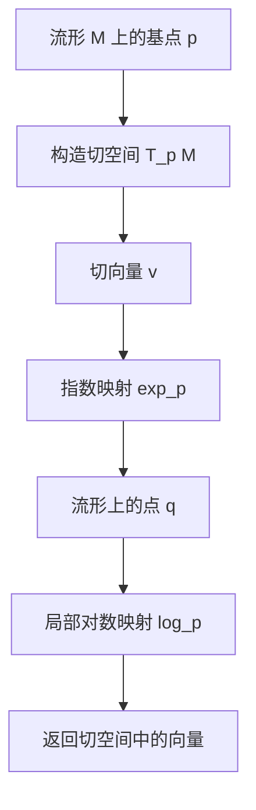
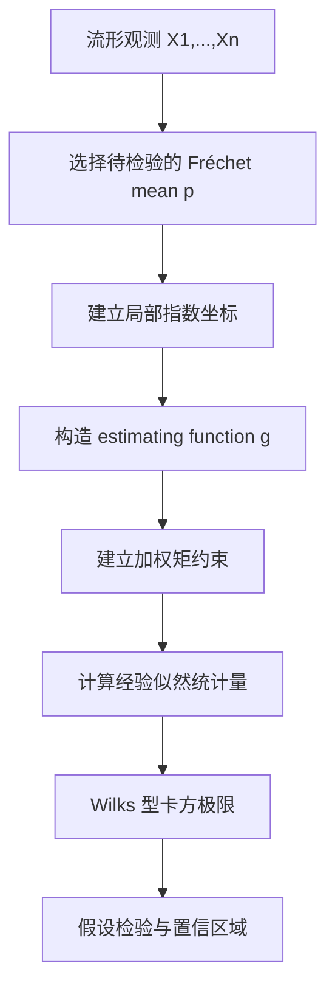
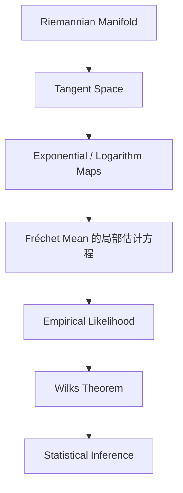

# 第 003 期｜流形、切空间与非欧统计推断

> Non-Euclidean Statistics · Learning & Research Notes

**日期：** 2026-11-18  
**主题：** Manifolds, Tangent Spaces & Statistical Inference  
**关键词：** Riemannian Manifold、Tangent Space、Exponential Map、Logarithm Map、Fréchet Mean、Empirical Likelihood、Smeariness

---

## 本期导读

前两期分别学习了：

- 第 001 期：度量空间、Fréchet mean 与 Fréchet regression。
- 第 002 期：测地距离、测地线、CAT(0) 空间与重心集中不等式。

本期进一步进入**流形统计（Manifold Statistics）**。

我们需要回答两个问题：

1. 如果数据位于弯曲空间中，如何进行类似欧氏空间的线性统计运算？
2. 如果流形上的 Fréchet mean 不满足经典中心极限定理，能否继续进行统计推断？

本期内容：

- **A. 基础知识：** 流形、切空间、黎曼度量、指数映射和对数映射。
- **B. 高质量研究精选：** 五篇具有明确学术价值的经典、正式发表及已接收论文。
- **C. 核心精读：** *Empirical likelihood for manifolds*。
- **D. 总结：** 三个收获、自测与下一期预告。

---

# A. 今日基础知识：流形与切空间

## A.1 为什么需要流形？

传统统计通常处理欧氏随机向量：

```math
X\in\mathbb R^p
```

例如，身高、体重和年龄构成的特征向量。

在欧氏空间中，可以自然地进行：

- 加法；
- 数乘；
- 线性组合；
- 内积；
- 均值和协方差计算。

但如果数据是方向、旋转、协方差矩阵或形状，情况就有所不同。

例如，单位球面：

```math
S^2=
\{x\in\mathbb R^3:\|x\|=1\}
```

球面上的两个点相加，结果一般不再位于球面上。

因此，球面不是一个向量空间。

不过，球面具有一个重要性质：

**在每个足够小的局部区域中，我们都可以使用二维欧氏坐标描述它。**

这就是流形思想的出发点。

### 流形的直观定义

一个 $m$ 维光滑流形 $\mathcal M$，可以理解为一个局部与 $\mathbb R^m$ 具有相同坐标结构，且局部坐标变换满足光滑性条件的空间。

注意区分两个维数：

- **Ambient Dimension：** 嵌入空间的维数；
- **Intrinsic Dimension：** 流形本身的维数。

例如，对于单位球面 $S^2$：

```math
S^2\subset\mathbb R^3
```

它的环境维数为 3，内在维数为 2。

### 常见统计流形

| 空间 | 内在维数 | 数据类型 |
|---|---:|---|
| 圆周 $S^1$ | 1 | 角度、周期数据 |
| 球面 $S^2$ | 2 | 三维方向数据 |
| 旋转群 $SO(3)$ | 3 | 姿态与旋转 |
| SPD 矩阵空间 | $p(p+1)/2$ | 正定协方差矩阵 |
| Grassmann 流形 $Gr(k,p)$ | $k(p-k)$ | $k$ 维线性子空间 |

流形统计的核心思想是：

利用局部线性结构和全局几何结构，建立适用于非线性数据空间的统计方法。

---

## A.2 切空间（Tangent Space）

切空间是理解流形统计最重要的概念之一。

### 直观理解

想象站在地球表面的一点。

地球表面是弯曲的，但脚下很小的一块区域可以近似为平面。

这个局部平面，就是切空间的直观模型。

设：

```math
p\in\mathcal M
```

则 $p$ 处的切空间记为：

```math
T_p\mathcal M
```

它是一个 $m$ 维向量空间。

### 从曲线定义切向量

考虑经过 $p$ 的光滑曲线：

```math
\gamma(0)=p
```

其在 $p$ 处的速度：

```math
\dot\gamma(0)
```

定义了一个切向量。

对于嵌入式流形，可以将切空间理解为所有这类速度向量组成的集合。

对于抽象流形，更严格的定义通过曲线等价类或导子给出。

### 球面切空间

考虑：

```math
S^2=
\{p\in\mathbb R^3:p^\top p=1\}
```

单位球面在点 $p$ 的切空间为：

```math
T_pS^2
=
\{v\in\mathbb R^3:p^\top v=0\}
```

也就是说，切向量必须与半径方向正交。

为什么？

因为球面上的曲线满足：

```math
\gamma(t)^\top\gamma(t)=1
```

对时间求导：

```math
2\gamma(t)^\top\dot\gamma(t)=0
```

令 $t=0$：

```math
p^\top\dot\gamma(0)=0
```

因此，球面上的任意切向量都与 $p$ 正交。

### 示例

设北极点：

```math
p=(0,0,1)
```

那么：

```math
T_pS^2
=
\{(a,b,0):a,b\in\mathbb R\}
```

它正好是三维空间中的水平平面。

---

## A.3 黎曼度量（Riemannian Metric）

有了切空间，我们可以进行向量运算。

但还需要回答：

**切向量的长度和夹角应该如何定义？**

这就需要黎曼度量。

对于每个点 $p\in\mathcal M$，黎曼度量定义一个内积：

```math
g_p(u,v)
```

其中：

```math
u,v\in T_p\mathcal M
```

黎曼度量随 $p$ 光滑变化。

它定义了切向量的长度：

```math
\|v\|_p
=
\sqrt{g_p(v,v)}
```

以及角度、曲线长度等几何量。

### 曲线长度

设：

```math
\gamma:[0,1]\rightarrow\mathcal M
```

是一条分段光滑曲线。

其长度为：

```math
L(\gamma)
=
\int_0^1
\sqrt{
g_{\gamma(t)}
\left(
\dot\gamma(t),
\dot\gamma(t)
\right)
}
\,dt
```

流形上两点之间的黎曼距离，可以通过连接两点的曲线长度的下确界定义。

### 为什么重要？

不同的黎曼度量可以对应不同的统计模型。

例如，在 SPD 矩阵空间中，可以考虑：

- Euclidean Metric；
- Affine-Invariant Riemannian Metric；
- Log-Euclidean Metric。

选择不同的度量，可能得到不同的 Fréchet mean、回归结果和统计解释。

---

## A.4 指数映射（Exponential Map）

给定流形上的一个点：

```math
p\in\mathcal M
```

以及切向量：

```math
v\in T_p\mathcal M
```

假设存在一条满足以下初始条件的测地线：

```math
\gamma_v(0)=p
```

```math
\dot\gamma_v(0)=v
```

则指数映射定义为：

```math
\exp_p(v)=\gamma_v(1)
```

直观上：

**指数映射把切空间中的向量，转换为流形上的点。**

需要注意，指数映射一般在零向量附近局部定义；若流形测地完备，则可以在整个切空间上定义。

### 单位球面上的指数映射

设：

```math
p\in S^2,\qquad v\in T_pS^2
```

令：

```math
r=\|v\|
```

当 $r>0$ 时：

```math
\exp_p(v)
=
\cos(r)p
+
\frac{\sin(r)}{r}v
```

当 $r=0$ 时：

```math
\exp_p(0)=p
```

这个公式说明：

从球面上的点 $p$ 出发，沿切向量 $v$ 指定的初始方向运动，可以到达新的球面点。

---

## A.5 对数映射（Logarithm Map）

指数映射的局部逆映射称为对数映射。

记作：

```math
\log_p(q)\in T_p\mathcal M
```

它把流形上的点 $q$ 转换为基点 $p$ 处的切向量。

在适当的局部区域中：

```math
\exp_p(\log_p(q))=q
```

### 单位球面上的对数映射

给定两个单位向量 $p,q$。

令：

```math
\theta=\arccos(p^\top q)
```

对于：

```math
0<\theta<\pi
```

有：

```math
\log_p(q)
=
\frac{\theta}{\sin\theta}
\left(
q-\cos(\theta)p
\right)
```

并定义：

```math
\log_p(p)=0
```

这个公式具有明确的几何意义：

- 向量方向表示从 $p$ 指向 $q$ 的最短测地方向；
- 向量长度等于两点的测地距离。

### Cut Locus：为什么对数映射不一定全局唯一？

在单位球面上，每个点都有一个对跖点。

从 $p$ 到对跖点存在无穷多条最短半大圆路径。

因此，在对跖点处，最短测地线方向不唯一。

这意味着对数映射无法在那里以单值方式定义。

这就是流形统计中经常需要讨论：

- Cut Locus；
- Injectivity Radius；
- Local Coordinates；

的原因。

### 图 1：流形、切空间与映射关系



---

## A.6 从几何概念走向统计学

前两期介绍了总体 Fréchet mean。

对随机对象：

```math
X\in\mathcal M
```

定义：

```math
F(p)
=
\frac12\mathbb E[d^2(X,p)]
```

总体 Fréchet mean $\mu$ 满足：

```math
F(\mu)
=
\min_{p\in\mathcal M}F(p)
```

如果 $\mu$ 附近的 Fréchet 风险足够光滑，且涉及的对数映射满足适当的唯一性与可积性条件，那么：

```math
\nabla F(\mu)
=
-\mathbb E[\log_\mu(X)]
```

因此，局部极小点的一阶必要条件是：

```math
\mathbb E[\log_\mu(X)]=0
```

对于样本 Fréchet mean，也可以得到对应的局部一阶条件：

```math
\sum_{i=1}^{n}
\log_{\hat\mu_n}(X_i)
=
0
```

这两个公式非常重要。

它们说明：

**可以将流形上的 Fréchet mean 问题转换为切空间中的估计方程。**

不过，这些等式依赖光滑性等条件，不能无条件用于任意度量空间。

### 与经典统计的联系

欧氏均值满足：

```math
\mathbb E[X-\mu]=0
```

而流形上的内在 Fréchet mean 在适当条件下满足：

```math
\mathbb E[\log_\mu(X)]=0
```

因此，对数映射在某种意义上扮演了非欧空间中的“局部减法”。

这为流形上的估计、回归和假设检验提供了重要工具。

---

# B. 高质量研究精选

本期选择五篇论文。

所有论文均具有明确的正式发表或会议接收状态。

与第 001、002 期正式推荐的文献不重复。

---

## B.1 Intrinsic Statistics on Riemannian Manifolds: Basic Tools for Geometric Measurements

**作者：** Xavier Pennec  
**年份：** 2006  
**期刊：** Journal of Mathematical Imaging and Vision, 25(1), 127–154  
**状态：** 正式发表  
**类型：** 经典方法与理论研究

**原文：**

https://doi.org/10.1007/s10851-006-6228-4

**作者研究主页：**

https://www-sop.inria.fr/members/Xavier.Pennec/RiemannianGeometricStatistics.html

### 研究问题

如何在黎曼流形上系统定义均值、协方差、概率模型和统计估计方法？

### 核心贡献

论文从几何统计角度研究：

- Fréchet mean；
- Riemannian distance；
- Exponential and logarithm maps；
- Intrinsic covariance；
- 流形上的统计优化；
- 局部概率建模。

### 学术价值

这篇论文将微分几何语言系统引入统计计算。

Xavier Pennec 长期从事黎曼几何统计和医学图像分析，并发表了多项相关研究。

对于学习流形统计的数学工具，它具有很高的参考价值。

### 局限

论文主要建立几何统计的基础框架，不是针对一般度量空间的统一非参数推断理论。

一些方法依赖局部坐标、均值唯一性以及指数映射的适用区域。

**推荐度：极高，基础必读。**

---

## B.2 Omnibus CLTs for Fréchet Means and Nonparametric Inference on Non-Euclidean Spaces

**作者：** Rabi Bhattacharya, Lizhen Lin  
**年份：** 2017  
**期刊：** Proceedings of the American Mathematical Society, 145(1), 413–428  
**状态：** 正式发表  
**类型：** 渐近统计理论

**原文：**

https://doi.org/10.1090/proc/13216

**开放预印本：**

https://arxiv.org/abs/1306.5806

### 研究问题

一般非欧空间中的样本 Fréchet mean 是否具有中心极限定理？

传统理论通常针对某些特定流形。

但现代复杂数据还包括树空间、分层空间和其他非光滑对象空间。

### 核心贡献

论文提出更一般的 Fréchet mean 中心极限定理。

其中：

- 通过局部坐标和 Fréchet 风险分析研究极限分布；
- 扩大非欧中心极限定理的适用范围；
- 讨论非参数统计推断；
- 将理论推广到某些分层空间。

### 作者研究背景

Rabi Bhattacharya 是非欧统计渐近理论的重要研究者。

Lizhen Lin 的相关研究涉及流形与非欧空间统计。

该论文发表于美国数学会的正式期刊，而非未经同行评审的预印本。

### 统计学价值

它为非欧数据中的置信区域和假设检验提供了重要理论基础。

### 局限

相关中心极限定理需要满足局部正则性、矩条件以及非退化条件。

当这些条件失效时，可能出现非标准极限分布。

**推荐度：极高。**

---

## B.3 A Smeary Central Limit Theorem for Manifolds with Application to High-Dimensional Spheres

**作者：** Benjamin Eltzner, Stephan F. Huckemann  
**年份：** 2019  
**期刊：** The Annals of Statistics, 47(6), 3360–3381  
**状态：** 正式发表  
**类型：** 非标准渐近理论

**原文：**

https://doi.org/10.1214/18-AOS1781

**开放预印本：**

https://arxiv.org/abs/1801.06581

### 研究问题

在流形上，样本 Fréchet mean 是否一定具有经典的根号 $n$ 收敛速度？

答案是否定的。

当总体 Fréchet 风险在均值附近的局部曲率发生特殊退化时，样本均值可能出现更慢的收敛速度。

### 核心贡献

论文建立了 Smeary Central Limit Theorem。

重点研究：

- 非标准 Fréchet mean 渐近理论；
- 高维球面上的 smeariness；
- Hessian 退化与收敛速度的关系；
- 流形几何对统计推断的影响。

### 为什么值得推荐？

这是正式发表于 Annals of Statistics 的理论研究。

它指出：

**不能把欧氏空间的中心极限定理机械地搬到流形上。**

正是这类现象推动了后续研究新的流形推断方法。

### 局限

论文讨论的是具有特定几何和分布性质的非标准现象。

Smeariness 并不意味着所有流形均值都不满足经典中心极限定理。

**推荐度：极高。**

---

## B.4 Empirical Likelihood for Manifolds

**作者：** Daisuke Kurisu, Taisuke Otsu  
**年份：** 2026  
**期刊：** Journal of the Royal Statistical Society: Series B, 88(1), 91–119  
**状态：** 正式发表  
**类型：** 高水平统计推断理论

**原文：**

https://doi.org/10.1093/jrsssb/qkaf043

**代码：**

https://github.com/DKurisu/Manifold-EL

### 研究问题

当流形上的 Fréchet mean 出现非标准渐近行为时，如何构造有效的假设检验和置信区域？

### 核心贡献

- 将 Empirical Likelihood 引入流形统计；
- 构造基于切空间 estimating equations 的非参数似然；
- 建立 Wilks 型极限定理；
- 研究 smeariness 情形下的均值推断；
- 扩展到两样本检验和 Fréchet variance；
- 研究局部 Fréchet regression 和均值集合。

### 作者学术背景

Daisuke Kurisu 的相关研究涉及非参数统计、时间序列及非欧统计。

Taisuke Otsu 长期研究计量经济学与统计推断，具有多项高水平正式发表成果。

论文正式发表于 JRSSB，是本期重点推荐的理论研究。

### 局限

理论仍依赖适当的局部流形结构、矩条件和 estimating equation 的非退化性。

对复合原假设的扩展需要比简单原假设更多的条件。

**推荐度：极高，本期核心精读。**

---

## B.5 Riemannian Ordinary Least Squares

**作者：** Xiaoyu Chen, Yujing Huang, Yingyan Zeng  
**日期：** 2026-11  
**会议：** NeurIPS 2026  
**状态：** 已接收  
**类型：** 近期几何统计方法研究

**原文：**

https://arxiv.org/abs/2611.10459

**代码：**

https://github.com/XiaoyuChenPub/ROLS

**作者主页：**

https://www.acsu.buffalo.edu/~xchen325/

### 研究问题

如何将 Ordinary Least Squares 推广到流形值响应，并为单个回归系数建立统计检验？

### 核心贡献

提出 Riemannian Ordinary Least Squares（ROLS）：

- 构造切空间条件均值模型；
- 同时支持标量和流形值解释变量；
- 在局部几何条件下提供闭式估计器；
- 建立带有曲率偏差项的预测误差界；
- 建立单个系数的渐近 t-test 与 Wald test。

### 作者背景与质量判断

论文已经获得 NeurIPS 2026 接收。

作者公开研究主页列出了该研究与相关流形统计成果。

因此，它不只是时间较新的普通 arXiv 预印本。

### 统计学价值

传统 Fréchet regression 重视条件中心位置及预测。

ROLS 进一步关注回归系数的解释性与统计显著性。

### 局限

- 依赖适当的局部几何条件；
- 对数映射可能受到 cut locus 影响；
- 预测结果可能存在曲率相关偏差；
- 局部线性模型不一定适合所有复杂流形关系。

**推荐度：高。**

---

# C. 核心论文精读

## Empirical Likelihood for Manifolds

**作者：** Daisuke Kurisu, Taisuke Otsu

**期刊：** Journal of the Royal Statistical Society: Series B

**年份：** 2026

**DOI：** https://doi.org/10.1093/jrsssb/qkaf043

**代码：** https://github.com/DKurisu/Manifold-EL

---

## C.1 研究动机：为什么经典推断可能失效？

在普通欧氏空间中，如果：

```math
X_1,\ldots,X_n
```

为独立同分布样本，具有有限二阶矩，那么样本均值在适当条件下满足：

```math
\sqrt n(\bar X-\mu)
\xrightarrow{d}
N(0,\Sigma)
```

因此可以构造：

- Wald test；
- 置信椭球；
- 渐近显著性检验。

但是，对于流形数据，Fréchet mean 的渐近分布还受到几何结构影响。

传统推断往往需要分析总体 Fréchet 风险在均值附近的 Hessian。

如果 Hessian 非奇异，通常可以通过局部展开建立根号 $n$ 型渐近结果。

但如果 Hessian 发生退化，经典结论可能失效。

### Smeariness

Smeariness 指某些流形估计问题中出现的非标准收敛现象。

在特定情况下，样本 Fréchet mean 的收敛速度可能慢于：

```math
n^{-1/2}
```

因此，传统 Wald 统计量可能无法使用通常的正态或卡方渐近近似。

### 论文的问题

作者希望回答：

**是否存在一种推断方法，不必依赖 Fréchet 风险 Hessian 的非奇异性，也能对流形均值构造有效检验？**

他们选择了 Empirical Likelihood。

---

## C.2 什么是 Empirical Likelihood？

Empirical Likelihood（经验似然）是一类非参数统计推断方法。

它不要求我们首先指定完整的概率分布族。

相反，可以从一个总体矩条件出发：

```math
\mathbb E[g(X,\theta)]=0
```

通过给样本分配概率权重，构造非参数似然函数。

设样本为：

```math
X_1,\ldots,X_n
```

给每个样本设置权重：

```math
p_1,\ldots,p_n
```

要求：

```math
p_i\geq0
```

```math
\sum_{i=1}^{n}p_i=1
```

以及：

```math
\sum_{i=1}^{n}
p_i g(X_i,\theta)
=
0
```

然后在这些约束下最大化权重乘积。

这种方法的关键特点是：

**将统计参数推断转化为对满足矩条件的样本权重进行优化。**

---

## C.3 流形上的数学设定

设：

```math
X\in\mathcal M
```

其中 $\mathcal M$ 在总体均值附近具有适当的黎曼流形结构。

考虑一个广义损失函数：

```math
\rho(p,X)
```

定义总体风险：

```math
F(p)=\mathbb E[\rho(p,X)]
```

总体广义 Fréchet mean $\mu$ 满足：

```math
F(\mu)
=
\min_{p\in\mathcal M}F(p)
```

为了建立估计方程，使用局部指数坐标。

令：

```math
u\in T_p\mathcal M
```

构造局部函数：

```math
u\mapsto\rho(\exp_p(u),X)
```

在选定的切空间坐标系中，可以定义 estimating function：

```math
g(X,p)
=
\left.
\frac{\partial}{\partial u}
\rho(\exp_p(u),X)
\right|_{u=0}
```

这里的 $g(X,p)$ 是用局部坐标表示的向量。

在适当的可微性和可积性条件下，总体 Fréchet mean 满足：

```math
\mathbb E[g(X,\mu)]=0
```

这就是论文构造经验似然的关键。

### 与普通 Fréchet Mean 的联系

如果使用平方测地距离损失：

```math
\rho(p,X)
=
\frac12d^2(p,X)
```

并且相关对数映射唯一、损失函数局部光滑，那么：

```math
g(X,p)
=
-\log_p(X)
```

这里等式在切空间坐标中理解。

因此，经验似然的矩条件与 Fréchet mean 的一阶条件直接联系起来。

---

## C.4 流形上的经验似然估计

考虑待检验的总体均值：

```math
p\in\mathcal M
```

记：

```math
g_i(p)=g(X_i,p)
```

在约束：

```math
\sum_{i=1}^{n}p_i=1
```

以及：

```math
\sum_{i=1}^{n}p_i g_i(p)=0
```

下，定义经验似然比：

```math
EL_n(p)
=
\max
\prod_{i=1}^{n}(np_i)
```

这里的最大化是对满足约束的非负权重进行的。

对应的经验似然统计量为：

```math
\ell_n(p)
=
-2\log EL_n(p)
```

在可行且满足适当内部条件时，可写成对偶形式：

```math
\ell_n(p)
=
2\max_{\lambda\in\Lambda_n(p)}
\sum_{i=1}^{n}
\log\left(
1+\lambda^\top g_i(p)
\right)
```

其中：

```math
\Lambda_n(p)
=
\left\{
\lambda\in\mathbb R^m:
1+\lambda^\top g_i(p)>0
\text{ for all }i
\right\}
```

### 如何理解？

原始经验似然需要优化 $n$ 个样本权重。

通过对偶变换，可以转化为优化一个维数为 $m$ 的向量 $\lambda$。

其中 $m$ 是局部流形维数。

这就是从非欧几何到可计算统计量的重要一步。

---

## C.5 核心理论：Wilks 型定理

论文的一个重要结果是：

在 Theorem 1 所列的正则条件下，如果 $\mu$ 为总体广义 Fréchet mean，则：

```math
\ell_n(\mu)
\xrightarrow{d}
\chi_m^2
```

其中：

- $\ell_n(\mu)$ 是在真实总体均值处计算的经验似然统计量；
- $m$ 是流形的局部维数；
- $\chi_m^2$ 是具有 $m$ 个自由度的卡方分布。

### 为什么重要？

普通 Wald 推断经常需要：

- 样本均值的渐近正态性；
- 适当的 Hessian 非奇异条件；
- 相应的渐近协方差估计。

但这篇论文对简单均值原假设建立的 Wilks 型结果，并不要求 Fréchet 风险 Hessian 非奇异。

因此，在一些具有 smeariness 的情形中，经验似然仍能够建立渐近有效的检验。

### 必须注意的条件

这个结果并不是无条件成立。

论文仍需要：

- 独立同分布样本；
- 适当的局部黎曼流形结构；
- 指数坐标的局部光滑可逆性；
- estimating function 的矩条件；
- estimating function 协方差的适当非退化性；
- 论文中规定的其他一致性和正则条件。

**不要求 Fréchet 风险 Hessian 非奇异，并不等于不需要任何非退化条件。**

这一区别非常重要。

---

## C.6 如何构造假设检验？

考虑简单原假设：

```math
H_0:\mu=\mu_0
```

以及：

```math
H_1:\mu\neq\mu_0
```

根据 Wilks 型定理，渐近水平为 $\alpha$ 的检验可以使用：

```math
\ell_n(\mu_0)
>
\chi^2_{m,1-\alpha}
```

作为拒绝规则。

其中：

```math
\chi^2_{m,1-\alpha}
```

表示自由度为 $m$ 的卡方分布的 $1-\alpha$ 分位数。

对应的渐近置信区域为：

```math
\mathcal C_{1-\alpha}
=
\left\{
p\in\mathcal M:
\ell_n(p)
\leq
\chi^2_{m,1-\alpha}
\right\}
```

与普通 Wald 方法相比，这种方法可以构造更加灵活的置信区域。

不过，它仍然是大样本近似，有限样本表现需要结合理论条件和具体实验判断。

---

## C.7 与 Wald 方法的比较

| 方面 | 传统 Wald 推断 | 流形 Empirical Likelihood |
|---|---|---|
| 主要依据 | 参数估计量的渐近正态性 | 估计方程与经验似然 |
| 几何工具 | 局部坐标、Hessian、渐近协方差 | 局部指数坐标、estimating function |
| Hessian 非奇异性 | 经典理论通常需要 | 简单均值原假设下不要求 |
| Smeariness | 传统正态近似可能失效 | 特定条件下仍可使用 Wilks 型结果 |
| 置信区域 | 通常基于二次型 | 基于经验似然水平集 |

这正是本文最重要的理论贡献。

---

## C.8 论文进一步研究了什么？

除了单个总体 Fréchet mean 的检验，作者还研究：

1. **Two-sample testing**：比较不同群体的非欧参数；
2. **Fréchet variance inference**：对非欧数据的变异程度进行统计推断；
3. **Quasi-Bayesian inference**：构造与经验似然相关的拟贝叶斯方法；
4. **Local Fréchet regression**：推广到局部回归问题；
5. **Fréchet mean set estimation**：处理可能存在多个最小化对象的情形。

论文还给出了相应的数值实验和 R 代码。

代码地址：

https://github.com/DKurisu/Manifold-EL

### 图 2：流形经验似然的统计流程



---

## C.9 为什么这篇论文有研究价值？

我认为有三个主要原因。

### 第一：它解决了一个真实的非欧统计难题

在流形上，几何结构可能导致样本均值出现非标准收敛。

这不是普通统计方法稍微修改一下就能解决的问题。

### 第二：它提供了新的推断路线

相比于只分析估计量的渐近正态性，Empirical Likelihood 从 estimating equation 出发构造检验。

这一思路具有进一步推广的潜力。

### 第三：它与现代统计理论联系紧密

这篇论文连接了：

- Fréchet mean；
- Riemannian geometry；
- M-estimation；
- Empirical likelihood；
- Nonstandard asymptotics；
- Hypothesis testing。

因此它不仅属于流形统计，也属于更广泛的现代统计推断理论。

---

## C.10 局限与开放问题

### 主要局限

1. 需要适当的局部流形与指数映射结构。
2. 需要 estimating function 满足相应矩条件。
3. 计算经验似然需要求解约束优化问题。
4. 简单原假设和复合原假设对应的理论条件不同。
5. 对 smeariness 的适应能力不等于对异常值污染的稳健性。

特别需要注意：

论文的复合原假设扩展需要额外的正则条件，不能直接认为所有扩展都继承了简单均值检验对 smeariness 的适应能力。

### 值得进一步研究的问题

**问题一：重尾流形经验似然**

如果 estimating function 只有较弱的矩条件，是否能够结合稳健估计思想建立有效推断？

**问题二：高维流形经验似然**

如果流形维数 $m$ 随着样本量 $n$ 增长，Wilks 型结果是否还能成立？

**问题三：非欧回归系数检验**

能否将经验似然与 Riemannian OLS 或更一般的 Fréchet regression 结合，建立具有清晰解释性的回归系数检验？

这些是基于现有研究提出的延伸方向，并不表示原论文已经证明对应结论。

---

## C.11 与今日基础知识的联系

本期基础课介绍了：

- 切空间；
- 指数映射；
- 对数映射；
- Fréchet mean 的一阶条件。

核心论文恰好利用这些工具：



这体现了非欧统计学一个非常重要的研究范式：

**利用几何结构构造统计对象，再通过局部线性化和统计理论建立推断方法。**

---

# D. 今日总结

## D.1 三个核心收获

### 1. 流形是局部欧氏的

虽然流形整体可以是弯曲的，但其切空间提供了局部线性结构。

### 2. 指数映射与对数映射连接几何和统计

在适当条件下，可以使用对数映射构造流形上的 estimating equation。

### 3. 非欧统计推断不必完全依赖传统 Wald 理论

Empirical Likelihood 提供了另一条重要路线，并能够在某些非标准渐近情形下建立有效推断。

---

## D.2 今日自测

### 问题一

考虑单位球面：

```math
S^2=\{p\in\mathbb R^3:\|p\|=1\}
```

设北极点：

```math
p=(0,0,1)
```

判断向量：

```math
v=(1,2,0)
```

是否属于该点的切空间。

### 答案

因为：

```math
p^\top v=0
```

所以：

```math
v\in T_pS^2
```

---

### 问题二

对于普通平方测地距离损失，在适当的光滑性和唯一性条件下，总体 Fréchet mean 的局部一阶条件是什么？

### 答案

```math
\mathbb E[\log_\mu(X)]=0
```

其中：

```math
\log_\mu(X)\in T_\mu\mathcal M
```

---

### 问题三

为什么 Empirical Likelihood 在某些 smeariness 情形下仍然能够进行推断？

### 答案

因为对于简单均值原假设，论文的 Wilks 型定理不依赖传统 Fréchet mean 渐近正态理论所要求的 Hessian 非奇异性。

但仍需要满足 estimating function 和局部流形结构的相应正则条件。

---

## D.3 下一期预告

### 第 004 期｜黎曼度量、曲率与平行传输

基础知识：

- Riemannian Metric；
- Sectional Curvature；
- Parallel Transport；
- Covariant Derivative；
- 不同切空间中的向量比较。

研究前沿：

- Riemannian Covariance；
- Intrinsic Cross-covariance；
- Manifold-valued Regression；
- 曲率对统计推断的影响。

核心问题：

**当两个随机对象的切向量属于不同切空间时，我们如何进行具有几何意义的协方差计算？**

---

# 参考文献

## 经典与正式发表研究

1. Pennec, X. (2006). *Intrinsic Statistics on Riemannian Manifolds: Basic Tools for Geometric Measurements*. Journal of Mathematical Imaging and Vision, 25(1), 127–154.

   https://doi.org/10.1007/s10851-006-6228-4

2. Bhattacharya, R., & Lin, L. (2017). *Omnibus CLTs for Fréchet Means and Nonparametric Inference on Non-Euclidean Spaces*. Proceedings of the American Mathematical Society, 145(1), 413–428.

   https://doi.org/10.1090/proc/13216

3. Eltzner, B., & Huckemann, S. F. (2019). *A Smeary Central Limit Theorem for Manifolds with Application to High-Dimensional Spheres*. The Annals of Statistics, 47(6), 3360–3381.

   https://doi.org/10.1214/18-AOS1781

4. Kurisu, D., & Otsu, T. (2026). *Empirical Likelihood for Manifolds*. Journal of the Royal Statistical Society: Series B, 88(1), 91–119.

   https://doi.org/10.1093/jrsssb/qkaf043

## 近期重要研究

5. Chen, X., Huang, Y., & Zeng, Y. (2026). *Riemannian Ordinary Least Squares*. NeurIPS 2026, accepted.

   https://arxiv.org/abs/2611.10459

## 相关代码

- Manifold Empirical Likelihood:

  https://github.com/DKurisu/Manifold-EL

- Riemannian Ordinary Least Squares:

  https://github.com/XiaoyuChenPub/ROLS

---

**Non-Euclidean Statistics Learning Notes · Issue 003**

*本系列将基础数学学习与高质量统计研究并行开展。研究论文的理论结论以原始文献中的具体假设为准。*
