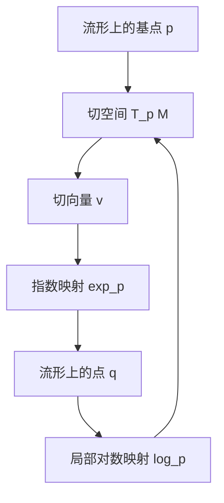
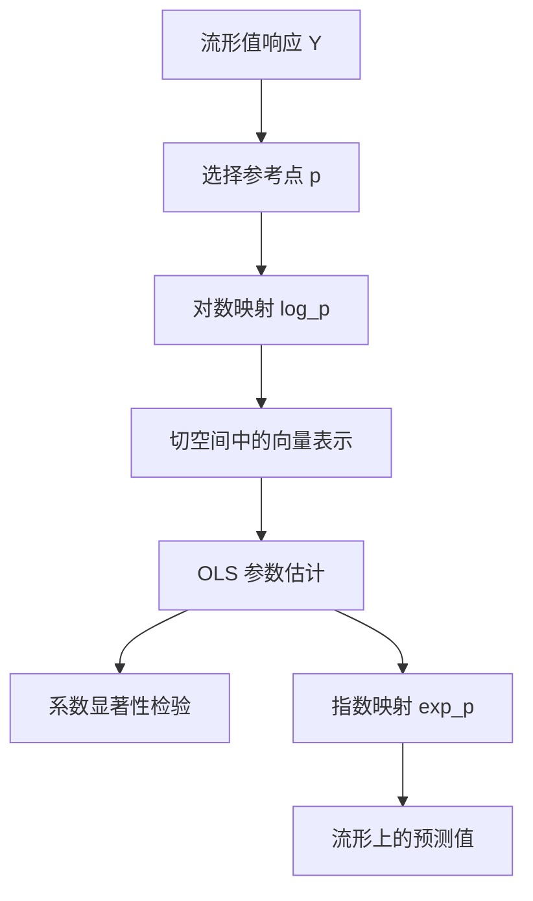

# 第 003 期｜流形、切空间与黎曼回归推断

> Non-Euclidean Statistics · Learning & Research Notes

**日期：** 2026-11-18  
**主题：** Manifolds, Tangent Spaces & Riemannian Inference  
**关键词：** Riemannian Manifold、Tangent Space、Exponential Map、Logarithm Map、Riemannian OLS

---

## 本期导读

本期包括：

- **A. 基础知识：** 流形、切空间、指数映射与对数映射
- **B. 前沿研究：** 四项非欧统计与几何方法研究
- **C. 核心精读：** Riemannian Ordinary Least Squares
- **D. 总结：** 关键概念、自测及下一期预告

核心问题：

**当响应变量不再属于欧氏向量空间时，如何定义回归系数，并对它们进行统计推断？**

---

# A. 今日基础知识：流形与切空间

## A.1 为什么需要流形？

上一期讨论了球面上的测地距离。

球面具有一个重要性质：虽然整个球面是弯曲的，但在每个足够小的局部区域内，我们都可以使用二维坐标描述它。

这就是流形思想的出发点。

一个 $d$ 维光滑流形 $\mathcal M$，直观上是一个局部看起来像 $\mathbb R^d$ 的空间，并且不同局部坐标之间可以进行光滑转换。

例如：

| 空间 | 内在维数 | 典型应用 |
|---|---:|---|
| 圆周 $S^1$ | 1 | 方向统计 |
| 球面 $S^2$ | 2 | 地理与方向数据 |
| SPD 矩阵空间 | $p(p+1)/2$ | 协方差统计 |
| Grassmann 流形 | $k(p-k)$ | 子空间统计 |

流形不一定需要嵌入某个欧氏空间才能定义，但许多实际数据空间都可以通过嵌入来理解。

---

## A.2 切空间（Tangent Space）

在流形上的一点 $p$ 附近，可以使用一个线性空间来近似流形。

这个空间称为切空间：

```math
T_p\mathcal M
```

它是一个向量空间。

对于单位球面：

```math
S^2=\{p\in\mathbb R^3:\|p\|=1\}
```

点 $p$ 处的切空间为：

```math
T_pS^2
=
\{v\in\mathbb R^3:p^\top v=0\}
```

也就是说，切向量与球面半径方向正交。

### 直觉

如果把地球表面视为球面，那么某一点的切平面就像与地球表面相切的一张平坦纸。

在切平面上，我们可以进行向量加法、内积、线性回归等运算。

但切空间只是局部线性近似，不能在任意远的范围内替代整个流形。

---

## A.3 黎曼度量（Riemannian Metric）

只有光滑结构还不足以定义长度和角度。

黎曼度量为每个切空间赋予一个随位置光滑变化的内积：

```math
g_p(u,v),
\qquad
u,v\in T_p\mathcal M
```

由此定义切向量的长度：

```math
\|v\|_p=\sqrt{g_p(v,v)}
```

再通过曲线长度定义流形上的距离。

对于曲线 $\gamma:[0,1]\to\mathcal M$：

```math
L(\gamma)
=
\int_0^1
\sqrt{
g_{\gamma(t)}
(\dot\gamma(t),\dot\gamma(t))
}\,dt
```

测地距离就是所有连接两点的分段光滑曲线长度的下确界。

---

## A.4 指数映射（Exponential Map）

给定：

```math
p\in\mathcal M,
\qquad
v\in T_p\mathcal M
```

从 $p$ 出发，沿初速度为 $v$ 的测地线运动单位时间，可以定义指数映射：

```math
\exp_p(v)=\gamma_v(1)
```

其中 $\gamma_v$ 是满足：

```math
\gamma_v(0)=p,
\qquad
\dot\gamma_v(0)=v
```

的测地线。

指数映射在零向量附近局部有定义；对于测地完备流形，它可以定义在整个切空间上。

对于单位球面，在 $v\ne0$ 时：

```math
\exp_p(v)
=
\cos(\|v\|)p
+
\frac{\sin(\|v\|)}{\|v\|}v
```

当 $v=0$ 时：

```math
\exp_p(0)=p
```

这使得我们可以先在切空间中计算，再将结果映射回流形。

---

## A.5 对数映射（Logarithm Map）

指数映射的局部逆映射称为对数映射：

```math
\log_p(q)\in T_p\mathcal M
```

直观上：

- 指数映射：切向量 → 流形上的点
- 对数映射：流形上的点 → 切向量

在单位球面上，若 $q$ 既不是 $p$ 也不是其对跖点，令：

```math
\theta=\arccos(p^\top q)
```

则：

```math
\log_p(q)
=
\frac{\theta}{\sin\theta}
(q-\cos\theta\,p)
```

并规定：

```math
\log_p(p)=0
```

在对跖点处，最短测地线不唯一，因此对数映射不能以单值方式全局定义。

这正是许多流形回归模型需要处理的几何限制。

### 图 1：流形与切空间之间的映射



---

## A.6 小练习

设：

```math
p=(0,0,1)
```

是单位球面上的北极点。

判断向量：

```math
v=(1,2,0)
```

是否属于 $T_pS^2$。

**答案：**

```math
p^\top v=0
```

因此 $v$ 属于北极点处的切空间。

---

# B. 今日前沿研究雷达

本期选四项真实可核验的研究，均为 2026 年预印本。以下日期为原始提交日期，不等同于正式期刊发表日期。

## B.1 Riemannian Ordinary Least Squares

**作者：** Xiaoyu Chen, Yujing Huang, Yingyan Zeng  
**提交日期：** 2026-11-07  
**原文：** https://arxiv.org/abs/2611.10459  
**代码：** https://github.com/XiaoyuChenPub/ROLS

### 研究问题

如何为流形值响应变量建立类似普通最小二乘回归的模型，并对单个系数进行显著性检验？

### 核心创新

- 构造切空间条件均值模型；
- 同时处理标量及流形值解释变量；
- 在局部几何条件下得到闭式估计器；
- 建立预测误差界及系数层面的渐近检验。

### 局限

模型依赖对数映射的单值性及相应局部几何条件；远离基点时，cut locus 和曲率效应会增加建模难度。

**本期核心精读。**

---

## B.2 The Manifold-Index Model: provably and efficiently avoiding the statistical and computational curse of dimensionality

**作者：** Yantao Wu, Mauro Maggioni  
**提交日期：** 2026-11-15  
**原文：** https://arxiv.org/abs/2611.20275

### 研究问题

当高维解释变量集中在未知低维流形附近时，能否使回归的统计难度主要由内在维数而非环境维数决定？

### 核心创新

提出 Manifold-Index Model 和 MANOR 算法，通过多尺度 PCA 与局部斜率信息估计切空间。

在论文规定的几何、噪声与采样条件下，建立依赖内在维数的预测误差速率。

### 局限

理论依赖流形邻域结构、光滑性、噪声有界性和采样条件，不适用于任意高维数据分布。

---

## B.3 Intrinsic Footpoint-invariant Riemannian Cross-covariance

**作者：** Carlos Soto, Cheng Wang, Zipan Huang, Xiaoyu Chen  
**提交日期：** 2026-06-08  
**原文：** https://arxiv.org/abs/2606.10212

### 研究问题

欧氏统计中的协方差可以衡量变量的联合变化，但流形上的随机对象位于非线性空间中，不同点的切空间也不相同。

如何定义不依赖任意坐标选择的内在交叉协方差？

### 核心创新

使用平行传输将局部变化向量送到共同切空间，构造黎曼交叉协方差，并研究其性质及渐近行为。

### 局限

需要适当的流形几何和传输结构；平行传输与参考点选择也可能带来计算成本。

---

## B.4 Retraction-Based Gradient Projection Algorithms on Manifolds

**作者：** Conglong Xu, Hao Wu  
**提交日期：** 2026-09-25  
**原文：** https://arxiv.org/abs/2609.30885

### 研究问题

如何将欧氏空间的投影梯度算法推广到流形上的约束优化？

### 核心创新

构造基于 retraction 的凸性概念及梯度投影算法，研究不同步长规则下的收敛性，并用于加权低秩近似。

### 局限

所建立的凸性与投影性质依赖特定 retraction 和约束结构，不能直接等同于一般流形上的全局凸优化。

---

# C. 今日核心论文精读

## Riemannian Ordinary Least Squares

**作者：** Chen, Huang & Zeng（2026）  
**原文：** https://arxiv.org/abs/2611.10459

## C.1 研究动机

普通线性回归模型为：

```math
Y=\beta_0+X^\top\beta+\varepsilon
```

其中 $Y$ 是欧氏空间中的随机变量。

如果 $Y$ 是球面方向、SPD 矩阵或其他流形对象，那么普通向量加法可能不再适用。

已有的 Fréchet 回归方法可以处理流形或一般度量空间中的响应变量，但并不总能提供类似欧氏 OLS 的单个系数解释与显著性检验。

本文尝试构造一种切空间版本的 OLS。

---

## C.2 核心思想：把局部非线性问题转化为线性问题

选取流形上的参考点：

```math
p\in\mathcal M
```

通过对数映射将响应变量送入切空间：

```math
Z=\log_p(Y)\in T_p\mathcal M
```

由于切空间是线性空间，可以在其中建立回归模型。

最基本的切空间回归示意为：

```math
Z_i=\alpha+B^\top x_i+\epsilon_i
```

其中等式需要在选定的切空间坐标系中理解。

然后使用指数映射将预测值送回流形：

```math
\hat Y(x)
=
\exp_p(\hat\alpha+\hat B^\top x)
```

这两式说明切空间回归的基本机制，并非对论文全部模型设定的逐字复现。

论文进一步处理标量与流形值解释变量，并通过明确的单值性条件保证相关映射具有良好定义。

### 图 2：切空间回归的统计流程



---

## C.3 主要理论结果

论文的一个重要特点是：不仅给出预测模型，还建立统计推断工具。

根据论文摘要，主要结果包括：

**1. 局部闭式估计**

在适当的几何及可识别条件下，切空间模型允许构造闭式估计器，避免所有参数都必须通过复杂的非线性优化获得。

**2. 预测误差**

论文建立了具有曲率偏差项的预测误差分析，其中 excess prediction error 的样本量相关部分达到：

```math
O(n^{-1})
```

需要注意，这不表示所有流形模型都能无条件达到该速率；曲率偏差及论文的局部几何假设必须同时考虑。

**3. 系数推断**

论文建立单个回归系数的渐近 $t$ 检验与 Wald 检验，使流形回归不仅能用于预测，也能用于解释变量效应分析。

---

## C.4 为什么这篇论文重要？

经典 Fréchet 回归的重要目标是估计条件 Fréchet mean。

而这篇论文进一步关注：

**能否像普通 OLS 一样，解释某个协变量的效应，并检验该效应是否显著？**

这对医学形状分析、方向数据和 SPD 矩阵统计都很重要。

例如，研究协方差矩阵随年龄变化时，我们可能不仅希望预测矩阵，还希望判断年龄是否具有显著影响。

---

## C.5 贡献与局限

### 主要贡献

1. 建立具有 OLS 风格解释性的黎曼回归模型。
2. 同时考虑标量和流形值解释变量。
3. 提供局部闭式估计与预测误差分析。
4. 建立单个系数的渐近统计检验。
5. 将切空间几何与传统回归推断联系起来。

### 主要局限

1. 对数映射可能在 cut locus 附近失去单值性。
2. 局部线性模型可能存在曲率相关偏差。
3. 参考点与坐标表达需要谨慎处理。
4. 对于高度弯曲或分布范围较广的数据，局部模型未必充分。

---

## C.6 进一步研究方向

以下是基于论文提出的研究问题，不是原文已经证明的结论。

**方向一：稳健黎曼 OLS**

如果切空间残差具有重尾分布，能否结合稳健 M-estimation 或 Median-of-Means？

**方向二：高维变量选择**

当解释变量维数很高时，能否构造带有稀疏惩罚的 Riemannian OLS，并建立有效的变量选择理论？

**方向三：曲率自适应推断**

能否设计能够适应未知曲率影响的系数检验，减少局部线性近似引入的偏差？

---

# D. 今日总结

## D.1 三个核心收获

**第一：** 流形是局部欧氏的空间，切空间提供了进行局部线性计算的工具。

**第二：** 指数映射和对数映射连接流形与切空间，但通常只能在适当局部区域内保持单值、可逆。

**第三：** 黎曼统计不仅可以定义均值与回归，还可以进一步研究系数解释、预测误差和假设检验。

---

## D.2 今日自测

在单位球面上，给定：

```math
p=(0,0,1)
```

以及切向量：

```math
v=(a,b,0)
```

令：

```math
r=\sqrt{a^2+b^2}
```

求 $\exp_p(v)$。

### 答案

当 $r>0$ 时：

```math
\exp_p(v)
=
\cos(r)(0,0,1)
+
\frac{\sin(r)}{r}(a,b,0)
```

即：

```math
\exp_p(v)
=
\left(
\frac{a\sin r}{r},
\frac{b\sin r}{r},
\cos r
\right)
```

当 $r=0$ 时，结果为 $p$。

---

## D.3 下一期预告

**第 004 期：黎曼度量、曲率与平行传输**

重点学习：

- 黎曼度量与长度
- 截面曲率
- 平行传输
- 不同切空间中的协方差
- 几何结构如何影响统计推断

---

# 参考文献

1. Chen, X., Huang, Y., & Zeng, Y. (2026). *Riemannian Ordinary Least Squares*.  
   https://arxiv.org/abs/2611.10459

2. Wu, Y., & Maggioni, M. (2026). *The Manifold-Index Model: provably and efficiently avoiding the statistical and computational curse of dimensionality*.  
   https://arxiv.org/abs/2611.20275

3. Soto, C., Wang, C., Huang, Z., & Chen, X. (2026). *Intrinsic Footpoint-invariant Riemannian Cross-covariance*.  
   https://arxiv.org/abs/2606.10212

4. Xu, C., & Wu, H. (2026). *Retraction-Based Gradient Projection Algorithms on Manifolds*.  
   https://arxiv.org/abs/2609.30885

---

**Non-Euclidean Statistics Learning Notes · Issue 003**

*本期为科研学习笔记。论文结论以原始文献中的具体假设和正式版本为准。*
