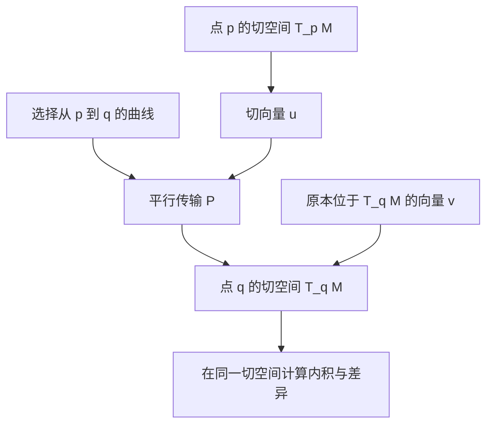
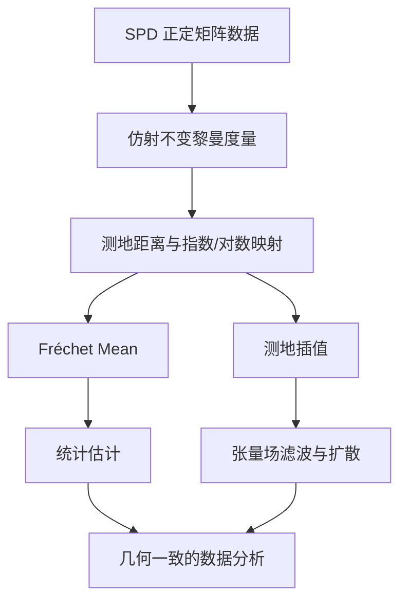

# 第 004 期｜黎曼度量、曲率与平行传输：从几何到协方差与回归

> Non-Euclidean Statistics · Learning & Research Notes

**日期：** 2026-11-19  
**主题：** Riemannian Metrics, Curvature, Parallel Transport & Geometric Statistics  
**关键词：** Riemannian Metric、Sectional Curvature、Covariant Derivative、Parallel Transport、SPD Manifold、Principal Geodesic Analysis

---

## 本期导读

第 001–003 期已经学习：

- 度量空间与 Fréchet mean；
- 测地线、CAT(0) 几何与重心集中；
- 流形、切空间、指数映射和经验似然推断。

本期继续深入流形的几何结构。

核心问题是：

**如果两个随机对象位于流形上的不同位置，它们的切向量属于不同的向量空间，我们应该怎样比较它们？**

今天将学习：

- **A. 基础知识：** 黎曼度量、截面曲率、协变导数、平行传输和流形协方差。
- **B. 研究精选：** 四篇正式发表的重要论文。
- **C. 核心精读：** A Riemannian Framework for Tensor Computing。
- **D. 总结：** 三项收获、自测及明日预告。

---

# A. 今日基础知识

## A.1 黎曼度量：流形上的长度与角度

设 $\mathcal M$ 是一个 $m$ 维光滑流形。

在每个点 $p\in\mathcal M$，存在切空间：

```math
T_p\mathcal M
```

切空间本身是向量空间，但仅有切空间还不足以定义几何长度。

因此，需要为每个切空间配备内积：

```math
g_p:T_p\mathcal M\times T_p\mathcal M\rightarrow\mathbb R
```

这个随位置光滑变化的正定内积称为黎曼度量。

它定义了切向量长度：

```math
\|v\|_p=\sqrt{g_p(v,v)}
```

在局部坐标中，黎曼度量可以写成一个正定矩阵 $G(p)$：

```math
g_p(u,v)=u^\top G(p)v
```

因此，流形上的长度不一定采用普通欧氏内积。

### 一个简单例子：球面

半径为 $R$ 的球面，在球坐标 $(\theta,\phi)$ 中具有度量：

```math
ds^2
=
R^2d\theta^2
+
R^2\sin^2(\theta)d\phi^2
```

这里 $\theta$ 是极角，$\phi$ 是方位角。

这个公式说明：

相同的坐标变化量，在球面的不同位置可能对应不同的实际距离。

例如，靠近北极时，改变经度对应的移动距离比赤道附近更小。

**统计学意义：**

如果忽略度量，直接把局部坐标当作普通欧氏向量，可能得到与真实几何不一致的距离、均值和回归结果。

---

## A.2 曲率：为什么空间的弯曲会影响统计？

曲率刻画流形的局部几何偏离欧氏空间的程度。

今天重点了解截面曲率（Sectional Curvature）。

对于点 $p$ 处由两个线性无关切向量 $u,v$ 张成的二维切平面，其截面曲率定义为：

```math
K_p(u,v)
=
\frac{
g_p(R(u,v)v,u)
}{
g_p(u,u)g_p(v,v)-g_p(u,v)^2
}
```

其中 $R$ 是黎曼曲率张量，采用与上述公式一致的符号约定。

### 三类典型空间

| 空间 | 截面曲率 | 几何特点 |
|---|---|---|
| 欧氏空间 | $K=0$ | 平直 |
| 半径为 $R$ 的球面 | $K=1/R^2$ | 正曲率 |
| 标准双曲空间 | $K=-1$ | 负曲率 |

曲率会影响：

1. 测地线是否唯一；
2. Fréchet mean 的局部或全局唯一性；
3. 平行传输是否依赖路径；
4. 统计优化的凸性；
5. 局部线性近似的误差。

需要特别注意：

正曲率不代表所有均值问题都会失效，负曲率也不能在缺少完备性等条件时自动保证所有统计结论。

---

## A.3 协变导数：如何比较不同位置的向量？

在欧氏空间中，向量可以直接相减。

但在流形上：

```math
u\in T_p\mathcal M
```

```math
v\in T_q\mathcal M
```

当 $p\neq q$ 时，两个向量属于不同切空间。

一般不能直接计算 $u-v$。

为此，需要引入协变导数（Covariant Derivative）。

### 定义直觉

设 $\gamma(t)$ 是流形上的曲线，$V(t)$ 是沿曲线变化的切向量场。

协变导数：

```math
\nabla_{\dot\gamma(t)}V
```

描述向量场沿曲线变化的内在速度。

在局部坐标中：

```math
(\nabla_{\dot\gamma}V)^k
=
\frac{dV^k}{dt}
+
\sum_{i,j}
\Gamma^k_{ij}
\dot\gamma^iV^j
```

其中 $\Gamma^k_{ij}$ 为 Christoffel 符号。

第二项修正了局部坐标基底随位置变化带来的影响。

因此，协变导数不是简单地对坐标分量求导。

---

## A.4 平行传输（Parallel Transport）

如果沿曲线 $\gamma$ 的向量场 $V(t)$ 满足：

```math
\nabla_{\dot\gamma(t)}V(t)=0
```

则称 $V(t)$ 沿 $\gamma$ 平行。

从 $p=\gamma(0)$ 到 $q=\gamma(1)$ 的平行传输记为：

```math
P_\gamma:T_p\mathcal M\rightarrow T_q\mathcal M
```

### 核心性质

对于 Levi-Civita 联络，平行传输保持内积：

```math
g_q(P_\gamma u,P_\gamma v)
=
g_p(u,v)
```

因此，它也保持向量长度。

### 为什么它不是普通复制？

在弯曲空间中，沿不同路径平行传输同一个向量，到达同一个终点时，可能得到不同结果。

这种路径依赖性与曲率密切相关。

在球面上，沿一个闭合测地三角形平行传输向量，最终方向可能与起始方向不同。

这就是几何中的 Holonomy 现象。

### 图 1：跨切空间比较的基本流程



**重要提醒：**

平行传输必须指定路径。对于存在多条路径的情况，不能把它视为无条件唯一的全局映射。

---

## A.5 流形上的协方差

这是今天基础知识与研究论文的关键连接。

在欧氏空间中：

```math
\Sigma
=
\mathbb E[(X-\mu)(X-\mu)^\top]
```

对于流形值随机变量 $X$，假设其 Fréchet mean $\mu$ 唯一，且对数映射在有关数据上良定义。

定义：

```math
Z=\log_\mu(X)
```

那么：

```math
Z\in T_\mu\mathcal M
```

我们可以在固定切空间中构造二阶矩：

```math
C_\mu
=
\mathbb E[ZZ^\top]
```

在正交切空间坐标下，这就是常见的内在协方差矩阵表达。

更一般地，真正的中心化协方差应写成：

```math
\Sigma_\mu
=
\mathbb E[
(Z-\mathbb E Z)
(Z-\mathbb E Z)^\top
]
```

如果 $\mu$ 满足 Fréchet 风险的适当一阶条件：

```math
\mathbb E[Z]=0
```

那么二者相同。

### 为什么需要平行传输？

如果我们希望比较不同群体的切空间协方差：

```math
\Sigma_{\mu_1}
```

和：

```math
\Sigma_{\mu_2}
```

那么它们分别定义在不同切空间中。

可以沿选定路径将第一组的切向量传输到第二组均值处，再比较其协方差。

如果平行传输在选定正交坐标下表示为矩阵 $P$，那么：

```math
\Sigma_{\mu_1\rightarrow\mu_2}
=
P\Sigma_{\mu_1}P^\top
```

这个公式说明：

**比较非欧协方差时，必须同时考虑数据的统计变异和切空间之间的几何关系。**

---

## A.6 一个二维球面小例子

考虑单位球面北极点：

```math
p=(0,0,1)
```

它的切空间为：

```math
T_pS^2
=
\{(a,b,0):a,b\in\mathbb R\}
```

假设两个切向量为：

```math
u=(1,0,0)
```

```math
v=(0,2,0)
```

在球面诱导的欧氏内积下：

```math
g_p(u,v)=0
```

它们互相正交。

如果把这两个向量沿同一条球面曲线平行传输到另一点 $q$，它们仍然正交，且长度不变。

但如果分别沿不同路径传输，则不能直接套用这一共同路径下的内积保持关系。

---

## A.7 基础练习

**问题：**

设流形上两个点为 $p,q$，且：

```math
u\in T_p\mathcal M
```

```math
v\in T_q\mathcal M
```

为什么不能直接计算 $u^\top v$ 作为内在几何内积？

### 答案

因为它们属于不同切空间。

即使流形嵌入欧氏空间，可以计算环境空间内积，也不代表这个内积是与流形内在几何一致的比较方式。

需要先指定一条路径，将其中一个向量平行传输到另一个向量所在的切空间，再使用该点的黎曼度量进行比较。

---

# B. 高质量研究精选

本期共四篇，全部为正式发表的研究成果。

没有使用未经充分核验的近期预印本凑数。

## B.1 A Riemannian Framework for Tensor Computing

**作者：** Xavier Pennec, Pierre Fillard, Nicholas Ayache  
**年份：** 2006  
**期刊：** International Journal of Computer Vision, 66, 41–66  
**状态：** 同行评审正式发表  
**类型：** 经典几何计算与统计方法

**原文：**

https://doi.org/10.1007/s11263-005-3222-z

**作者机构的研究报告：**

https://www-sop.inria.fr/asclepios/Publications/Xavier.Pennec/Pennec_RR_Tensors.pdf

### 研究问题

如何对对称正定矩阵构建几何一致的插值、均值、滤波和统计计算方法？

### 主要贡献

- 引入仿射不变黎曼度量；
- 建立正定矩阵空间上的几何计算框架；
- 给出测地线和均值的几何性质；
- 将统计均值推广到张量图像处理；
- 构造适合该几何结构的插值、滤波与正则化方法。

### 学术价值

Xavier Pennec 在黎曼统计方面有长期正式发表记录，包括第 003 期介绍的流形内在统计基础论文。

这篇论文在几何统计与医学图像计算之间建立了直接联系。

### 局限

矩阵对数、指数及迭代优化的计算成本高于普通欧氏运算；选择哪种 SPD 度量仍然依赖应用目标。

**本期核心精读。**

---

## B.2 Principal Geodesic Analysis for the Study of Nonlinear Statistics of Shape

**作者：** P. Thomas Fletcher, Conglin Lu, Stephen M. Pizer, Sarang Joshi  
**年份：** 2004  
**期刊：** IEEE Transactions on Medical Imaging, 23(8), 995–1005  
**状态：** 同行评审正式发表  
**类型：** 经典形状统计方法

**原文：**

https://doi.org/10.1109/TMI.2004.831793

**开放 PDF：**

https://www2.imm.dtu.dk/projects/manifold/Papers/fletcherTMI2004.pdf

### 研究问题

传统 PCA 需要线性向量空间。

当形状数据位于非线性空间时，如何寻找主要变异方向？

### 主要贡献

论文提出 Principal Geodesic Analysis（PGA），利用流形的测地结构推广 PCA 的思想。

核心思路是：

- 估计几何中心；
- 在切空间或测地结构中寻找主要变异；
- 使用测地曲线描述非线性形状变化。

### 创新意义

将欧氏 PCA 的方差分解思想扩展到具有非线性几何结构的形状数据。

### 局限

PGA 的计算依赖几何模型和优化方法；切空间线性近似可能不足以描述远离均值的复杂变化。

---

## B.3 Geodesic Regression and the Theory of Least Squares on Riemannian Manifolds

**作者：** P. Thomas Fletcher  
**年份：** 2013  
**期刊：** International Journal of Computer Vision, 105(2), 171–185  
**状态：** 同行评审正式发表  
**类型：** 流形回归方法与理论

**原文：**

https://doi.org/10.1007/s11263-012-0591-y

### 研究问题

如何将欧氏线性回归推广为流形上的测地回归？

### 主要贡献

- 使用测地曲线描述标量解释变量与流形响应之间的关系；
- 建立内在平方距离最小化目标；
- 研究相关最小二乘理论；
- 在对称空间中讨论存在唯一性与概率模型联系；
- 提供非参数置换检验。

### 与第 001 期的区别

第 001 期的 Global Fréchet Regression 主要使用加权 Fréchet 风险。

这里的 Geodesic Regression 则直接用一条参数化测地线拟合流形响应。

二者都是非欧回归，但模型结构与统计解释不同。

### 局限

单条测地线适合描述相对简单的变化趋势，可能不足以拟合具有明显弯曲或多阶段变化的时间轨迹。

---

## B.4 Intrinsic Polynomials for Regression on Riemannian Manifolds

**作者：** Jacob Hinkle, P. Thomas Fletcher, Sarang Joshi  
**年份：** 2014  
**期刊：** Journal of Mathematical Imaging and Vision, 50, 32–52  
**状态：** 同行评审正式发表  
**类型：** 非线性流形回归方法

**原文：**

https://doi.org/10.1007/s10851-013-0489-5

### 研究问题

单条测地线类似欧氏直线。

如果流形数据的变化趋势更复杂，如何建立二次、三次或更高阶的内在回归曲线？

### 主要贡献

- 构造任意整数阶的黎曼多项式回归；
- 使用协变导数描述高阶变化；
- 发展伴随方程和梯度优化方法；
- 研究 Lie 群及其作用空间中的计算简化；
- 在形状和医学图像数据上展示方法。

### 与 Fletcher（2013）的关系

测地回归对应较简单的一阶模型。

本文通过高阶内在多项式提供更灵活的趋势建模能力。

### 局限

模型阶数增加会带来更高计算复杂度和过拟合风险；选择阶数与进行统计推断并不简单。

---

# C. 核心论文精读

## A Riemannian Framework for Tensor Computing

**作者：** Xavier Pennec, Pierre Fillard, Nicholas Ayache  
**期刊：** International Journal of Computer Vision  
**年份：** 2006  
**DOI：** https://doi.org/10.1007/s11263-005-3222-z

---

## C.1 为什么正定矩阵需要非欧几何？

考虑一个对称正定矩阵：

```math
P\in\mathrm{SPD}(p)
```

它满足：

```math
P=P^\top
```

以及对所有非零向量 $x$：

```math
x^\top Px>0
```

正定矩阵广泛出现在：

- 协方差矩阵；
- 扩散张量成像；
- 多元高斯模型；
- 几何优化；
- 脑影像统计。

在普通欧氏方法中，可以直接把矩阵当作向量处理。

例如，对两个 SPD 矩阵取算术平均：

```math
M_E=\frac{P+Q}{2}
```

算术平均仍然正定。

但这个平均不一定符合我们希望保留的仿射变换不变性。

如果数据经历可逆线性坐标变换：

```math
P\mapsto APA^\top
```

那么几何距离最好具有相应的不变性。

这就是论文选择仿射不变黎曼度量的重要动机。

---

## C.2 仿射不变黎曼度量

在 SPD 空间中，切空间可以自然识别为对称矩阵空间。

设：

```math
U,V\in T_P\mathrm{SPD}(p)
```

定义：

```math
g_P(U,V)
=
\mathrm{tr}(P^{-1}UP^{-1}V)
```

这里 $\mathrm{tr}$ 表示矩阵迹。

这是常用的 Affine-Invariant Riemannian Metric（AIRM）。

### 为什么叫仿射不变？

对于任意可逆矩阵 $A$，考虑变换：

```math
P\mapsto APA^\top
```

以及相应切向量变换。

该度量满足：

```math
g_{APA^\top}(AUA^\top,AVA^\top)
=
g_P(U,V)
```

因此，在可逆线性坐标变换下，切向量的内积保持不变。

这使得几何分析不依赖某一种任意选择的线性坐标系。

---

## C.3 SPD 测地距离

对于两个 SPD 矩阵 $P,Q$，仿射不变测地距离为：

```math
d_{\mathrm{AI}}(P,Q)
=
\left\|
\log(P^{-1/2}QP^{-1/2})
\right\|_F
```

其中：

- $\log$ 为矩阵对数；
- $\|\cdot\|_F$ 为 Frobenius 范数；
- $P^{-1/2}$ 为正定矩阵的逆平方根。

### 特征值表达

设：

```math
\lambda_1,\ldots,\lambda_p
```

为：

```math
P^{-1/2}QP^{-1/2}
```

的正特征值。

那么：

```math
d_{\mathrm{AI}}^2(P,Q)
=
\sum_{j=1}^{p}(\log\lambda_j)^2
```

这个公式说明：

AIRM 比较的是矩阵之间的相对变化，而不只是矩阵元素的绝对差异。

---

## C.4 一个一维例子

当 $p=1$ 时，SPD 矩阵就是正实数。

设：

```math
P=1,\qquad Q=9
```

普通欧氏距离为：

```math
d_E(P,Q)=8
```

仿射不变距离为：

```math
d_{\mathrm{AI}}(P,Q)
=
|\log9|
```

现在考虑两个数：

```math
P=10,\qquad Q=90
```

它们的欧氏距离为 80。

但仿射不变距离仍然是：

```math
d_{\mathrm{AI}}(10,90)=|\log9|
```

因为两组数据具有相同的比例变化。

这体现了该度量对相对尺度变化的处理方式。

---

## C.5 SPD 测地线

对于 $P,Q\in\mathrm{SPD}(p)$，连接两者的仿射不变测地线为：

```math
\gamma(t)
=
P^{1/2}
(P^{-1/2}QP^{-1/2})^t
P^{1/2}
```

其中：

```math
0\leq t\leq1
```

当 $t=0$：

```math
\gamma(0)=P
```

当 $t=1$：

```math
\gamma(1)=Q
```

当 $t=1/2$ 时，得到两点之间的几何中点：

```math
M_{\mathrm{AI}}
=
P^{1/2}
(P^{-1/2}QP^{-1/2})^{1/2}
P^{1/2}
```

### 一维情况

对于两个正数 $a,b$：

```math
M_{\mathrm{AI}}=\sqrt{ab}
```

例如：

```math
a=1,\qquad b=9
```

欧氏中点是：

```math
M_E=5
```

而仿射不变几何中点是：

```math
M_{\mathrm{AI}}=3
```

这说明选择不同几何结构，会直接改变统计中心的定义。

---

## C.6 SPD 空间中的 Fréchet Mean

对于 SPD 样本：

```math
P_1,\ldots,P_n
```

定义 Fréchet 风险：

```math
F(P)
=
\frac1n\sum_{i=1}^{n}
d_{\mathrm{AI}}^2(P,P_i)
```

对应的 Fréchet mean 满足：

```math
F(\hat P)=
\min_{P\in\mathrm{SPD}(p)}F(P)
```

SPD 空间在仿射不变度量下具有完备、非正截面曲率的几何结构。

因此，平方距离具有有利的凸性性质。

在该空间中，有限样本的平方距离重心唯一。

这是论文方法能够建立稳定几何均值计算的重要原因。

### 与普通矩阵均值的区别

欧氏均值为：

```math
\bar P_E
=
\frac1n\sum_{i=1}^{n}P_i
```

AIRM Fréchet mean 则是测地平方距离的最小化点。

一般不能简单地通过逐元素平均得到。

---

## C.7 指数映射与对数映射

SPD 空间中的指数映射为：

```math
\exp_P(U)
=
P^{1/2}
\exp(P^{-1/2}UP^{-1/2})
P^{1/2}
```

其中右侧 $\exp$ 是矩阵指数。

对数映射为：

```math
\log_P(Q)
=
P^{1/2}
\log(P^{-1/2}QP^{-1/2})
P^{1/2}
```

这两个公式可以用于构造 Fréchet mean 的数值算法。

例如，对于平方测地距离目标，可以在当前估计点 $P_k$ 处计算：

```math
V_k
=
\frac1n\sum_{i=1}^{n}
\log_{P_k}(P_i)
```

然后使用如下指数映射更新：

```math
P_{k+1}
=
\exp_{P_k}(\eta_kV_k)
```

其中 $\eta_k$ 是步长。

这是基于黎曼梯度思想的一种基本迭代形式。

实际收敛速度及数值稳定性取决于步长选择、目标函数和具体实现。

---

## C.8 从均值到张量图像处理

论文不仅研究 SPD 矩阵均值。

它还将几何框架应用到：

- 张量插值；
- 高斯型滤波；
- 各向异性扩散；
- 缺失张量恢复；
- 张量场正则化。

在扩散张量 MRI 中，矩阵特征值描述不同方向的扩散强度。

如果使用不合适的欧氏处理方法，可能出现与张量几何不一致的插值和变异描述。

论文通过 AIRM 构造内在处理方法，使张量场分析能够尊重正定矩阵空间的几何结构。

### 图 2：论文方法结构



---

## C.9 理论贡献的直觉

论文的重要贡献不只是提供一个新的矩阵距离。

更重要的是建立了一套统一的几何计算语言：

**第一：** 将正定矩阵空间视为黎曼流形。

**第二：** 用仿射不变距离替代普通矩阵元素差异。

**第三：** 将均值、插值和滤波统一为基于几何距离的优化问题。

**第四：** 利用非正曲率和完备性，获得均值唯一性等良好的数学性质。

这些性质为后来的 SPD 统计方法和几何数据分析提供了重要基础。

---

## C.10 论文的局限

### 计算复杂度

矩阵对数、指数、平方根和特征分解的计算通常比普通欧氏运算昂贵。

### 度量选择

AIRM 并不是 SPD 空间唯一合理的度量。

例如，Log-Euclidean Metric 也具有重要应用。

不同度量可能强调不同的不变性、计算效率和统计解释。

### 高维统计问题

论文建立了重要的几何计算框架，但并未解决所有高维协方差估计问题。

当矩阵维数接近甚至超过样本量时，仍可能需要额外的正则化与统计理论。

### 统计推断

几何均值的唯一性并不自动提供有限样本置信区域或假设检验。

这仍需要相应的概率模型与推断理论。

---

## C.11 从论文延伸出的研究问题

以下是本笔记提出的研究方向，不是原论文已经证明的结果。

### 方向一：SPD 协方差的跨群体比较

如果不同群体的 SPD Fréchet mean 不同，能否通过平行传输构造更稳定的二阶变异比较方法？

### 方向二：高维 SPD 统计

如何将几何均值与高维正则化、稀疏结构或低秩模型结合？

### 方向三：几何与统计效率的权衡

能否构造兼顾仿射不变性、计算效率和统计推断性质的新型 SPD 估计方法？

---

# D. 今日总结与自测

## D.1 三项核心收获

**收获一：**

黎曼度量决定了流形上的长度、角度和测地距离，因此是非欧统计方法的基础。

**收获二：**

协变导数与平行传输解决了不同切空间之间的向量比较问题。

**收获三：**

在 SPD 空间中，仿射不变黎曼度量能够建立具有明确几何性质的均值、插值和统计计算方法。

---

## D.2 今日自测

### 问题一

平行传输是否保持切向量长度？

**答案：**

对于 Levi-Civita 联络，沿同一曲线的平行传输保持黎曼内积，因此保持长度。

---

### 问题二

设两个一维 SPD 数据为：

```math
a=4,\qquad b=16
```

求欧氏中点和 AIRM 几何中点。

**答案：**

欧氏中点：

```math
M_E=\frac{4+16}{2}=10
```

AIRM 几何中点：

```math
M_{\mathrm{AI}}
=
\sqrt{4\cdot16}
=
8
```

---

### 问题三

为什么不能直接比较两个不同基点处的流形协方差矩阵？

**答案：**

因为它们描述的是不同切空间中的二阶变异。

若要进行内在几何比较，需要指定切空间之间的识别方式，例如沿选定曲线使用平行传输。

---

## D.3 明日基础课预告

### 第 005 期｜流形上的概率分布、梯度与统计优化

下一期重点学习：

- Riemannian Gradient；
- Riemannian Hessian；
- 流形上的概率密度；
- Riemannian Normal Distribution；
- Riemannian Gradient Descent；
- 几何优化与统计估计的关系。

核心问题：

**当参数位于非线性流形上时，如何定义概率模型，并构造具有统计意义的优化算法？**

---

# 参考文献

1. Pennec, X., Fillard, P., & Ayache, N. (2006). A Riemannian Framework for Tensor Computing. *International Journal of Computer Vision*, 66, 41–66.

   https://doi.org/10.1007/s11263-005-3222-z

2. Fletcher, P. T., Lu, C., Pizer, S. M., & Joshi, S. (2004). Principal Geodesic Analysis for the Study of Nonlinear Statistics of Shape. *IEEE Transactions on Medical Imaging*, 23(8), 995–1005.

   https://doi.org/10.1109/TMI.2004.831793

3. Fletcher, P. T. (2013). Geodesic Regression and the Theory of Least Squares on Riemannian Manifolds. *International Journal of Computer Vision*, 105(2), 171–185.

   https://doi.org/10.1007/s11263-012-0591-y

4. Hinkle, J., Fletcher, P. T., & Joshi, S. (2014). Intrinsic Polynomials for Regression on Riemannian Manifolds. *Journal of Mathematical Imaging and Vision*, 50, 32–52.

   https://doi.org/10.1007/s10851-013-0489-5

---

**Non-Euclidean Statistics Learning Notes · Issue 004**

*本系列坚持基础知识与研究论文并行，优先选择具有可靠发表记录、明确理论贡献及可核验原文的高质量研究。*
