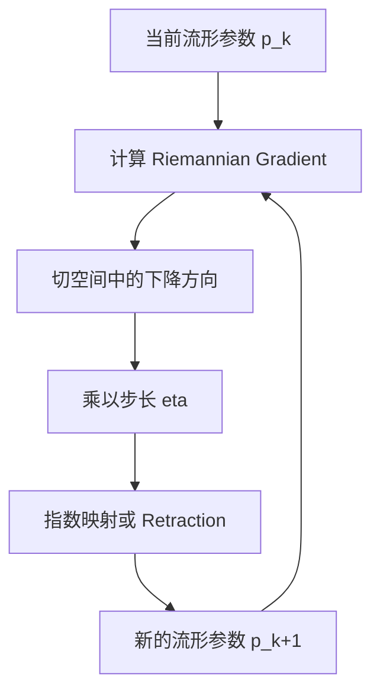
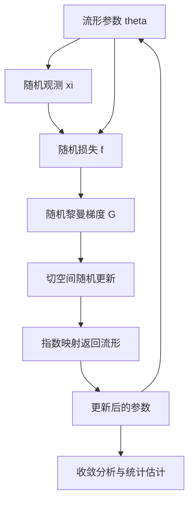

# 第 005 期｜流形上的概率分布、黎曼梯度与随机优化

> Non-Euclidean Statistics · Learning & Research Notes

**日期：** 2026-11-20  
**主题：** Riemannian Probability, Gradient & Stochastic Optimization  
**关键词：** Riemannian Gradient、Hessian、Geodesic Convexity、Stochastic Gradient Descent、Riemannian Gaussian Distribution

---

## 本期导读

前四期已经学习：

- Fréchet mean 与非欧回归；
- 测地线、曲率与重心理论；
- 切空间与非欧统计推断；
- 平行传输、SPD 几何与协方差。

本期进入非欧统计的另一个核心领域：

**流形上的统计优化。**

很多非欧统计估计量都可以表示为：

```math
\hat\theta
=
\arg\min_{\theta\in\mathcal M}
F_n(\theta)
```

但如果参数空间 $\mathcal M$ 不是线性空间，传统的欧氏梯度下降不能直接使用。

我们需要研究三个问题：

1. 如何定义流形上的梯度和 Hessian？
2. 如何在流形上定义概率分布与似然函数？
3. 如何建立流形随机梯度算法的收敛理论？

---

# A. 今日基础知识

## A.1 从欧氏梯度到黎曼梯度

在欧氏空间中，考虑光滑函数：

```math
f:\mathbb R^p\rightarrow\mathbb R
```

梯度下降更新为：

```math
x_{k+1}
=
x_k-\eta_k\nabla f(x_k)
```

其中 $\eta_k$ 为步长。

这个更新使用了欧氏空间的向量加法。

但是在流形上：

```math
p_k\in\mathcal M
```

即使梯度是一个切向量，直接计算：

```math
p_k-\eta_k v
```

也未必仍在流形上。

因此，我们需要一种与流形几何相容的梯度定义。

### 黎曼梯度的定义

设：

```math
f:\mathcal M\rightarrow\mathbb R
```

为光滑函数。

在点 $p$ 处，黎曼梯度 $\mathrm{grad}f(p)$ 是满足：

```math
g_p(\mathrm{grad}f(p),v)
=
df_p(v)
```

对任意 $v\in T_p\mathcal M$ 成立的唯一切向量。

其中 $df_p(v)$ 表示函数沿切向量 $v$ 的方向导数。

### 直觉

欧氏梯度表示函数上升最快的方向。

黎曼梯度则表示：

**在给定黎曼度量下，函数局部上升最快的切向量方向。**

所以梯度不仅依赖目标函数，也依赖度量。

---

## A.2 局部坐标公式

假设在局部坐标中，黎曼度量矩阵为：

```math
G(p)
```

普通坐标偏导数组成：

```math
\nabla_{\mathrm{coord}}f(p)
```

那么黎曼梯度的坐标表示为：

```math
\mathrm{grad}f(p)
=
G(p)^{-1}
\nabla_{\mathrm{coord}}f(p)
```

这里的等式是在同一局部坐标系下理解的。

如果：

```math
G(p)=I
```

就回到欧氏梯度。

但一般情况下：

```math
G(p)\neq I
```

因此，欧氏梯度与黎曼梯度可能不同。

### 一个简单例子

考虑正实数流形：

```math
\mathcal M=(0,\infty)
```

赋予度量：

```math
g_x(u,v)=\frac{uv}{x^2}
```

设目标函数：

```math
f(x)=\frac12(\log x-a)^2
```

普通导数为：

```math
f'(x)=\frac{\log x-a}{x}
```

由于度量矩阵为：

```math
G(x)=\frac1{x^2}
```

所以黎曼梯度为：

```math
\mathrm{grad}f(x)
=
x(\log x-a)
```

注意它与普通导数不同。

这说明：

**同一个统计目标，在不同几何度量下可以具有不同的梯度表达。**

---

## A.3 流形梯度下降

流形上的基本梯度下降更新为：

```math
p_{k+1}
=
\exp_{p_k}
\left(
-\eta_k\mathrm{grad}f(p_k)
\right)
```

这里指数映射将切空间中的更新向量重新映射到流形。

### 三个步骤

1. 在当前点计算黎曼梯度；
2. 在切空间中选择负梯度更新方向；
3. 通过指数映射返回流形。

### 图 1：黎曼梯度下降



### Retraction

指数映射有时计算成本较高。

实际算法经常使用 Retraction：

```math
R_p:T_p\mathcal M\rightarrow\mathcal M
```

它需要满足：

```math
R_p(0)=p
```

以及在零向量处的一阶导数为恒等映射。

于是可以更新：

```math
p_{k+1}
=
R_{p_k}
\left(
-\eta_k\mathrm{grad}f(p_k)
\right)
```

Retraction 是指数映射的局部一阶替代，并不意味着两者在全局上完全等价。

---

## A.4 黎曼 Hessian

在欧氏统计中，Hessian 用于研究：

- 局部极值；
- 优化收敛速度；
- 参数估计的渐近理论；
- 二阶近似。

流形上也可以定义相应对象。

对于切向量：

```math
v\in T_p\mathcal M
```

定义黎曼 Hessian 算子：

```math
\mathrm{Hess}f(p)[v]
=
\nabla_v\mathrm{grad}f
```

其中 $\nabla$ 表示 Levi-Civita 联络。

对应的双线性形式为：

```math
\mathrm{Hess}f(p)(u,v)
=
g_p(
\nabla_u\mathrm{grad}f,
v
)
```

黎曼 Hessian 与普通坐标二阶偏导数并不总是相同。

原因是流形上的向量场随位置变化时，还需要考虑几何联络。

---

## A.5 测地凸性

在欧氏空间中，凸函数满足：

```math
f((1-t)x+ty)
\leq
(1-t)f(x)+tf(y)
```

在流形上，可以使用测地线代替线段。

设 $\gamma:[0,1]\rightarrow\mathcal M$ 是连接 $p$ 和 $q$ 的测地线。

如果：

```math
f(\gamma(t))
\leq
(1-t)f(p)+tf(q)
```

对所有 $t\in[0,1]$ 成立，则称函数沿这条测地线凸。

如果对有关定义域中的所有适用测地线均成立，则称函数测地凸。

### 为什么重要？

在适当的全局几何和凸性条件下，测地凸优化可以避免非全局的局部极小值。

但是：

- 一般流形不一定具有全局唯一测地线；
- 非正曲率并不自动使所有目标函数凸；
- 梯度下降的收敛速度仍依赖光滑性、步长和曲率条件。

---

## A.6 流形上的概率分布

欧氏空间的概率密度通常相对于 Lebesgue 测度定义。

在黎曼流形上，可以使用黎曼体积测度：

```math
d\mathrm{vol}_g(x)
```

定义概率密度 $p(x)$，满足：

```math
\int_{\mathcal M}
p(x)\,d\mathrm{vol}_g(x)=1
```

例如，可以考虑围绕中心 $\mu$ 的平方测地距离模型：

```math
p(x\mid\mu,\sigma)
=
\frac1{Z(\mu,\sigma)}
\exp\left(
-\frac{d^2(x,\mu)}{2\sigma^2}
\right)
```

其中：

```math
Z(\mu,\sigma)
=
\int_{\mathcal M}
\exp\left(
-\frac{d^2(x,\mu)}{2\sigma^2}
\right)
d\mathrm{vol}_g(x)
```

是归一化常数。

需要注意：

这种分布是基于平方测地距离构造的黎曼高斯型分布，并不在所有流形上等同于通过指数映射推送欧氏高斯分布得到的分布。

归一化常数也不一定与中心 $\mu$ 无关。

在具有足够对称性的空间中，情况可以得到简化。

---

## A.7 小例子：正实数上的几何优化

仍然考虑：

```math
\mathcal M=(0,\infty)
```

以及度量：

```math
g_x(u,v)=\frac{uv}{x^2}
```

其测地距离为：

```math
d(x,y)=|\log x-\log y|
```

给定正数样本：

```math
x_1,\ldots,x_n
```

定义 Fréchet 风险：

```math
F(x)
=
\frac1{2n}
\sum_{i=1}^{n}
(\log x-\log x_i)^2
```

令：

```math
z=\log x
```

那么目标函数变为：

```math
F(z)
=
\frac1{2n}
\sum_{i=1}^{n}
(z-\log x_i)^2
```

最优解满足：

```math
\hat z
=
\frac1n\sum_{i=1}^{n}\log x_i
```

所以：

```math
\hat x
=
\exp\left(
\frac1n\sum_{i=1}^{n}\log x_i
\right)
```

也就是几何平均数。

这说明：

在某些非欧空间中，合适的坐标变换可以将几何统计问题转化为欧氏优化问题。

---

## A.8 今日基础练习

**问题：**

设：

```math
f(x)=\frac12(\log x-2)^2
```

定义在正实数流形上，度量为：

```math
g_x(u,v)=\frac{uv}{x^2}
```

求黎曼梯度及最优点。

### 答案

黎曼梯度为：

```math
\mathrm{grad}f(x)
=
x(\log x-2)
```

令其为零：

```math
\log x=2
```

得到：

```math
x^*=e^2
```

---

# B. 高质量研究精选

本期共选择四项经典与高质量正式成果。

## B.1 Stochastic Gradient Descent on Riemannian Manifolds

**作者：** Silvère Bonnabel  
**年份：** 2013  
**期刊：** IEEE Transactions on Automatic Control, 58(9), 2217–2229  
**状态：** 同行评审正式发表  
**类型：** 经典随机优化理论

**原文：**

https://doi.org/10.1109/TAC.2013.2254619

### 研究问题

如何将随机梯度下降推广到黎曼流形，并证明算法收敛？

### 主要贡献

- 构造流形随机梯度算法；
- 研究随机更新的几何实现；
- 在相应正则性条件下证明收敛到临界点的结果；
- 给出协方差矩阵等几何应用。

### 作者研究背景

Silvère Bonnabel 的研究涉及几何控制、随机算法和流形优化。

这篇论文发表于 IEEE Transactions on Automatic Control，具有明确的同行评审记录。

### 局限

收敛到临界点不等于全局最优。

理论需要步长、光滑性、随机噪声及迭代轨迹控制等条件。

**本期核心精读。**

---

## B.2 First-order Methods for Geodesically Convex Optimization

**作者：** Hongyi Zhang, Suvrit Sra  
**年份：** 2016  
**会议：** 29th Conference on Learning Theory（COLT）  
**论文集：** Proceedings of Machine Learning Research, 49, 1617–1638  
**状态：** 同行评审正式发表  
**类型：** 测地凸优化复杂度理论

**正式原文：**

https://proceedings.mlr.press/v49/zhang16b.html

**预印本：**

https://arxiv.org/abs/1602.06053

### 研究问题

在非正曲率流形上，是否能够建立类似欧氏凸优化的迭代复杂度理论？

### 主要贡献

- 分析 Hadamard 流形上的一阶优化方法；
- 研究光滑和非光滑测地凸目标；
- 给出确定性与随机次梯度方法的复杂度界；
- 解释截面曲率如何影响收敛速率。

### 学术价值

Suvrit Sra 的研究长期涉及矩阵优化、机器学习和几何方法。

本文发表于理论机器学习的重要会议 COLT，贡献在于严格的复杂度分析，而不仅是提出新算法。

### 局限

主要结果依赖 Hadamard 流形及相应测地凸性假设。

不能直接推广到任意正曲率或非凸流形问题。

---

## B.3 Riemannian Gaussian Distributions on the Space of Symmetric Positive Definite Matrices

**作者：** Salem Said, Lionel Bombrun, Yannick Berthoumieu, Jonathan H. Manton  
**年份：** 2017  
**期刊：** IEEE Transactions on Information Theory, 63(4), 2153–2170  
**状态：** 同行评审正式发表  
**类型：** SPD 空间概率建模

**原文：**

https://doi.org/10.1109/TIT.2017.2653803

### 研究问题

如何在对称正定矩阵空间上构造具有几何意义的概率分布？

### 主要贡献

- 建立基于黎曼距离的 SPD 高斯型分布；
- 研究归一化常数与相关概率性质；
- 发展参数估计与概率建模方法；
- 将几何统计与概率分布联系起来。

### 学术价值

该论文发表于 IEEE Transactions on Information Theory。

Jonathan H. Manton 等作者在几何统计、信号处理与信息理论方面有相关正式研究记录。

### 局限

概率密度和归一化常数的计算可能涉及复杂的几何积分。

模型也不一定适合具有多峰、重尾或明显非对称结构的数据。

---

## B.4 Optimization Algorithms on Matrix Manifolds

**作者：** P.-A. Absil, Robert Mahony, Rodolphe Sepulchre  
**年份：** 2008  
**出版社：** Princeton University Press  
**状态：** 权威学术专著  
**类型：** 奠基性优化参考书

**出版社原文：**

https://press.princeton.edu/books/ebook/9781400830244/optimization-algorithms-on-matrix-manifolds-pdf

### 研究问题

如何系统构造适用于矩阵流形的数值优化算法？

### 主要内容

- 黎曼梯度与 Hessian；
- Retraction；
- Riemannian Newton Method；
- Trust-region Methods；
- 流形上的优化收敛理论；
- 正交约束与低秩矩阵优化。

### 学术价值

这是一部系统性专著，而非单篇新论文。

对于需要真正掌握非欧统计计算方法的研究者，它提供了统一的几何与数值分析基础。

### 局限

重点是优化算法和几何计算，而不是完整的统计推断理论。

优化算法收敛不自动意味着估计量具有一致性、渐近正态性或有效置信区间。

---

# C. 核心论文精读

## Stochastic Gradient Descent on Riemannian Manifolds

**作者：** Silvère Bonnabel  
**年份：** 2013  
**期刊：** IEEE Transactions on Automatic Control  
**DOI：** https://doi.org/10.1109/TAC.2013.2254619

---

## C.1 研究问题

在传统随机优化中，目标函数通常写为：

```math
F(\theta)
=
\mathbb E[f(\theta,\xi)]
```

其中 $\xi$ 是随机变量。

欧氏随机梯度下降使用：

```math
\theta_{k+1}
=
\theta_k-\eta_k
\nabla_\theta f(\theta_k,\xi_k)
```

但如果：

```math
\theta\in\mathcal M
```

则欧氏更新可能离开参数空间。

因此，论文研究：

**如何在保持流形约束的同时，使用随机梯度更新参数，并建立收敛理论？**

---

## C.2 基本设定

设 $\mathcal M$ 是黎曼流形。

目标函数为：

```math
F(\theta)
=
\mathbb E[f(\theta,\xi)]
```

假设能够获得随机梯度：

```math
G(\theta,\xi)
\in T_\theta\mathcal M
```

并在适当条件下满足：

```math
\mathbb E[G(\theta,\xi)\mid\theta]
=
\mathrm{grad}F(\theta)
```

也就是说，随机梯度在条件期望意义下等于真实黎曼梯度。

---

## C.3 核心算法

黎曼随机梯度下降可以写为：

```math
\theta_{k+1}
=
\exp_{\theta_k}
\left(
-\eta_kG(\theta_k,\xi_k)
\right)
```

算法分为：

1. 从当前参数 $\theta_k$ 出发；
2. 计算随机黎曼梯度；
3. 在切空间中沿负梯度方向移动；
4. 通过指数映射回到流形。

在适当条件下，也可以使用满足要求的 Retraction 代替指数映射。

### 图 2：流形随机优化与统计估计



---

## C.4 步长条件

经典随机逼近理论经常采用：

```math
\sum_{k=1}^{\infty}\eta_k=\infty
```

以及：

```math
\sum_{k=1}^{\infty}\eta_k^2<\infty
```

例如：

```math
\eta_k=\frac{a}{k}
```

其中 $a>0$。

第一项条件保证累计更新不会过早停止。

第二项条件帮助控制随机噪声的累计影响。

但仅有这两个条件并不足以保证流形随机梯度算法收敛。

还需要适当的几何、光滑性和随机过程条件。

---

## C.5 核心理论结论

论文证明，在其规定的正则性条件下，黎曼随机梯度算法能够获得向目标函数临界点收敛的结果。

临界点满足：

```math
\mathrm{grad}F(\theta^*)=0
```

这一结论是流形版本的随机逼近收敛理论。

### 直觉解释

在欧氏空间中，随机梯度包含：

- 真实下降方向；
- 随机扰动。

如果步长逐渐减小，并且噪声得到适当控制，算法有机会逐渐靠近临界点。

在流形上，基本思想类似，但更新必须尊重切空间和测地几何。

### 必须区分

论文的临界点收敛结论不意味着：

```math
F(\theta_k)\rightarrow
\min_{\theta\in\mathcal M}F(\theta)
```

一定成立。

如果目标函数非凸，临界点可能不是全局最小点。

只有加入额外的测地凸性等条件，才可能建立更强的全局优化结论。

---

## C.6 与 Fréchet Mean 的联系

考虑：

```math
F(p)
=
\frac12\mathbb E[d^2(p,X)]
```

在平方距离损失局部光滑、对数映射适用时：

```math
\mathrm{grad}F(p)
=
-\mathbb E[\log_p(X)]
```

因此，一个随机梯度可以取为：

```math
G(p,X)=-\log_p(X)
```

代入黎曼 SGD：

```math
p_{k+1}
=
\exp_{p_k}
\left(
\eta_k\log_{p_k}(X_k)
\right)
```

这具有非常直观的意义：

**每观察一个新的随机对象，就沿着从当前估计指向该对象的测地方向移动一小步。**

当：

```math
\eta_k=\frac1{k}
```

时，它可以被理解为一种在线几何均值更新方法。

不过，实际一致性和收敛性质仍依赖空间几何、分布及算法条件。

---

## C.7 一个可手算的例子

在正实数流形上，使用：

```math
d(x,y)=|\log x-\log y|
```

其指数映射为：

```math
\exp_x(v)
=
x\exp(v/x)
```

对数映射为：

```math
\log_x(y)
=
x\log(y/x)
```

因此，在线 Fréchet mean 更新：

```math
x_{k+1}
=
\exp_{x_k}
\left(
\eta_k\log_{x_k}(y_k)
\right)
```

可以化简为：

```math
x_{k+1}
=
x_k^{1-\eta_k}y_k^{\eta_k}
```

这是一种加权几何平均更新。

例如：

```math
x_k=4,\qquad y_k=16
```

如果：

```math
\eta_k=\frac12
```

那么：

```math
x_{k+1}
=
\sqrt{4\cdot16}
=
8
```

它对应正实数流形上两点的测地中点。

这说明黎曼随机优化并非抽象的数学技巧，而是可以对应明确的几何平均运算。

---

## C.8 与欧氏 SGD 的区别

| 方面 | 欧氏 SGD | 黎曼 SGD |
|---|---|---|
| 参数空间 | $\mathbb R^p$ | 黎曼流形 |
| 梯度 | 欧氏梯度 | 黎曼梯度 |
| 更新 | 向量加法 | 指数映射或 Retraction |
| 几何依赖 | 欧氏内积 | 黎曼度量与曲率 |
| 收敛分析 | 随机逼近理论 | 随机逼近与流形几何 |
| 典型应用 | 线性参数、神经网络 | SPD、旋转、子空间、几何均值 |

---

## C.9 论文的主要贡献

**贡献一：**

将随机梯度下降系统推广到黎曼流形。

**贡献二：**

在适当条件下建立收敛到临界点的理论。

**贡献三：**

展示了几何约束下随机优化的可行性，并讨论了包括协方差矩阵在内的应用。

**贡献四：**

为后续流形在线学习、随机几何优化及非欧统计估计提供了基础方法。

---

## C.10 局限与研究机会

### 主要局限

1. 一般非凸问题无法仅凭该理论保证全局最优。
2. 随机梯度需要满足适当的无偏性和矩条件。
3. 指数映射可能具有较高计算成本。
4. 流形几何可能使全局收敛分析更加困难。
5. 算法收敛与统计估计效率是不同的问题。

### 本笔记提出的延伸方向

以下不是原论文已经证明的结果。

**方向一：重尾流形 SGD**

能否使用截断梯度、稳健均值估计等方法，减弱传统二阶矩假设？

**方向二：非欧在线推断**

能否在在线 Fréchet mean 更新过程中同步构造置信区域？

**方向三：高维 SPD 随机优化**

当 SPD 矩阵维数随样本量增长时，如何联合分析统计误差、优化误差和计算复杂度？

这些问题将统计理论与几何优化紧密联系起来。

---

# D. 今日总结

## D.1 三项核心收获

### 收获一：黎曼梯度依赖度量

相同目标函数在不同几何结构下，可能具有不同的梯度和优化路径。

### 收获二：流形上的概率分布需要指定参考测度

平方测地距离可以用于构造高斯型概率模型，但归一化常数和概率性质受几何结构影响。

### 收获三：流形 SGD 将统计估计与几何优化连接起来

Fréchet mean 的在线估计可以解释为沿随机观测方向的测地更新。

---

## D.2 今日自测

### 问题一

为什么黎曼梯度不一定等于普通坐标梯度？

**答案：**

因为黎曼梯度由度量定义。

在局部坐标中：

```math
\mathrm{grad}f
=
G^{-1}\nabla_{\mathrm{coord}}f
```

只有在相应坐标中度量矩阵为单位矩阵时，二者才直接相同。

---

### 问题二

流形随机梯度下降是否总能收敛到全局最优？

**答案：**

不能。

一般收敛理论通常首先研究临界点。

若希望保证全局最优，需要额外的测地凸性、几何和算法条件。

---

### 问题三

在正实数流形上，若当前估计为 9，新观测为 25，步长为 $1/2$，在线几何均值更新是多少？

**答案：**

```math
x_{k+1}
=
9^{1/2}25^{1/2}
=
15
```

---

## D.3 明日基础课预告

### 第 006 期｜Wasserstein 空间与最优传输统计

下一期将从流形转向概率分布空间。

基础内容：

- Optimal Transport；
- Coupling；
- Wasserstein Distance；
- Wasserstein Barycenter；
- 一维分位数表示；
- Wasserstein 空间中的统计估计。

核心问题：

**当一个观测本身就是概率分布时，我们应该如何定义距离、均值和统计回归？**

---

# 参考文献

1. Bonnabel, S. (2013). Stochastic Gradient Descent on Riemannian Manifolds. *IEEE Transactions on Automatic Control*, 58(9), 2217–2229.

   https://doi.org/10.1109/TAC.2013.2254619

2. Zhang, H., & Sra, S. (2016). First-order Methods for Geodesically Convex Optimization. *Proceedings of Machine Learning Research*, 49, 1617–1638.

   https://proceedings.mlr.press/v49/zhang16b.html

   https://arxiv.org/abs/1602.06053

3. Said, S., Bombrun, L., Berthoumieu, Y., & Manton, J. H. (2017). Riemannian Gaussian Distributions on the Space of Symmetric Positive Definite Matrices. *IEEE Transactions on Information Theory*, 63(4), 2153–2170.

   https://doi.org/10.1109/TIT.2017.2653803

4. Absil, P.-A., Mahony, R., & Sepulchre, R. (2008). *Optimization Algorithms on Matrix Manifolds*. Princeton University Press.

   https://press.princeton.edu/books/ebook/9781400830244/optimization-algorithms-on-matrix-manifolds-pdf

---

**Non-Euclidean Statistics Learning Notes · Issue 005**

*本系列坚持基础理论与高质量研究并行，优先采用可核验的正式发表论文、经典研究和权威专著，不以预印本的新颖程度代替学术质量判断。*
