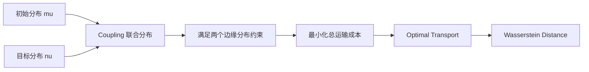
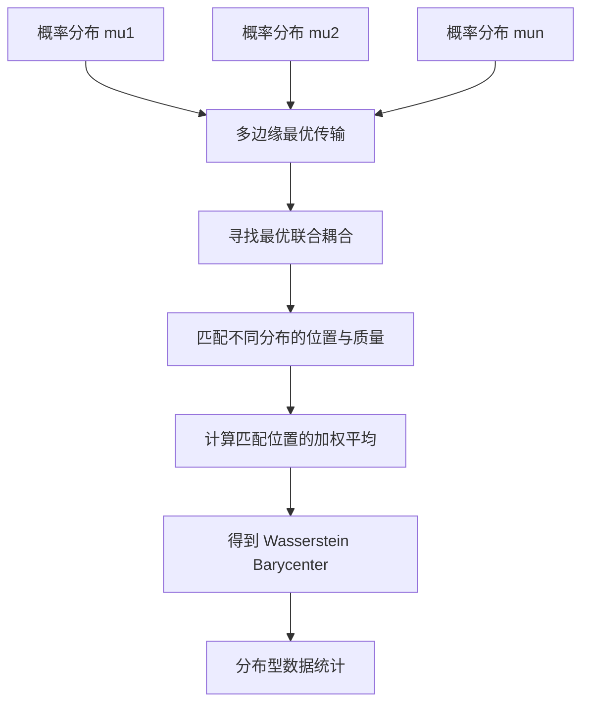

# 第 006 期｜Wasserstein 空间、最优传输与概率分布的统计重心

> Non-Euclidean Statistics · Learning & Research Notes

**日期：** 2026-11-20  
**主题：** Optimal Transport, Wasserstein Geometry & Distributional Statistics  
**关键词：** Optimal Transport、Coupling、Wasserstein Distance、Quantile Function、Wasserstein Barycenter、Distributional Data、Bures–Wasserstein Geometry

---

## 本期导读

前五期已经学习：

- 第 001 期：度量空间、Fréchet mean 与 Fréchet regression；
- 第 002 期：测地线、CAT(0) 空间与重心集中；
- 第 003 期：流形、切空间与非欧统计推断；
- 第 004 期：黎曼度量、曲率、平行传输与 SPD 几何；
- 第 005 期：流形概率分布、黎曼梯度与随机优化。

本期进入非欧统计学的另一条重要研究主线：

**概率分布型数据统计（Distributional Data Analysis）。**

我们希望回答：

1. 如何度量两个概率分布之间的差异？
2. 如何定义多个概率分布的平均分布？
3. 如何利用概率分布的几何结构构建统计估计量？
4. Wasserstein 重心与普通混合分布究竟有什么不同？

今日核心论文为 Agueh 与 Carlier 于 2011 年发表于 SIAM Journal on Mathematical Analysis 的 Barycenters in the Wasserstein Space。

---

# A. 今日基础知识：最优传输与 Wasserstein 空间

## A.1 为什么概率分布也可以成为数据？

传统统计通常观察：

```math
X_1,\ldots,X_n\in\mathbb R^p
```

但在许多现代统计问题中，每个研究对象可能需要通过一个完整的概率分布描述。

例如：

| 应用场景 | 每个统计观测对象 |
|---|---|
| 医学研究 | 一个患者的血糖分布 |
| 人口统计 | 一个城市的收入分布 |
| 气候统计 | 一个地区的气温分布 |
| 金融统计 | 一种资产的收益率分布 |
| 单细胞研究 | 一个样本中的细胞特征分布 |
| 脑影像 | 一个受试者的神经活动分布 |

此时，我们观察的可能是：

```math
\mu_1,\ldots,\mu_n
\in\mathcal P_2(\mathbb R^d)
```

其中：

```math
\mathcal P_2(\mathbb R^d)
=
\left\{
\mu:
\int_{\mathbb R^d}\|x\|^2\,d\mu(x)<\infty
\right\}
```

这里默认 $\mu$ 是定义在 $\mathbb R^d$ 上的 Borel 概率测度。

这个空间包含所有具有有限二阶矩的概率分布。

问题在于：

虽然概率分布可以进行普通混合，但概率混合不一定能够反映分布之间的几何位置关系。

因此，我们需要一种适合分布型数据的距离。

---

## A.2 最优传输的直觉

Optimal Transport，即最优传输，最基本的问题是：

如何以最小成本，将一个概率分布的质量搬运到另一个概率分布？

假设：

- $\mu$ 表示初始质量分布；
- $\nu$ 表示目标质量分布；
- $c(x,y)$ 表示从位置 $x$ 向位置 $y$ 搬运单位质量的成本。

最优传输寻找满足质量守恒、并使总代价最小的搬运方案。

如果把概率分布想象成地面上的沙堆，那么最优传输问题就是：

**如何用最低的搬运成本，将第一堆沙子变成第二堆沙子？**

---

## A.3 Monge 最优传输问题

设：

```math
T:\mathbb R^d\rightarrow\mathbb R^d
```

为一个可测映射。

如果：

```math
T_\#\mu=\nu
```

则称 $T$ 将分布 $\mu$ 推送为分布 $\nu$。

推前测度的定义是：

```math
(T_\#\mu)(B)
=
\mu(T^{-1}(B))
```

其中 $B$ 是可测集合。

Monge 最优传输问题可以写成：

```math
\inf_{T:T_\#\mu=\nu}
\int_{\mathbb R^d}
c(x,T(x))\,d\mu(x)
```

### Monge 问题的局限

Monge 映射要求一个起点的质量被映射到一个确定的终点。

因此，它不能直接将一个原子位置上的质量分成多个部分，分别输送到不同位置。

例如：

```math
\mu=\delta_0
```

```math
\nu=
\frac12\delta_{-1}
+
\frac12\delta_1
```

不存在一个确定性映射 $T$，能够把 $\delta_0$ 推送成为上述两个原子的混合分布。

这促使研究者考虑更加一般的传输方案。

---

## A.4 Kantorovich 问题与 Coupling

Kantorovich 将确定性的传输映射推广为联合概率分布。

定义耦合集合：

```math
\Pi(\mu,\nu)
=
\left\{
\pi:
\pi(\cdot,\mathbb R^d)=\mu,\ 
\pi(\mathbb R^d,\cdot)=\nu
\right\}
```

其中 $\pi$ 是定义在乘积空间上的概率测度，两个边缘分布分别为 $\mu$ 和 $\nu$。

可以将 $\pi$ 理解为一种允许质量分割的传输计划。

例如，$\pi(A\times B)$ 表示从区域 $A$ 搬运到区域 $B$ 的概率质量。

Kantorovich 问题写成：

```math
\inf_{\pi\in\Pi(\mu,\nu)}
\int_{\mathbb R^d\times\mathbb R^d}
c(x,y)\,d\pi(x,y)
```

与 Monge 问题相比，它允许更加灵活的质量运输。

### 图 1：最优传输的基本结构



---

## A.5 Wasserstein 距离的定义

对于 $p\geq1$，定义：

```math
W_p(\mu,\nu)
=
\left[
\inf_{\pi\in\Pi(\mu,\nu)}
\int
\|x-y\|^p\,d\pi(x,y)
\right]^{1/p}
```

当两个概率分布均具有有限 $p$ 阶矩时，$W_p$ 在相应概率测度空间上构成距离。

本系列重点关注二阶 Wasserstein 距离：

```math
W_2^2(\mu,\nu)
=
\inf_{\pi\in\Pi(\mu,\nu)}
\int
\|x-y\|^2\,d\pi(x,y)
```

因此：

```math
(\mathcal P_2(\mathbb R^d),W_2)
```

本身就是一个非欧度量空间。

### 为什么特别关注 W₂？

主要原因包括：

1. 与平方损失和 Fréchet mean 自然联系；
2. 具有丰富的测地几何结构；
3. 在一维情况下存在分位数表示；
4. 与高斯分布和 SPD 矩阵几何具有直接联系；
5. 可以使用最优传输映射构建统计方法。

---

## A.6 最简单的例子：Dirac 测度

考虑两个点质量分布：

```math
\mu=\delta_a,\qquad
\nu=\delta_b
```

唯一的传输方式是将全部质量从 $a$ 搬运到 $b$。

因此：

```math
W_2^2(\delta_a,\delta_b)
=
\|a-b\|^2
```

从而：

```math
W_2(\delta_a,\delta_b)
=
\|a-b\|
```

这说明欧氏空间可以通过 Dirac 测度嵌入 Wasserstein 空间。

普通欧氏距离是 Wasserstein 距离在点质量分布上的特殊情况。

---

## A.7 为什么不用普通分布差异？

不同的概率分布差异度量具有不同的数学含义。

| 度量或差异 | 主要关注内容 |
|---|---|
| Total Variation | 概率质量差异 |
| KL Divergence | 相对于参考分布的信息差异 |
| Hellinger Distance | 密度平方根之间的差异 |
| Wasserstein Distance | 质量移动的空间成本 |

其中 KL divergence 并不是严格意义上的距离，因为它通常不具有对称性，也不满足三角不等式。

### 一个特别直观的例子

考虑：

```math
\mu=\delta_0,\qquad
\nu_\varepsilon=\delta_\varepsilon
```

对于任意 $\varepsilon>0$，在取值范围为 $[0,1]$ 的常见 total variation 定义下：

```math
d_{\mathrm{TV}}(\mu,\nu_\varepsilon)=1
```

因为两个点质量分布的支撑不同。

但是：

```math
W_2(\mu,\nu_\varepsilon)
=
\varepsilon
```

当 $\varepsilon$ 趋于零时：

```math
W_2(\mu,\nu_\varepsilon)
\longrightarrow0
```

这体现了 Wasserstein 距离对底层空间几何位置的敏感性。

需要注意，这并不意味着 Wasserstein 距离在所有统计任务中都优于其他分布差异。

不同距离应当根据统计目标选择。

---

## A.8 一维 Wasserstein 距离：分位数表示

这是本期最重要的基础公式之一。

设 $\mu$ 的累积分布函数为：

```math
F_\mu(x)=\mu((-\infty,x])
```

定义广义分位数函数：

```math
Q_\mu(u)
=
\inf\{x:F_\mu(x)\geq u\}
```

其中 $0<u<1$。

对于任意两个具有有限二阶矩的一维概率分布：

```math
W_2^2(\mu,\nu)
=
\int_0^1
|Q_\mu(u)-Q_\nu(u)|^2\,du
```

这个公式非常重要。

它说明，一维 Wasserstein 距离等于两个分位数函数之间的平方积分距离。

### 几何意义

映射：

```math
\mu\mapsto Q_\mu
```

将一维 Wasserstein 空间等距嵌入：

```math
L^2(0,1)
```

其像是由几乎处处意义下具有非降代表元的平方可积函数构成的闭凸集合。

因此，一维 Wasserstein 空间具有非常有利的 Hilbert 空间几何结构。

这也是为什么一维分布型数据的统计理论，往往比多维情形更容易建立。

但是：

一般的多维 Wasserstein 空间不存在这种统一的分位数函数等距表示。

---

## A.9 小例子：一维均匀分布

设：

```math
\mu=\mathrm{Unif}(0,2)
```

```math
\nu=\mathrm{Unif}(2,4)
```

对应分位数函数为：

```math
Q_\mu(u)=2u
```

```math
Q_\nu(u)=2+2u
```

因此：

```math
W_2^2(\mu,\nu)
=
\int_0^1
|2u-(2+2u)|^2\,du
```

即：

```math
W_2^2(\mu,\nu)=4
```

所以：

```math
W_2(\mu,\nu)=2
```

这里两个分布具有相同形状，只是整体发生了平移。

Wasserstein 距离恰好等于平移距离。

---

## A.10 Wasserstein 测地线

设 $\pi^*$ 为连接 $\mu$ 和 $\nu$ 的一个最优传输计划。

定义：

```math
S_t(x,y)=(1-t)x+ty
```

其中 $0\leq t\leq1$。

令：

```math
\mu_t=(S_t)_\#\pi^*
```

则 $\mu_t$ 构成连接 $\mu$ 和 $\nu$ 的一条常速 Wasserstein 测地线。

其满足：

```math
W_2(\mu_s,\mu_t)
=
|s-t|W_2(\mu,\nu)
```

如果最优传输计划由映射 $T$ 给出，则可以写成：

```math
\mu_t=
((1-t)I+tT)_\#\mu
```

这种插值称为 displacement interpolation，即位移插值。

### 一维情况

测地线的分位数函数具有简单形式：

```math
Q_{\mu_t}(u)
=
(1-t)Q_\mu(u)
+
tQ_\nu(u)
```

注意，这是分位数函数的线性插值，而不是概率密度的普通线性混合。

---

## A.11 Wasserstein Barycenter

现在进入今日核心统计对象。

给定概率分布：

```math
\mu_1,\ldots,\mu_n
\in\mathcal P_2(\mathbb R^d)
```

以及权重：

```math
w_i\geq0,\qquad
\sum_{i=1}^n w_i=1
```

定义 Wasserstein 重心：

```math
\bar\mu
\in
\arg\min_{\mu\in\mathcal P_2(\mathbb R^d)}
\sum_{i=1}^n
w_iW_2^2(\mu,\mu_i)
```

这就是第 001 期介绍的 Fréchet mean，在 Wasserstein 空间中的具体实现。

它也被称为：

- Wasserstein barycenter；
- Wasserstein Fréchet mean；
- Wasserstein mean。

当所有权重相等时：

```math
w_i=\frac1n
```

得到普通样本 Wasserstein 重心。

---

## A.12 一维 Wasserstein 重心的闭式表达

由于一维 Wasserstein 距离可以表示为分位数函数之间的平方距离，因此重心问题可以写成：

```math
\min_Q
\sum_{i=1}^n
w_i
\int_0^1
|Q(u)-Q_{\mu_i}(u)|^2\,du
```

其中 $Q$ 必须是具有有限平方积分的分位数函数。

由于加权平均保持非降性，因此最优解可以写成：

```math
Q_{\bar\mu}(u)
=
\sum_{i=1}^n
w_iQ_{\mu_i}(u)
```

这就是一维 Wasserstein 重心的闭式公式。

### 关键认识

普通混合分布平均的是概率测度或累积分布函数。

Wasserstein 重心平均的是分位数函数。

两者具有不同的统计意义。

---

## A.13 一个特别重要的例子：高斯分布平均

设：

```math
\mu_1=\mathcal N(0,1)
```

```math
\mu_2=\mathcal N(6,1)
```

它们的普通混合分布为：

```math
\mu_{\mathrm{mix}}
=
\frac12\mathcal N(0,1)
+
\frac12\mathcal N(6,1)
```

这个混合分布保留两个相距较远的群体。

其均值为：

```math
\mathbb E[X]=3
```

方差为：

```math
\mathrm{Var}(X)=1+9=10
```

但是，两个分布的等权 Wasserstein 重心为：

```math
\bar\mu=\mathcal N(3,1)
```

因此：

| 方法 | 结果 | 方差 |
|---|---|---:|
| 普通混合 | 两个高斯分布的混合 | 10 |
| Wasserstein 重心 | 位于几何中心的单个高斯分布 | 1 |

这两个结果都可以有统计意义，但回答的是不同问题。

普通混合回答：

如果先随机选择一个群体，再从该群体抽样，得到什么样的总体分布？

Wasserstein 重心回答：

如果把每个群体的整体分布视为一个统计对象，其几何平均位置是什么？

后者能够在该平移例子中保留组内分布的形状。

---

## A.14 总体 Wasserstein 重心

设 $\boldsymbol\mu$ 为随机概率测度。

它本身是一个取值于 Wasserstein 空间的随机对象：

```math
\boldsymbol\mu
\in\mathcal P_2(\mathbb R^d)
```

总体 Wasserstein 重心定义为：

```math
\mu^*
\in
\arg\min_{\mu\in\mathcal P_2(\mathbb R^d)}
\mathbb E[
W_2^2(\mu,\boldsymbol\mu)
]
```

这里存在两层随机性。

第一层：

每个概率分布内部描述随机变量。

第二层：

概率分布本身也可以随统计个体而随机变化。

例如，一个患者拥有一个血糖分布，而不同患者的血糖分布彼此不同。

Wasserstein 重心研究的是第二层随机性的中心位置。

这为分布型数据统计提供了重要的总体参数。

---

## A.15 今日基础练习

### 问题一

设：

```math
\mu=\delta_2,\qquad
\nu=\delta_8
```

求二阶 Wasserstein 距离及等权重心。

### 答案

距离为：

```math
W_2(\mu,\nu)=6
```

重心为：

```math
\bar\mu=\delta_5
```

这与欧氏空间中的两点平均一致。

### 问题二

设：

```math
\mu_1=\mathrm{Unif}(0,2)
```

```math
\mu_2=\mathrm{Unif}(4,8)
```

求它们的等权 Wasserstein 重心。

### 答案

两个分位数函数分别为：

```math
Q_1(u)=2u
```

```math
Q_2(u)=4+4u
```

重心分位数函数为：

```math
Q_{\bar\mu}(u)
=
\frac12(2u+4+4u)
```

因此：

```math
Q_{\bar\mu}(u)=2+3u
```

所以：

```math
\bar\mu=\mathrm{Unif}(2,5)
```

---

# B. 高质量研究精选

## B.0 今日研究质量筛选说明

本期推荐四篇正式发表论文：

- 一篇 Wasserstein 重心奠基性论文；
- 一篇重心正则化统计理论论文；
- 一篇近年随机优化理论论文；
- 一篇近年大样本概率统计理论论文。

已与当前第 001–005 期推荐记录进行去重。

今日暂无达到本期筛选标准并完成充分核验的最新成果。

不使用质量尚未充分核验的预印本凑数。

下列论文均具有可核验的正式发表记录。

---

## B.1 Barycenters in the Wasserstein Space

**作者：** Martial Agueh, Guillaume Carlier

**年份：** 2011

**正式发表日期：** 2011-03-31

**期刊：** SIAM Journal on Mathematical Analysis, 43(2), 904–924

**发表状态：** 同行评审正式发表

**类型：** 经典基础、最优传输数学理论

**原文及期刊记录：**

https://doi.org/10.1137/100805741

### 研究问题

如何将连接两个概率分布的 Wasserstein 测地插值推广到多个概率分布的几何平均？

### 主要创新

论文系统研究了有限个概率测度重心的：

- 存在性；
- 唯一性；
- 最优传输刻画；
- 正则性；
- 多边缘最优传输表示；
- 高斯分布重心。

其重要性在于为概率分布空间中的 Fréchet mean 建立了系统数学基础。

### 质量判断

论文发表于 SIAM Journal on Mathematical Analysis。

它的主要贡献是数学结构和严格理论，而非仅仅提出一种新的计算指标。

重心理论成为后续分布型数据统计、Wasserstein 回归和概率测度几何计算的重要基础。

### 局限

论文主要研究有限个已知概率测度的重心。

现实统计数据中，每个概率测度可能只通过有限样本被观测。

由此产生的两阶段估计误差、统计收敛速度和置信区域，并不是该论文的主要研究对象。

**推荐等级：基础必读。**

**本期核心精读。**

---

## B.2 Penalization of Barycenters in the Wasserstein Space

**作者：** Jérémie Bigot, Elsa Cazelles, Nicolas Papadakis

**年份：** 2019

**期刊：** SIAM Journal on Mathematical Analysis

**发表状态：** 同行评审正式发表

**类型：** 经典统计方法、正则化理论

**原文：**

https://doi.org/10.1137/18M1185065

### 研究问题

实际研究中通常不能直接观测每个完整的概率分布。

研究者往往只能获得来自不同未知分布的有限样本。

如何利用正则化提高 Wasserstein 重心估计的稳定性？

### 主要创新

考虑在普通 Wasserstein 重心目标中加入凸惩罚项。

典型形式为：

```math
\hat\mu_\gamma
\in
\arg\min_\mu
\left\{
\frac1n\sum_{i=1}^n
W_2^2(\mu,\hat\mu_i)
+
\gamma E(\mu)
\right\}
```

其中：

- $\hat\mu_i$ 是经验测度或分布估计量；
- $E(\mu)$ 是适当的惩罚泛函；
- $\gamma$ 是正则化参数。

论文研究了重心的存在唯一性、稳定性及统计收敛性质。

其理论使用与惩罚泛函相关的 Bregman divergence 作为重要分析工具。

### 作者相关研究记录

Jérémie Bigot 与 Thierry Klein 的正式发表论文：

Characterization of Barycenters in the Wasserstein Space by Averaging Optimal Transport Maps.

ESAIM: Probability and Statistics, 22, 35–57, 2018.

https://doi.org/10.1051/ps/2017020

这项既有成果为随机概率测度的重心刻画提供了相关理论背景。

此处仅作为作者研究记录，不单列为本期第五篇正式推荐。

### 质量判断

相比普通 Wasserstein 重心，本文直接面对实际统计问题中的分布观测误差。

因此，其价值不仅在于改善数值计算，也在于建立正则化重心的统计理论。

### 局限

正则化会改变估计目标，产生偏差。

惩罚项的选择和正则化参数的大小都会影响结果。

相关理论也依赖于惩罚泛函及分布空间的适当条件。

**推荐等级：高，适合研究分布型数据估计。**

---

## B.3 Stochastic Gradient Descent for Barycenters in Wasserstein Space

**作者：** Julio Backhoff, Joaquín Fontbona, Gonzalo Rios, Felipe Tobar

**年份：** 2025（正式卷期）

**期刊：** Journal of Applied Probability, 62(1), 15–43

**发表状态：** 同行评审正式发表

**类型：** 近年研究、随机优化与概率理论

**DOI：**

https://doi.org/10.1017/jpr.2024.39

**开放原文：**

https://www.cambridge.org/core/services/aop-cambridge-core/content/view/01D0E71342D6AA114FAD820FE4AD9E81/S0021900224000391a.pdf/stochastic_gradient_descent_for_barycenters_in_wasserstein_space.pdf

### 研究问题

如果随机概率分布不断到达，如何在线估计总体 Wasserstein 重心？

是否可以建立类似欧氏随机梯度下降的算法，并给出严格的收敛理论？

### 主要创新

论文建立了针对 Wasserstein 总体重心的随机梯度算法。

在适当的绝对连续性及最优传输映射存在条件下，其基本更新思想可以表示为：

```math
\mu_{k+1}
=
\left[
(1-\eta_k)I+
\eta_k T_{\mu_k}^{\nu_k}
\right]_\#\mu_k
```

其中：

- $\mu_k$ 是当前重心估计；
- $\nu_k$ 是新到达的随机概率测度；
- $T_{\mu_k}^{\nu_k}$ 是相应最优传输映射；
- $\eta_k$ 是更新步长。

论文研究：

- 在线随机重心计算；
- 几乎必然收敛的充分条件；
- Karcher mean 的唯一性；
- 在进一步条件下的期望最优性差距收敛率；
- Mini-batch SGD。

### 与第 005 期的关系

第 005 期学习了普通黎曼流形中的随机梯度下降。

本篇论文将类似的随机逼近思想发展到概率测度空间。

但是，Wasserstein 空间并不是简单的有限维光滑黎曼流形。

因此，不能直接套用有限维流形 SGD 的所有理论。

这正是本文独立研究的价值所在。

### 质量判断

文章发表于 Journal of Applied Probability，并具有开放全文。

它不仅提出算法，还建立了关于收敛、唯一性和收敛率的理论结果。

### 局限

这些收敛结论依赖论文规定的结构性条件。

一般 Wasserstein 空间中的 Karcher mean 或临界点不一定自动是唯一的全局重心。

算法收敛率也不能直接等同于两阶段经验分布观测下的统计估计误差。

**推荐等级：高，适合研究非欧随机优化与在线估计。**

---

## B.4 Large Sample Theory for Bures–Wasserstein Barycentres

**作者：** Leonardo V. Santoro, Victor M. Panaretos

**年份：** 2025

**期刊：** The Annals of Applied Probability, 35(5), 3215–3241

**发表状态：** 同行评审正式发表

**类型：** 近年重点研究、大样本统计理论、算子几何

**原文：**

https://doi.org/10.1214/25-AAP2192

**IMS 正式期刊全文：**

https://www.imstat.org/publications/aap/aap_35_5/aap_35_5.pdf

### 研究问题

当研究对象是协方差算子，甚至定义于无限维 Hilbert 空间中时，Bures–Wasserstein 样本重心是否具有可靠的大样本理论？

### 研究背景

在有限维情况下，中心化高斯分布之间的二阶 Wasserstein 距离可以写成：

```math
d_{\mathrm{BW}}^2(A,B)
=
\mathrm{tr}(A)
+
\mathrm{tr}(B)
-
2\mathrm{tr}
\left[
(A^{1/2}BA^{1/2})^{1/2}
\right]
```

其中 $A,B$ 为协方差矩阵。

这种几何可进一步考虑一般 Hilbert 空间中适当的协方差算子。

### 主要创新

论文研究一般可分 Hilbert 空间中的 Bures–Wasserstein 重心。

其理论贡献包括：

1. 建立样本重心序列的几乎必然相对紧性；
2. 刻画聚点与总体重心之间的关系；
3. 给出保证极限唯一性的充分正则条件；
4. 在进一步矩条件和正则条件下建立中心极限定理；
5. 研究经验最优传输算子向总体传输算子的强算子收敛。

### 为什么重要？

此前很多 SPD 和高斯重心研究集中在有限维矩阵空间。

本文进一步研究协方差算子的无限维情况。

这对以下研究方向具有重要意义：

- 函数型数据分析；
- 协方差算子统计；
- 高斯随机过程；
- 非欧函数型数据推断。

### 质量判断

论文发表于 The Annals of Applied Probability。

其主要贡献是严格的大样本理论，并非仅仅构造新的距离或数值算法。

对非欧统计理论研究而言，这篇论文具有较强的数学参考价值。

### 局限

中心极限定理依赖进一步的矩条件与算子正则性条件。

不能将其直接理解为任意随机概率测度的通用 Wasserstein CLT。

此外，协方差算子的理论结果与通过离散、噪声函数型数据估计算子的实际观测问题仍需要进一步衔接。

**推荐等级：极高，值得后续单独进行技术精读。**

---

# C. 核心论文精读

## Barycenters in the Wasserstein Space

**作者：** Martial Agueh, Guillaume Carlier

**期刊：** SIAM Journal on Mathematical Analysis

**年份：** 2011

**卷期页码：** 43(2), 904–924

**DOI：**

https://doi.org/10.1137/100805741

---

## C.1 为什么选择这篇论文？

这篇论文是理解 Wasserstein 统计学的基础。

如果不理解 Wasserstein 重心的数学结构，那么后续关于：

- Wasserstein 回归；
- 分布型数据 PCA；
- 重心一致性；
- 重心中心极限定理；
- Bures–Wasserstein 统计；
- 在线 Wasserstein 估计；

都容易停留在算法层面。

本篇论文建立了几何平均的理论基础。

后续统计研究则进一步回答：

如何在随机抽样和有限数据条件下估计这个几何平均？

---

## C.2 研究问题与数学设定

给定：

```math
\mu_1,\ldots,\mu_n
\in\mathcal P_2(\mathbb R^d)
```

以及正权重：

```math
\lambda_i>0,\qquad
\sum_{i=1}^n\lambda_i=1
```

论文考虑重心问题：

```math
\inf_{\nu\in\mathcal P_2(\mathbb R^d)}
\sum_{i=1}^n
\lambda_iW_2^2(\nu,\mu_i)
```

我们希望回答：

1. 是否存在最小化解？
2. 该解是否唯一？
3. 是否可以通过最优传输映射刻画？
4. 输入分布为高斯分布时，能否获得具体表达？

这些都是非欧 Fréchet mean 的具体数学问题。

---

## C.3 从两个分布的插值推广到多个分布

对于两个分布，考虑：

```math
\inf_\nu
\left\{
(1-t)W_2^2(\nu,\mu_0)
+
tW_2^2(\nu,\mu_1)
\right\}
```

其中 $0<t<1$。

由距离三角不等式，可以证明目标函数的下界为：

```math
t(1-t)W_2^2(\mu_0,\mu_1)
```

Wasserstein 测地线上的对应插值点能够达到这一界。

因此，两分布的加权 Wasserstein 重心就是相应的测地插值点。

对于三个及更多分布，问题不再只是沿一条测地线移动。

我们需要寻找一个同时考虑多个分布几何位置的中心。

这就是论文研究的一般重心问题。

---

## C.4 核心理论之一：重心的存在性与唯一性

### 存在性

对于有限个具有有限二阶矩的输入概率测度，Wasserstein 重心问题存在最小化解。

其背后的数学思想包括：

- 目标函数的下半连续性；
- 概率测度序列的紧性控制；
- 二阶矩的控制。

这里仅介绍理论直觉，不展开完整存在性证明。

### 唯一性

一般情况下，重心不一定唯一。

论文建立了足以保证唯一性的条件。

一个常用的充分条件是：

至少一个具有正权重的输入测度相对于 Lebesgue 测度绝对连续。

这一条件与平方 Wasserstein 距离的严格凸性以及最优传输映射的结构有关。

### 为什么重要？

统计估计需要明确总体参数和样本估计目标。

如果重心存在但不唯一，就需要：

- 研究重心集合；
- 指定选择规则；
- 发展集合值统计推断。

因此，存在唯一性不是单纯的几何问题，也是统计参数可识别性的重要基础。

---

## C.5 核心理论之二：多边缘最优传输

传统最优传输研究两个边缘分布。

而 Wasserstein 重心需要同时考虑：

```math
\mu_1,\ldots,\mu_n
```

因此，自然产生多边缘最优传输问题。

定义：

```math
\Pi(\mu_1,\ldots,\mu_n)
```

为所有具有指定边缘分布 $\mu_1,\ldots,\mu_n$ 的联合概率测度集合。

对任意输入位置：

```math
x_1,\ldots,x_n\in\mathbb R^d
```

定义加权欧氏平均映射：

```math
b(x_1,\ldots,x_n)
=
\sum_{i=1}^n\lambda_i x_i
```

考虑如下多边缘成本：

```math
c(x_1,\ldots,x_n)
=
\sum_{i=1}^n
\lambda_i
\|x_i-b(x_1,\ldots,x_n)\|^2
```

利用加权方差分解，可以写成：

```math
c(x_1,\ldots,x_n)
=
\frac12
\sum_{i,j=1}^n
\lambda_i\lambda_j
\|x_i-x_j\|^2
```

然后研究多边缘最优传输：

```math
\inf_{\gamma\in\Pi(\mu_1,\ldots,\mu_n)}
\int c(x_1,\ldots,x_n)\,d\gamma
```

如果 $\gamma^*$ 是适当的最优解，那么其加权平均映射的推前测度：

```math
\bar\mu=b_\#\gamma^*
```

给出 Wasserstein 重心。

### 这个结论的直觉

假设我们可以在概率意义下，将不同分布中的位置进行最合理的对应。

然后：

1. 根据最优联合传输建立位置匹配；
2. 对每组匹配的位置计算加权欧氏平均；
3. 收集这些平均位置的概率分布。

最终得到 Wasserstein 重心。

这说明 Wasserstein 重心并不是对密度逐点求平均，而是先匹配概率质量，再对匹配的位置进行平均。

### 图 2：Wasserstein 重心的多边缘机制



---

## C.6 与 Brenier 最优传输映射的关系

对于平方欧氏距离成本，在适当条件下，特别是源测度绝对连续时，最优传输计划可以由一个映射给出。

经典 Brenier 理论刻画该映射为某个凸函数的梯度：

```math
T=\nabla\phi
```

其中 $\phi$ 为凸函数。

对于 Wasserstein 重心 $\bar\mu$，假设相关正则性条件成立，并设：

```math
T_i:\mathbb R^d\rightarrow\mathbb R^d
```

为从 $\bar\mu$ 到 $\mu_i$ 的最优传输映射。

那么重心具有如下平衡关系：

```math
\sum_{i=1}^n
\lambda_i T_i(x)=x
```

这个等式在相关条件下对 $\bar\mu$ 几乎处处成立。

等价地：

```math
\sum_{i=1}^n
\lambda_i(T_i(x)-x)=0
```

### 与前几期的联系

在普通欧氏空间中，均值满足：

```math
\sum_{i=1}^n
\lambda_i(X_i-\bar X)=0
```

在黎曼流形中，适当条件下 Fréchet mean 满足：

```math
\sum_{i=1}^n
\lambda_i\log_{\bar x}(X_i)=0
```

在 Wasserstein 几何中，最优传输位移：

```math
T_i-I
```

扮演类似于局部对数映射的角色。

因此，重心满足一个几何意义上的位移平衡条件。

这建立了三个不同统计空间之间的深层联系。

| 空间 | 中心位置的一阶平衡 |
|---|---|
| 欧氏空间 | 普通向量差 |
| 黎曼流形 | 对数映射 |
| Wasserstein 空间 | 最优传输位移 |

需要注意：

一般的传输位移平衡条件并不能脱离相应假设，直接作为全局唯一最小值的充分条件。

---

## C.7 核心理论之三：高斯分布的 Wasserstein 距离

这是论文与第 004 期 SPD 矩阵统计建立联系的关键部分。

设：

```math
\mu_1=\mathcal N(m_1,\Sigma_1)
```

```math
\mu_2=\mathcal N(m_2,\Sigma_2)
```

其中 $\Sigma_1,\Sigma_2$ 为对称正定协方差矩阵。

两者之间的平方 Wasserstein 距离为：

```math
W_2^2(\mu_1,\mu_2)
=
\|m_1-m_2\|^2
+
\mathrm{tr}(\Sigma_1)
+
\mathrm{tr}(\Sigma_2)
-
2\mathrm{tr}
\left[
(\Sigma_1^{1/2}
\Sigma_2
\Sigma_1^{1/2})^{1/2}
\right]
```

这个公式分为两部分：

1. 均值向量之间的欧氏距离；
2. 协方差矩阵之间的 Bures–Wasserstein 距离。

因此可以写成：

```math
W_2^2(\mu_1,\mu_2)
=
\|m_1-m_2\|^2
+
d_{\mathrm{BW}}^2(\Sigma_1,\Sigma_2)
```

注意：

这个距离与第 004 期学习的仿射不变黎曼距离 AIRM 不同。

它们都可以用于 SPD 矩阵，但对应不同的几何与统计解释。

---

## C.8 高斯分布之间的最优传输映射

对于非退化高斯分布，平方成本最优传输映射具有仿射形式：

```math
T(x)
=
m_2+A(x-m_1)
```

其中：

```math
A
=
\Sigma_1^{-1/2}
\left(
\Sigma_1^{1/2}
\Sigma_2
\Sigma_1^{1/2}
\right)^{1/2}
\Sigma_1^{-1/2}
```

该矩阵满足：

```math
A\Sigma_1A^\top=\Sigma_2
```

因此，高斯分布的均值与协方差都能够在该映射下得到正确转换。

这个公式说明：

对于高斯分布，最优传输问题可以通过矩阵运算显式描述，而不需要求解任意概率测度之间的一般传输问题。

---

## C.9 高斯 Wasserstein 重心

设：

```math
\mu_i=\mathcal N(m_i,\Sigma_i)
```

其中各协方差矩阵为正定矩阵。

论文证明相应 Wasserstein 重心仍然是高斯分布。

记：

```math
\bar\mu=\mathcal N(\bar m,\bar\Sigma)
```

其均值为：

```math
\bar m=\sum_{i=1}^n\lambda_i m_i
```

协方差矩阵满足非线性矩阵方程：

```math
\bar\Sigma
=
\sum_{i=1}^n
\lambda_i
\left(
\bar\Sigma^{1/2}
\Sigma_i
\bar\Sigma^{1/2}
\right)^{1/2}
```

在相应正定条件下，可对重心协方差进行唯一性刻画。

### 为什么这个方程重要？

普通协方差矩阵算术平均为：

```math
\bar\Sigma_E
=
\sum_{i=1}^n\lambda_i\Sigma_i
```

但 Wasserstein 重心协方差通常不是算术平均。

这是因为 Wasserstein 几何关注对应高斯概率分布之间的最优传输关系。

对于一般不交换的协方差矩阵，上述重心方程并没有简单的逐元素平均解。

这也推动了后续 Bures–Wasserstein 重心计算算法及大样本理论的发展。

---

## C.10 一维高斯重心的闭式表达

如果：

```math
\mu_i=\mathcal N(m_i,\sigma_i^2)
```

其中 $\sigma_i>0$，则：

```math
Q_{\mu_i}(u)
=
m_i+\sigma_i\Phi^{-1}(u)
```

这里 $\Phi$ 为标准正态分布函数。

根据分位数平均公式：

```math
Q_{\bar\mu}(u)
=
\sum_{i=1}^n
\lambda_i
\left(
m_i+\sigma_i\Phi^{-1}(u)
\right)
```

整理可得：

```math
Q_{\bar\mu}(u)
=
\bar m+\bar\sigma\Phi^{-1}(u)
```

其中：

```math
\bar m=
\sum_{i=1}^n\lambda_i m_i
```

```math
\bar\sigma=
\sum_{i=1}^n\lambda_i\sigma_i
```

因此：

```math
\bar\mu
=
\mathcal N
\left(
\sum_{i=1}^n\lambda_i m_i,
\left(
\sum_{i=1}^n\lambda_i\sigma_i
\right)^2
\right)
```

### 关键结果

一维 Gaussian Wasserstein barycenter 平均的是标准差，而不是直接平均方差。

### 数值例子

设：

```math
\mu_1=\mathcal N(0,1)
```

```math
\mu_2=\mathcal N(4,9)
```

两个分布的标准差分别为 1 和 3。

等权重下：

```math
\bar m=\frac{0+4}{2}=2
```

```math
\bar\sigma=\frac{1+3}{2}=2
```

因此：

```math
\bar\mu=\mathcal N(2,4)
```

而两个方差的普通算术平均为：

```math
\frac{1+9}{2}=5
```

这说明：

即使输入数据全部为高斯分布，不同统计几何仍会产生不同的平均结果。

---

## C.11 与 SPD 仿射不变几何的比较

在第 004 期，我们学习了 SPD 空间的仿射不变黎曼距离：

```math
d_{\mathrm{AI}}(P,Q)
=
\left\|
\log(P^{-1/2}QP^{-1/2})
\right\|_F
```

本期又学习了 Bures–Wasserstein 距离。

当 SPD 矩阵退化为一维正数 $a,b$ 时：

```math
d_{\mathrm{AI}}(a,b)
=
|\log a-\log b|
```

而：

```math
d_{\mathrm{BW}}(a,b)
=
|\sqrt a-\sqrt b|
```

因此，对两个一维协方差对象：

```math
a=1,\qquad b=9
```

不同几何产生不同均值。

### 欧氏几何

```math
M_E=\frac{1+9}{2}=5
```

### 仿射不变几何

```math
M_{\mathrm{AI}}=\sqrt{1\cdot9}=3
```

### Bures–Wasserstein 几何

```math
M_{\mathrm{BW}}
=
\left(
\frac{\sqrt1+\sqrt9}{2}
\right)^2
=
4
```

结果对比：

| 几何 | 平均对象 | 重心 |
|---|---|---:|
| Euclidean | 方差本身 | 5 |
| Affine-Invariant | 对数尺度 | 3 |
| Bures–Wasserstein | 标准差尺度 | 4 |

这是非常值得记住的例子。

它说明距离不是统计方法中的一个无关紧要的技术选择。

距离实际上决定了统计参数的定义及其解释。

---

## C.12 论文的主要理论贡献

### 贡献一：建立多分布几何平均的数学基础

将 Wasserstein 测地插值推广到多个概率分布的重心。

### 贡献二：建立重心存在性、唯一性与正则性理论

为 Wasserstein Fréchet mean 的可识别性提供数学基础。

### 贡献三：联系多边缘最优传输

通过联合耦合的最优结构刻画概率分布的几何平均。

### 贡献四：解决重要的高斯分布情况

将 Wasserstein 重心问题与 SPD 矩阵几何联系起来。

这些贡献构成现代分布型数据统计的重要理论起点。

---

## C.13 从几何重心进一步走向统计理论

这里区分两个不同问题。

### 问题一：几何重心

给定确定的概率分布：

```math
\mu_1,\ldots,\mu_n
```

寻找其 Wasserstein 重心。

这是核心论文主要研究的问题。

### 问题二：统计重心估计

假设：

```math
\boldsymbol\mu_1,\ldots,\boldsymbol\mu_n
```

为从某个概率测度空间上的总体分布中抽取的独立同分布随机对象。

此时样本重心是总体 Wasserstein 重心的统计估计量。

我们进一步关心：

- 一致性；
- 收敛速度；
- 中心极限定理；
- 置信区域；
- 稳健性；
- 高维统计表现。

B.2、B.3 和 B.4 的研究分别从正则化、随机优化和大样本理论等方面推进这些问题。

因此，本期四篇论文形成了较清晰的研究链条：

几何对象定义，统计估计，计算方法，大样本理论。

---

## C.14 两阶段抽样问题

这是实际分布型数据统计中特别重要的一个问题。

通常不能直接观测真实概率分布 $\mu_i$。

研究者只能观测：

```math
Y_{i1},\ldots,Y_{im_i}
\sim\mu_i
```

并利用这些数据构造经验测度：

```math
\hat\mu_i
=
\frac1{m_i}
\sum_{j=1}^{m_i}
\delta_{Y_{ij}}
```

因此，实际使用的重心为：

```math
\hat\nu_{n,m}
\in
\arg\min_\nu
\frac1n
\sum_{i=1}^n
W_2^2(\nu,\hat\mu_i)
```

这里至少存在三种误差来源：

1. 不同随机概率分布之间的抽样误差；
2. 每个概率分布内部的估计误差；
3. 数值算法带来的优化误差。

可以引入理想样本重心：

```math
\nu_n
\in
\arg\min_\nu
\frac1n
\sum_{i=1}^n
W_2^2(\nu,\mu_i)
```

以及总体重心 $\nu^*$。

由三角不等式：

```math
W_2(\hat\nu_{n,m},\nu^*)
\leq
W_2(\hat\nu_{n,m},\nu_n)
+
W_2(\nu_n,\nu^*)
```

第一项对应分布估计误差对重心的影响。

第二项对应理想样本重心的外层统计误差。

这个分解是本笔记补充的统计分析视角，不是对原论文某个特定定理的直接复述。

该问题也是正则化重心研究的重要动机。

---

## C.15 论文的局限

### 第一：几何基础与统计推断仍有距离

存在唯一性并不自动意味着能够建立中心极限定理、置信区域或者假设检验。

### 第二：多维情况具有计算困难

一般高维 Wasserstein 重心没有像一维分位数平均那样简单的闭式表达。

### 第三：两阶段抽样问题需要额外理论

当输入分布只能通过有限随机样本估计时，重心的误差分析更复杂。

### 第四：重尾与稳健性

Wasserstein 平方距离依赖二阶矩。

当输入随机分布受到重尾或异常分布污染时，普通平方距离重心可能需要稳健化。

### 第五：几何条件不能随意推广

一般 Wasserstein 空间不应直接视为 CAT(0) 空间。

特别是多维 Wasserstein 空间中的曲率和测地凸性结构，与第 002 期讨论的非正曲率空间并不相同。

一维 Wasserstein 空间具有特殊的 Hilbert 几何优势，但这一性质不能直接推广到多维情况。

---

## C.16 值得探索的研究方向

以下属于本笔记提出的研究方向，不表示核心论文已经证明相应结论。

### 方向一：两阶段 Wasserstein 重心的稳健估计

可以考虑将平方距离损失替换为稳健损失：

```math
F(\nu)
=
\mathbb E
\left[
\rho(W_2(\nu,\boldsymbol\mu))
\right]
```

研究异常概率分布污染下的稳定性与估计误差。

### 方向二：分布型数据的自适应正则化

当不同个体的内部样本量 $m_i$ 差异很大时，如何利用估计精度进行加权或正则化？

需要注意，这种加权可能改变总体估计目标，因此必须明确统计参数的定义。

### 方向三：无限维 Bures–Wasserstein 统计

能否进一步将协方差算子重心理论与函数型数据回归、假设检验及不完整数据观测结合？

这一方向与本期 B.4 的近年研究直接相关。

---

# D. 今日总结与自测

## D.1 三项核心收获

### 收获一：Wasserstein 距离利用底层空间几何

Wasserstein 距离不是单纯比较概率密度的差异，而是度量概率质量重新分布的最优运输成本。

### 收获二：Wasserstein 重心是分布型数据的 Fréchet mean

在一维情况下，它具有分位数函数平均的闭式表示。

多维情况下则与多边缘最优传输及传输映射的平衡结构密切相关。

### 收获三：高斯分布将 Wasserstein 几何与 SPD 统计连接起来

高斯 Wasserstein 重心的协方差由 Bures–Wasserstein 几何决定。

它与欧氏均值、仿射不变黎曼均值具有不同的统计含义。

---

## D.2 今日自测

### 问题一

为什么普通分布混合不一定是 Wasserstein 重心？

**答案：**

因为普通混合直接对概率测度进行线性组合，而 Wasserstein 重心最小化测地平方距离。

在一维情况下，Wasserstein 重心对应分位数函数的加权平均。

---

### 问题二

设：

```math
\mu_1=\mathcal N(2,4)
```

```math
\mu_2=\mathcal N(8,16)
```

计算两个分布的等权 Wasserstein 重心。

**答案：**

均值为：

```math
\bar m=\frac{2+8}{2}=5
```

标准差为：

```math
\bar\sigma=\frac{2+4}{2}=3
```

因此：

```math
\bar\mu=\mathcal N(5,9)
```

注意重心方差是平均标准差的平方。

---

### 问题三

设一维协方差对象为 4 和 16。

分别计算 Euclidean、AIRM 和 Bures–Wasserstein 重心。

**答案：**

Euclidean 重心：

```math
M_E=\frac{4+16}{2}=10
```

AIRM 重心：

```math
M_{\mathrm{AI}}=\sqrt{4\cdot16}=8
```

Bures–Wasserstein 重心：

```math
M_{\mathrm{BW}}
=
\left(
\frac{\sqrt4+\sqrt{16}}2
\right)^2
=
9
```

---

### 问题四

为什么分布型数据统计具有两阶段抽样问题？

**答案：**

因为概率分布本身可以是来自某个总体的随机对象，而每个随机分布又通常只能通过其内部有限样本估计。

因此，需要同时分析随机分布之间的变异和分布内部的估计误差。

---

### 问题五

多维 Wasserstein 空间是否可以直接使用一维分位数函数平均公式？

**答案：**

一般不可以。

一维 Wasserstein 空间具有特殊的单调分位数函数等距表示。

多维空间通常需要最优传输映射、联合耦合或其他几何工具。

---

## D.3 明日基础课预告

### 第 007 期｜Brenier 定理、Kantorovich 对偶与 Sinkhorn 算法

下一期进一步研究：

- Kantorovich Duality；
- Brenier's Theorem；
- Convex Potential；
- c-transform；
- Entropic Optimal Transport；
- Sinkhorn Algorithm；
- 精确 Wasserstein 距离与正则化传输之间的区别。

核心问题：

**最优传输为什么会与凸函数和对偶优化联系起来？如何高效计算两个复杂概率分布之间的传输关系？**

学习目标：

不仅会使用 Wasserstein 距离，还能够理解其计算方法背后的数学结构。

---

# 参考文献与本期去重记录

## 本期正式推荐文献

1. Agueh, M., & Carlier, G. (2011). Barycenters in the Wasserstein Space. SIAM Journal on Mathematical Analysis, 43(2), 904–924.

   https://doi.org/10.1137/100805741

2. Bigot, J., Cazelles, E., & Papadakis, N. (2019). Penalization of Barycenters in the Wasserstein Space. SIAM Journal on Mathematical Analysis.

   https://doi.org/10.1137/18M1185065

3. Backhoff, J., Fontbona, J., Rios, G., & Tobar, F. (2025). Stochastic Gradient Descent for Barycenters in Wasserstein Space. Journal of Applied Probability, 62(1), 15–43.

   https://doi.org/10.1017/jpr.2024.39

4. Santoro, L. V., & Panaretos, V. M. (2025). Large Sample Theory for Bures–Wasserstein Barycentres. The Annals of Applied Probability, 35(5), 3215–3241.

   https://doi.org/10.1214/25-AAP2192

## 作者相关成果核验

Bigot, J., & Klein, T. (2018). Characterization of Barycenters in the Wasserstein Space by Averaging Optimal Transport Maps. ESAIM: Probability and Statistics, 22, 35–57.

https://doi.org/10.1051/ps/2017020

该项仅作为相关作者研究背景，不计入本期正式推荐文献数量。

## 第006期新增正式推荐 DOI

后续各期应将以下 DOI 纳入正式推荐排除清单：

- 10.1137/100805741
- 10.1137/18M1185065
- 10.1017/jpr.2024.39
- 10.1214/25-AAP2192

本期核心精读与 B.1 为同一篇论文，不重复计数。

---

**Non-Euclidean Statistics Learning Notes · Issue 006**

*坚持基础理论与高质量研究并行。优先推荐具有明确数学贡献、可靠发表记录和可核验原文的学术成果。论文数量服从研究质量，不以发表时间或预印本热度代替学术价值。*

---

今天这篇论文需要我再展开做更细的技术精读（定理、证明、算法和实验）吗？
